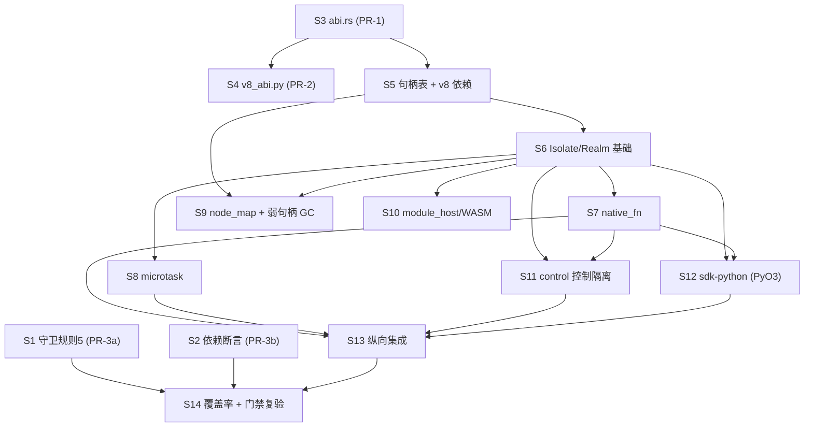

# G1 闸门「引擎纵向验证」施工图（2026-10-12）

> **本文档是什么**：把技术方案 §18 的 G1 六项必产出（**原生绑定、模块/WASM、微任务、GC 循环、
> 控制入口隔离、Python 回调**）转成**工程师可直接按图施工**的设计。
> 深度参考 `docs/design-remaining-tasks-2026-10-12.md`（T2 探针施工图的写成范式）。
>
> **前置 ADR（全部「已接受」）**：
> - **ADR-0009**（G1-PRE-1，类型面）：`RealmId/JsHandle/HostValue` 的 Rust 定义落
>   `crates/engine-v8/src/abi.rs`；Python 契约落 `contracts/iv8_contract/v8_abi.py`；
>   `v8` 只许出现在 `crates/engine-v8/Cargo.toml`；**不新增 workspace 成员**；C-1~C-4 硬约束；
>   PR-1/2/3a/3b 拆分。
> - **ADR-0007**（T2.1）：cppgc ↔ V8 跨语言环**无法回收** ⇒ 强引用环禁令、DOM 侧只存弱引用。
> - **ADR-0012**（T2.5）：三条死锁路径里**只有 GIL 一条会死锁，且 watchdog 打不断** ⇒
>   宿主回调禁同步持 GIL 等待页面线程。
> - **ADR-0002 / 0008**（unsafe 白名单形态 / `poc/` 白名单）：`WHITELIST=("crates/engine-v8/", "poc/")`。
>
> **纪律（硬）**：`AGENTS.md` 铁律十条。本轮**只做设计与 brief，不写功能代码、不落 ADR**。
> 本文档**不含实现**，函数签名是**设计契约**（工程师据此写测试先行）。
>
> **闸门判据**：G1 全部通过后才开展 **G2 页面纵向**；**本轮不做 Web IDL 生成器**（`bindings-webidl`
> 在 G1 结束前保持空 `[dependencies]`，只见 `engine_v8::abi` 三类型）。

---

## 0. 一句话

> **engine-v8 用「一个 Isolate + 一个 Realm + 一张带 generation 的句柄表」把 V8 关进一个
> 只暴露 `RealmId/JsHandle/HostValue` 三类型的窄门；六项能力各自留下可独立验证的最小测试集；
> PyO3 只做「值转换 + 回调派发」，且回调派发遵守 ADR-0012 的 GIL 纪律。**

---

## Part A：系统设计

### 1. engine-v8 模块结构

#### 1.1 文件清单（新增/修改）

| 文件 | 职责（一句话） | 关键类型 | unsafe |
|---|---|---|---|
| `crates/engine-v8/src/abi.rs` | **类型面唯一 Rust 定义点**（ADR-0009 已定；G1 只接线） | `RealmId` / `JsHandle` / `HostValue` / `WeakJsHandle` | **零**（守卫规则 5 从外部强制 `abi.rs` 无 `v8::`） |
| `crates/engine-v8/src/error.rs` | 安全错误类型（不 leak v8 类型） | `JsError` / `JsErrorKind` | 零 |
| `crates/engine-v8/src/isolate.rs` | 进程级 V8 平台一次性初始化 + Isolate 生命周期 | `EngineHost`（Once 守卫）、`AgentRuntime` | **零**（S6 已验收：`isolate.rs` 无手写 unsafe） |
| `crates/engine-v8/src/realm.rs` | 一个 `Context` 及其宿主身份；eval/call/属性/原生函数/模块/close | `Realm` | **有**（S7+：裸指针别名桥 / scope，逐块 `#[allow(unsafe_code)]` + `SAFETY`，`realm.rs:187/491/552/665/676/703/712`） |
| `crates/engine-v8/src/handles.rs` | **句柄表**（弱槽）：分配/解析/释放/复用防呆；显式租借 | `HandleTable` / `Slot` / `HandleLease` | **零**（S5 已确认，`handles.rs:10`「零 unsafe」；ADR-0013 决策 9） |
| `crates/engine-v8/src/native_fn.rs` | `FunctionTemplate` + 宿主函数 trampoline + 表征 | `NativeFn` / `NativeFnSpec` | **有**（S7：trampoline 别名桥，`native_fn.rs:102` 逐块 SAFETY） |
| `crates/engine-v8/src/microtask.rs` | **宿主显式管理**的微任务策略 + 声明性预算 + 墙钟宽限 | `MicrotaskPolicy` / `MicrotaskBudget` | **零**（S8：纯类型/常量） |
| `crates/engine-v8/src/module_host.rs` | 模块解析/加载/缓存宿主 | `ModuleHost`（trait）/ `MemoryModuleHost` / `ModuleRegistry` | **零**（S10：纯数据 + trait） |
| `crates/engine-v8/src/node_map.rs` | **C-3**：`NodeId ↔ 弱句柄` 双向映射（归 engine-v8） | `NodeMap`（key 为 `u64`，避免依赖 `web-dom`） | 零（纯哈希表） |
| `crates/engine-v8/src/control.rs` | **控制入口隔离**：单 Realm 双模式（控制全局安装/撤销） | `ControlPlane` / `CONTROL_GLOBAL` | **零**（S11：经 `Realm` 安全 API） |
| `crates/engine-v8/src/lib.rs` | 模块接线 + crate 文档 + **`pub mod abi`**（crate 根含**唯一**类型 re-export：`pub use abi::{HostValue, JsHandle, RealmId, WeakJsHandle};`） | `mod` 声明 + 该 re-export | 零 |

> **文件命名纪律（跨平台铁律 1）**：全部 **小写 + 下划线**，无大小写歧义。
> `mod` 名与文件名**逐字符一致**（`#[path]` 一律不用，防 mac/Linux 大小写差异静默失败）。

#### 1.2 关键类型与函数签名（设计契约，原文）

> 术语（给不懂 Rust 的维护者）：`pub struct Foo(u64)` ≈ 「一个只包了一个 64 位整数的不可直接改的类型」；
> `unsafe { … }` ≈ 「绕过编译器内存安全检查的代码块，安全责任转由人（此处是 `// SAFETY:` 注释）承担」。

##### `abi.rs`（ADR-0009 已定，此处照录 + G1 增补）

```rust
use crate::error::JsError; // 注意：abi.rs 内不得出现任何 `v8::` 路径（守卫规则 5）

/// 一个 V8 Context 及其宿主身份。高 32 位 = isolate 序号，低 32 位 = realm 序号。
#[repr(transparent)]
#[derive(Clone, Copy, PartialEq, Eq, Hash, Debug)]
pub struct RealmId(u64);

impl RealmId {
    pub const fn from_parts(isolate_seq: u32, realm_seq: u32) -> Self;
    pub const fn isolate_seq(self) -> u32;
    pub const fn realm_seq(self) -> u32;
}

/// 句柄表槽位索引。高 32 位 = generation（复用防呆），低 32 位 = 槽位下标。
/// **不是 GC 根**（C-1）：类型本身只是 u64，不携带任何 rooting 语义。
#[repr(transparent)]
#[derive(Clone, Copy, PartialEq, Eq, Hash, Debug)]
pub struct JsHandle(u64);

impl JsHandle {
    pub const fn new(index: u32, generation: u32) -> Self;
    pub const fn index(self) -> u32;
    pub const fn generation(self) -> u32;
}

/// 弱句柄：不阻止 GC。供 DOM 侧监听器槽使用（C-2 的 `WeakJsHandle`）。
/// 打包布局与 `JsHandle` 一致（高 32 位 = generation，低 32 位 = 下标）。
#[repr(transparent)]
#[derive(Clone, Copy, PartialEq, Eq, Hash, Debug)]
pub struct WeakJsHandle(u64);

impl WeakJsHandle {
    pub const fn new(index: u32, generation: u32) -> Self;
    pub const fn index(self) -> u32;
    pub const fn generation(self) -> u32;
}

/// 跨边界值。**有界枚举，8 变体，只增不改语义**（ADR-0009 决策 4 判据 3）。
#[derive(Clone, Debug, PartialEq)]
pub enum HostValue {
    Undefined,
    Null,
    Bool(bool),
    Number(f64),
    Str(String),
    Object   { realm: RealmId, handle: JsHandle },
    Array    { realm: RealmId, handle: JsHandle },
    Function { realm: RealmId, handle: JsHandle },
}
```

> **实现已验收 · 文档对齐（S3）**：`abi.rs` 四类型（`RealmId`/`JsHandle`/`WeakJsHandle`/`HostValue`）已落盘；
> `WeakJsHandle::{new,index,generation}` 为 S3 期扩展，已采纳（源码 `abi.rs:91-109`；测试
> `weak_handle_packing_and_equality` 见 `abi.rs:212-231`）。`pub use abi::{HostValue, JsHandle, RealmId, WeakJsHandle};`
> 见 `lib.rs:24`。

##### `error.rs`

```rust
#[derive(Clone, Copy, PartialEq, Eq, Debug)]
pub enum JsErrorKind {
    Compile,          // 语法/编译错误
    Exception,        // JS 抛出的可捕获异常（TryCatch 取回）
    Collected,        // 【ADR-0013 决策 3】弱引用已空 = 值已被 GC 回收
    StaleHandle,      // 【ADR-0013 决策 3】句柄 generation 不匹配（已释放/复用）——复用防呆
    WrongRealm,       // 句柄来自另一个 Realm
    Terminated,       // 执行被 terminate_execution 打断（watchdog）
    MicrotaskBudget,  // 微任务预算耗尽（防死循环）
    CallbackDeadline, // 【ADR-0014 决策 2】Python 回调墙钟超限（事后可判定，不挂死）
    GcCycleForbidden, // 违反强引用环禁令（编程错误；防环由 C-2 类型面禁令承担，见 ADR-0013 决策 6）
    ControlRevoked,   // 页面脚本执行期访问控制入口（控制入口隔离）
    ReentrantEval,    // 回调内再次 eval 同一 Context（ADR-0012 D5 / ADR-0014 决策 3，RAII 强制）
    Internal,         // 其它
}

#[derive(Clone, Debug)]
pub struct JsError {
    kind: JsErrorKind,
    message: String,
}
impl JsError {
    pub fn new(kind: JsErrorKind, message: impl Into<String>) -> Self;
    pub fn kind(&self) -> JsErrorKind;
    pub fn message(&self) -> &str;
}
```

> **变更说明（ADR-0013 / ADR-0014）**：相对初稿**新增 `Collected` 与 `CallbackDeadline`**，二者**必须分开测试**
> （`Collected` = 弱引用空；`StaleHandle` **只**表 generation 不匹配）。`GcCycleForbidden` 语义收窄为
> 「编程错误」——防环保证改由 **C-2 类型面禁令**承担（ADR-0013 决策 6）。

##### `isolate.rs`

> **实现已验收 · 文档对齐（S6）**：D1——`create_realm` 把 Isolate **移交**给 `Realm`（见 `realm.rs`），
> 重复调用返回 `Internal`（`isolate.rs:74-82`）；D2——`TerminateHandle` **不含 `is_executing`**
> （v8 152 未暴露该查询，**不造 API**；`isolate.rs:95-103`）。

```rust
/// 进程级 V8 平台初始化守卫：`V8::initialize_platform` / `V8::initialize` 只能调用一次。 // isolate.rs:16-41
pub struct EngineHost;

impl EngineHost {
    /// 幂等：首次真正初始化，其后返回 `Ok(())`。
    /// 初始化前设 `--no_freeze_flags_after_init --expose-gc`（后者令 `request_garbage_collection_for_testing` 可用）。
    pub fn init_once() -> Result<(), JsError>;

    /// 进程是否已完成 V8 初始化（供测试断言，不触发初始化）。
    pub fn is_initialized() -> bool;
}

/// 同一 Agent 的 Isolate（**G1：单 Isolate**）。  // isolate.rs:44-48
/// `create_realm` 把 `OwnedIsolate` **移交**给 `Realm`（否则只持 `Realm` 的 `PyContext` 会悬垂）。
pub struct AgentRuntime { isolate: Option<v8::OwnedIsolate>, terminate: TerminateHandle }

impl AgentRuntime {
    /// 建 Isolate（`CreateParams`；G1 不挂 cppgc 堆，那属 G2 的 DOM）。
    pub fn new() -> Result<Self, JsError>;
    /// 在同一个 Isolate 上开一个 Realm；**Isolate 已移交前一个 Realm ⇒ `Internal`（G1 单 Realm）**。
    pub fn create_realm(&mut self) -> Result<Realm, JsError>;
    /// 供 watchdog 使用的跨线程终止句柄（`IsolateHandle`）。
    pub fn thread_safe_handle(&self) -> TerminateHandle;
}

/// 终止句柄的**安全影子**（对外只暴露方法，不暴露 `v8::IsolateHandle`）。  // isolate.rs:91-103
#[derive(Clone)]
pub struct TerminateHandle(v8::IsolateHandle);
impl TerminateHandle {
    /// 强制中断该 Isolate 上正在运行的 JS（跨线程安全）。
    /// **注**：v8 152 的 `IsolateHandle` **未暴露** `is_executing` 类查询 API，故本类型**不提供**该查询
    /// （**不构造无真实依据的假 API**）。
    pub fn terminate_execution(&self);
}
```

##### `realm.rs`

> **实现已验收 · 文档对齐（S6→S10）**：D1——`Realm` **自持 `Box<v8::OwnedIsolate>`**（S6 自持、S7 改 `Box`
> 以启用别名桥，**偏差 E1**，`realm.rs:105`）；D6——字段 `realm_id` **更名 `identity`**（`realm.rs:107`），
> `ctrl_revoked` **未入 `Realm`**（控制能力改由 S11 的 `ControlPlane` 承载）；`realm.rs` **有逐块
> `#[allow(unsafe_code)]`** 的裸指针桥（S7+，`realm.rs:187/491/552/665/676/703/712`）。

```rust
pub struct Realm {
    isolate: Box<v8::OwnedIsolate>,     // S7：堆间接 ⇒ 别名桥使能（E1）
    identity: RealmId,                  // D6（非 `realm_id`）
    context: v8::Global<v8::Context>,
    handles: HandleTable,
    native_fns: Vec<Option<NativeFn>>,  // S7：已注册宿主原生函数
    module_registry: ModuleRegistry,    // S10
    module_host: Option<Box<dyn crate::module_host::ModuleHost>>,  // S10
    module_root: String,                // S10：解析相对 specifier
    in_callback: bool,                  // 重入守卫位（ADR-0014 决策 3；RAII 置/复位）
    terminate: TerminateHandle,         // S8：微任务墙钟守卫用
    microtask_grace: Duration,          // S8：墙钟宽限
    closed: bool,
}

impl Realm {
    pub fn id(&self) -> RealmId;

    // —— 求值（§4：用 &mut self 强制串行；经裸指针 `eval_impl`，S7 别名桥）——
    pub fn eval(&mut self, src: &str) -> Result<HostValue, JsError>;
    pub fn eval_module(&mut self, src: &str, url: &str) -> Result<HostValue, JsError>;  // S10（静态 import 已转绿）

    // —— 对象操作（方案 C 的窄接口，ADR-0009 备选 C 采纳子集）——
    pub fn get_prop(&mut self, h: JsHandle, key: &str) -> Result<HostValue, JsError>;
    pub fn set_prop(&mut self, h: JsHandle, key: &str, v: HostValue) -> Result<(), JsError>;
    pub fn call(&mut self, h: JsHandle, this: Option<HostValue>, args: &[HostValue])
        -> Result<HostValue, JsError>;

    // —— 句柄 ——
    pub fn root(&mut self, h: JsHandle) -> Result<HandleLease, JsError>; // 显式强引用（见 §2）
    pub fn weak(&mut self, h: JsHandle) -> Result<WeakJsHandle, JsError>;

    // —— 原生函数（S7）——
    pub fn new_function(&mut self, name: &str, len: u32, f: NativeFn) -> Result<JsHandle, JsError>;
    pub fn install_native_at(&mut self, spec: &NativeFnSpec, f: NativeFn) -> Result<JsHandle, JsError>;

    // —— 微任务（S8）——
    pub fn set_microtasks_policy(&mut self, p: MicrotaskPolicy);
    pub fn set_microtask_grace(&mut self, grace: Duration);
    pub fn perform_checkpoint(&mut self) -> Result<usize, JsError>;   // 恒返回 1（如实口径，见 §3.3）

    // —— 模块（S10）——
    pub fn set_module_root(&mut self, url: &str);
    pub fn set_module_host(&mut self, host: Box<dyn crate::module_host::ModuleHost>);

    // —— 关闭（§4：幂等；排空 handles + native_fns + module_registry）——
    pub fn close(&mut self) -> Result<(), JsError>;

    // —— crate 内部（pub(crate)；供 native_fn trampoline 与重入守卫）——
    pub(crate) fn handles_mut(&mut self) -> &mut HandleTable;
    pub(crate) fn take_native(&mut self, id: usize) -> Option<NativeFn>;
    pub(crate) fn put_native(&mut self, id: usize, func: Option<NativeFn>);
}

// 模块级（不进跨 crate 签名）：  // realm.rs:29 / 657-684 / 693-737
pub(crate) const REALM_DATA_SLOT: u32 = 0;                                  // 存 *mut Realm（S7 桥）
pub(crate) struct CallbackGuard { realm: *mut Realm }                       // Drop 无条件复位 in_callback
pub(crate) fn enter_callback(realm: *mut Realm) -> Result<CallbackGuard, JsError>;  // 重入 ⇒ ReentrantEval
fn module_resolver(...) -> Option<v8::Local<'s, v8::Module>>;               // S10：CallbackScope::new 桥
```

##### `handles.rs`

> **形态依据 ADR-0013（已接受）**：**弱引用槽表 + 显式租借**（方案 B + 三修正）。
> **实现已验收 · 文档对齐（S5）**：以下签名与 `crates/engine-v8/src/handles.rs` 已验收实现一致；
> 关键差异相对初稿：① 槽存**弱引用**且为 **`Option<v8::Weak>`**（`None` = 已释放）；② `HandleLease`
> **自持 `Global`**、**不借用整表**；③ `resolve` 取 **`&scope`**（v8 `to_local` 只需只读 scope）。

```rust
/// 一个槽位：`generation` 单调递增（复用防呆）；`weak` 是**弱引用**（不阻止 GC）。
/// `weak == None` 表示该槽**已释放**（`free`/`drain` 之后）——用 `Option` 是为了让
/// `free(&mut self, h)`（不带 isolate 参数）能「清空弱引用」：置 `None` 即丢弃 `Weak`，等价且不泄漏。
struct Slot { generation: u32, weak: Option<v8::Weak<v8::Value>> }   // handles.rs:25-28

/// 句柄表（slot table）。**这是 JsHandle 语义的唯一实现**（C-1）：
/// 持有一个 `JsHandle` **不等于**持有 GC 根（弱槽，ADR-0013 决策 7 属性面阅读）。
pub struct HandleTable { slots: Vec<Slot>, free: Vec<u32>, realm: RealmId }   // handles.rs:32-37

impl HandleTable {
    pub fn new(realm: RealmId) -> Self;

    /// 登记一个值：建槽、存**弱引用**。`isolate` 参数必需（`v8::Weak::new` 需 `&mut Isolate`，ADR-0013 决策 5）。
    pub fn alloc(&mut self, isolate: &mut v8::Isolate, local: v8::Local<v8::Value>)
        -> Result<JsHandle, JsError>;

    /// 解析：比对**完整** `(index, generation)`；弱已空 ⇒ `Collected`；generation 不匹配 ⇒ `StaleHandle`（ADR-0013 决策 3）。
    /// **取 `&scope`**（只读）；底层 `Weak::to_local(scope)` 只需 `&PinScope`。
    pub fn resolve<'s>(&self, scope: &v8::PinScope<'s, '_>, handle: JsHandle)
        -> Result<v8::Local<'s, v8::Value>, JsError>;

    /// 释放：清空 `weak`（置 `None`）+ `generation += 1`；**generation 回绕到 0 ⇒ 退役该槽**
    /// （不再入空闲栈，该下标**永久退役** ⇒ 彻底消除 ABA，ADR-0013 决策 4）。  // handles.rs:106-122
    pub fn free(&mut self, handle: JsHandle) -> Result<(), JsError>;

    /// close 时排空全部槽位（§4：释放宿主回调与句柄）。  // handles.rs:125-128
    pub fn drain(&mut self);

    /// 显式租借：从弱槽 `to_global` 拿到 `Global`（强引用本体），包成 `HandleLease`。  // handles.rs:135-156
    /// 弱已空 ⇒ `Collected`；generation 不匹配 ⇒ `StaleHandle`。
    pub fn root(&mut self, isolate: &mut v8::Isolate, handle: JsHandle)
        -> Result<HandleLease, JsError>;

    /// 生成弱句柄（供 DOM 面 / `node_map` 使用，**不阻止 GC**；ADR-0013 决策 6 / C-2）。 // handles.rs:162-165
    pub fn weak(&self, handle: JsHandle) -> Result<WeakJsHandle, JsError>;

    /// 本表所属 Realm。  // handles.rs:169-171
    pub fn realm(&self) -> RealmId;
}

/// 显式租借：**自己拥有该值的 `Global`（强引用本体）**，**不借用表**（ADR-0013 决策 1）。
/// 只有持有一个 `HandleLease` 才保证对应 JS 值存活；`Drop` = 取消 rooting（RAII）。
/// **注**：防跨语言环**不由**「lease 不 Clone」承担（跨层错配，ADR-0013 决策 6）——改由 **C-2 类型面禁令**承担。
pub struct HandleLease {          // handles.rs:200-208
    realm: RealmId,
    handle: JsHandle,
    global: v8::Global<v8::Value>,   // 强引用本体（只持有、不读取；`#[allow(dead_code)]`）
}
impl HandleLease {
    pub fn realm(&self) -> RealmId;
    pub fn handle(&self) -> JsHandle;
}
impl Drop for HandleLease { fn drop(&mut self); }   // handles.rs:224-229：Global 自身 Drop 取消 rooting
```

> **零 unsafe（已确认）**：本模块只用 `v8::Weak::new`/`to_local`/`to_global`/drop（**安全 API**），
> **不含任何 `unsafe`**（`handles.rs:10-14`）；SAFETY 面收敛到 S7+ 的 scope/trampoline。

##### `native_fn.rs`

> **实现已验收 · 文档对齐（S7，偏差 E1）**：`Realm.isolate` 改为 **`Box<v8::OwnedIsolate>`**
> （`realm.rs:105`）——**S7 别名桥的使能前提**：trampoline 在回调内物化的 `&mut Realm` 需是唯一活跃可变引用，
> 故运行 JS 的帧只持**堆上** Isolate 的 `&mut`（Box 间接，与 `Realm` 结构体是不同分配）。

```rust
/// 宿主函数的类型擦除签名：入参是只读 `HostValue` 切片，返回一个 `HostValue`。  // native_fn.rs:36
pub type NativeFn = Box<dyn FnMut(&mut Realm, &[HostValue]) -> Result<HostValue, JsError> + Send>;

/// 一个原生函数的注册描述（name / length / id）。  // native_fn.rs:39-47
pub struct NativeFnSpec { pub name: String, pub length: u32, pub id: u32 }

/// 把原生函数注册到 Realm（`FunctionTemplate` 路径，§5「特殊表征」）。  // native_fn.rs:53-59
pub fn install_native(realm: &mut Realm, spec: &NativeFnSpec, f: NativeFn) -> Result<JsHandle, JsError>;

/// trampoline：**非捕获 `fn`**（v8 `MapFnTo` 要求 `UnitType`）。  // native_fn.rs:66-138
/// 经 `REALM_DATA_SLOT`（isolate data slot，`realm.rs:29`）取回 `*mut Realm` 并物化 `&mut Realm`；
/// 入口 `Realm::eval` / `Realm::call` 在运行 JS 前把自身地址写入该槽（S7 别名/生命周期桥）。
pub(crate) fn native_trampoline(
    scope: &mut v8::PinScope<'_, '_>, args: v8::FunctionCallbackArguments, rv: v8::ReturnValue,
);
```

> **`#[allow(unsafe_code)]` 逐块开口属既定机制**（AGENTS.md 铁律 4）：`native_fn.rs:102` 的裸指针
> 物化为**紧邻 `SAFETY:` 注释**的逐块开口；`Realm` 侧的桥（`realm.rs:187/491/552/665/676/703/712`）同。

##### `microtask.rs`

> **实现已验收 · 文档对齐（S8）**：**条数预算在 V8 上不可兑现** ⇒ G1 改用**墙钟截断**
> （watchdog 线程 + `terminate_execution`，见 `Realm::perform_checkpoint`，`realm.rs:485-523`）；
> `perform_checkpoint` **返回恒为 `1`**（V8 不暴露真实条数——**如实登记，不造假**）。

```rust
#[derive(Clone, Copy, PartialEq, Eq, Debug)]
pub enum MicrotaskPolicy { Explicit, Auto }   // G1 默认 Explicit（宿主显式管理，§6）  // microtask.rs:7-12

/// 预算：**声明性**的「单次 checkpoint 条数上限」（V8 上不直接据此截断，见上注）。  // microtask.rs:23-33
#[derive(Clone, Copy, Debug)]
pub struct MicrotaskBudget { pub max_jobs: u32 }
impl Default for MicrotaskBudget { fn default() -> Self { Self { max_jobs: 100_000 } } }

/// 墙钟守卫的默认宽限（G1 的**实际**截断判据）。  // microtask.rs:36
pub const DEFAULT_MICROTASK_GRACE: Duration = Duration::from_millis(500);
```

##### `module_host.rs`

> **实现已验收 · 文档对齐（S10）**：**静态 import 已转绿**（经 `module_resolver` +
> `v8::CallbackScope::new` 作用域桥，`realm.rs:693-737`；测试 `module_static_import_resolves`
> `realm.rs:1223-1245`）。**动态 import 原触发 V8 FATAL（SIGTRAP）——已知失败项**；
> **2026-10-13 专项修复转绿（ADR-0015）**：根因 = 宿主回调在**无挂起异常**时返回空 `MaybeLocal`
> 撞 V8 断言 `Check failed: has_exception()`（**非** crate 限制）；修法 = `dynamic_import_callback`
> 失败一律 `reject_import`（TypeError），绝不空返回（`realm.rs:761-887`）。
> 注：`realm.rs:686-691` 的模块级注释属**批内早期版本**，其「本批未实现」表述已被 `CallbackScope::new`
> 桥的实现超越（静态 import 已可解析）。

```rust
/// 模块解析/加载钩子（§7 宿主钩子：模块解析、动态 import、`import.meta`、模块缓存）。  // module_host.rs:11-20
pub trait ModuleHost {
    /// 把 specifier 解析为绝对 URL；返回 `None` 表示无法解析（抛 `TypeError`）。
    fn resolve(&self, referrer: &str, specifier: &str) -> Option<String>;
    /// 加载模块源码（同步；G1 只做内存/固定来源，不接网络）。
    fn load(&self, url: &str) -> Result<String, JsError>;
}

/// 内存模块宿主：`url → 源码`（测试 / 离线生成形态）。  // module_host.rs:24-59
pub struct MemoryModuleHost { /* modules: HashMap<String, String> */ }
impl MemoryModuleHost {
    pub fn new() -> Self;
    pub fn insert(&mut self, url: &str, source: &str);
}

/// 模块缓存：`URL → v8::Global<Module>`（`pub(crate)`；v8 类型不进任何签名）。  // module_host.rs:65-84
pub(crate) struct ModuleRegistry { /* modules: HashMap<String, v8::Global<v8::Module>> */ }
```

##### `node_map.rs`（C-3）

```rust
/// `NodeId ↔ 弱句柄` 双向映射。key 用 `u64`，**不依赖 `web-dom`**（保持 crate 边界）。
/// **持 `WeakJsHandle` 而非 `JsHandle`**（ADR-0013 决策 6 / C-2）：node_map 若持强句柄会永久钉住 wrapper，
/// 重演 ADR-0007 泄漏（且泄漏点在白名单 crate 内部、门禁不可见）。
pub struct NodeMap {
    by_node: std::collections::HashMap<u64, WeakJsHandle>,
    by_handle: std::collections::HashMap<WeakJsHandle, u64>,
}
impl NodeMap {
    pub fn new() -> Self;
    pub fn bind(&mut self, node: u64, h: WeakJsHandle) -> Option<WeakJsHandle>; // 同一 node 复用同一 wrapper
    pub fn handle_for(&self, node: u64) -> Option<WeakJsHandle>;
    pub fn node_for(&self, h: WeakJsHandle) -> Option<u64>;
    pub fn unbind(&mut self, node: u64);
    pub fn len(&self) -> usize;
    pub fn is_empty(&self) -> bool;
}
```

##### `control.rs`

> **实现已验收 · 文档对齐（S11，偏差 E）**：施工图 §1.2 曾设想「**双 Realm**（控制 Realm + 页面 Realm）」，但
> 已验收的 **D1**（`Realm` 自持 `OwnedIsolate`）下**一个 Isolate 不可能被两个 Realm 同时自持** ⇒ 采纳
> **路线 (a)：单 Realm 双模式**（同一个 `Realm` 上以「控制全局 `__iv8__` 的安装/撤销」区分控制/页面范围）。
> `with_page_script` 的闭包参数为 **`&mut ControlPlane`**（非 `&mut Realm`）；`revoked` 复位用
> `catch_unwind`（等价 RAII，全程安全代码，`control.rs:70-79`）。**对 D1 无影响**。

```rust
/// 控制全局名（控制范围专用）。  // control.rs:22
pub const CONTROL_GLOBAL: &str = "__iv8__";

/// 控制入口隔离（§5）：单 Realm 双模式。  // control.rs:25-28
pub struct ControlPlane { realm: Realm, revoked: bool }
impl ControlPlane {
    /// 建控制面（内部持有一个 Realm）。  // control.rs:35
    pub fn new(host: &mut AgentRuntime) -> Result<Self, JsError>;
    /// 控制求值：临时安装 `__iv8__`（RAII，退出即撤）；已撤销 ⇒ `ControlRevoked`。  // control.rs:47-59
    pub fn eval_control(&mut self, src: &str) -> Result<HostValue, JsError>;
    /// 页面求值：`__iv8__` 不可见。  // control.rs:65-67
    pub fn eval_page(&mut self, src: &str) -> Result<HostValue, JsError>;
    /// 页面脚本范围：进入撤销控制能力，退出恢复（含 panic 路径）。  // control.rs:70-79
    pub fn with_page_script<R>(&mut self, f: impl FnOnce(&mut ControlPlane) -> R) -> R;
    /// 控制能力当前是否可用。  // control.rs:83-85
    pub fn is_control_available(&self) -> bool;
    /// 页面 Realm 的可变引用。  // control.rs:88-90
    pub fn realm_mut(&mut self) -> &mut Realm;
}
```

---

### 2. sdk-python 结构

#### 2.1 PyO3 模块设计

**模块名**：`iv8`（Python 包名）。G1 只交付**最小可用面**（不实现 §16 的完整 `JSContext` 兼容层，
那属 G4）；面要能证明「六项能力经 Python 可达」。

```rust
// crates/sdk-python/src/lib.rs
/// `unsendable`：内含 V8 Isolate（`!Send`），只能在其创建线程上使用（与 ADR-0014 决策 4 一致）。
#[pyclass(unsendable, name = "Context", module = "iv8")]
pub struct PyContext {
    plane: RefCell<engine_v8::control::ControlPlane>,   // 内含单 Realm；RefCell ⇒ &self + 重入探测
    callback_deadline_ms: Arc<AtomicU64>,               // 回调截止期限（宿主自持）
    mode: String, time_mode: String,                    // 仅记录（完整 §16 兼容层属 G4）
}

#[pymethods]
impl PyContext {
    #[new]
    fn new(mode: Option<&str>, time_mode: Option<&str>) -> PyResult<Self>;   // 内部 set_microtasks_policy(Explicit)
    fn eval(&self, py: Python<'_>, src: &str) -> PyResult<PyObject>;
    fn eval_module(&self, py: Python<'_>, src: &str, url: &str) -> PyResult<PyObject>;
    fn expose(&self, name: &str, cb: Py<PyAny>) -> PyResult<()>;
    fn perform_checkpoint(&self) -> PyResult<usize>;
    fn control_eval(&self, py: Python<'_>, src: &str) -> PyResult<PyObject>;
    fn close(&self) -> PyResult<()>;
    fn set_callback_deadline_ms(&self, ms: u64);
    #[getter] fn mode(&self) -> &str;
    #[getter] fn time_mode(&self) -> &str;
}

#[pymodule]
fn iv8(m: &Bound<'_, PyModule>) -> PyResult<()>;
// 注册：Context / JsRef(PyJsRef) / UndefinedType(PyUndefined) + undefined / Iv8Error / ReentrantEvalError
```

> **实现已验收 · 文档对齐（S6 D1/D2 + S12 偏差 1~4）**：
> - D1/D2：`PyContext::new` 经 `AgentRuntime::new()` + `create_realm()` 建 `Realm`；**`Realm` 自持
>   `Box<OwnedIsolate>`**（`realm.rs:105`），`create_realm` **移交** Isolate、**重复 ⇒ `Internal`**（G1 单 Realm，
>   `isolate.rs:74-82`）；`TerminateHandle` **只暴露 `terminate_execution`**（`isolate.rs:95-103`）。
> - **S12 偏差 1**：`py_to_host` 签名为 **`(target_realm, obj)`**（非施工图初稿 `(py, obj)`——`PyJsRef` 只能回同
>   Realm 的判定需要目标 realm；且不使用 GIL token，`convert.rs:161`）。
> - **S12 偏差 2**：`PyContext` **持 `ControlPlane`**（非裸 `Realm` + 独立 `ctrl`），`Realm` 置于 **`RefCell`**——
>   `&self` 方法 + `try_borrow_mut` 做**重入探测**（`lib.rs:77-126`）。
> - **S12 偏差 3**：`PyContext::new` 设 **`MicrotaskPolicy::Explicit`**（`lib.rs:102-105`）。
> - **S12 偏差 4**：**线程断言在机制层单测**（`callback.rs:156-170` `callback_thread_assertion_rejects_foreign_thread`）——
>   G1 单线程下「非 eval 线程触发回调」的**集成路径结构不可达**（`PyContext` 为 `unsendable`、Isolate `!Send`）。

#### 2.2 HostValue ↔ Python 转换（归 sdk-python，ADR-0009 待确认 1）

**方向唯一**：`engine-v8 → sdk-python`（`use engine_v8::{RealmId, JsHandle, HostValue}`）；
**不依赖 `bindings-webidl`**。转换放这里、不放 `engine-v8`（避免把 Python 转换点塞进 unsafe 白名单）。

```rust
// crates/sdk-python/src/convert.rs
/// HostValue → Python 对象。Object/Array/Function 转为 `PyJsRef`（当场 `root` 取 lease）。  // convert.rs:123
pub fn host_to_py(py: Python<'_>, realm: &mut engine_v8::realm::Realm, value: &HostValue) -> PyResult<PyObject>;
/// Python 对象 → HostValue。仅接受已登记类型；不可转换 ⇒ 明确报错（不静默 None）。  // convert.rs:161
/// **签名偏差**：`(target_realm, obj)`（非 `(py, obj)`）——
/// `PyJsRef`「只能回同 Realm」的判定需要目标 realm，且本函数不用 GIL token。
pub fn py_to_host(target_realm: engine_v8::RealmId, obj: &Bound<'_, PyAny>) -> Result<HostValue, engine_v8::error::JsError>;

/// JS 引用在 Python 侧的载体（持有 realm + handle + **租借**；再传回即还原为 JS 值）。
/// **内持 `HandleLease`** ⇒ Python 侧**默认存活且可用**（ADR-0013 决策 2）。  // convert.rs:70-78
#[pyclass(name = "JsRef", module = "iv8")]
pub struct PyJsRef {
    realm: engine_v8::RealmId,
    handle: engine_v8::JsHandle,
    _lease: engine_v8::handles::HandleLease,
}
```

**类型映射表**（逐项可测）：

| Rust `HostValue` | Python 侧 | 往返等价 |
|---|---|---|
| `Undefined` | `iv8.undefined`（单例哨兵） | ✔ |
| `Null` | `None` | ✔ |
| `Bool` | `bool` | ✔ |
| `Number` | `float`（整数保持 `int` 由 `PyJsRef` 语义另行处理） | ✔（按 f64 精度） |
| `Str` | `str` | ✔ |
| `Object/Array/Function` | `PyJsRef` | ✔ |

> 转换**不是双向可逆的万能桥**：`PyJsRef` 只能回到**同一 Realm**（`WrongRealm` 否则）。
> 这一条是**故意制造摩擦**，防止把句柄当普通值跨 Realm 传递。

#### 2.3 Python 回调派发（严守 ADR-0012）

**关键结论（来自 ADR-0012）**：`Python::with_gil` 在页面线程同步等待时**不可被 watchdog 打断**
（`GIL_BLOCKED_MS≈6000` 而 `WATCHDOG_FIRED_AT≈3000`）。故：

1. **回调内不发起跨线程阻塞式取锁**（**措辞精确化**，ADR-0014 决策 5）：G1 采用「**回调进入前已在
   解释器内**」的形态——由 Python 侧主动调用 `ctx.eval(...)`（此时本线程**本就持有** GIL），宿主回调在同
   一线程内直接派发。同线程已持锁时 `with_gil` 是**重入**（非跨线程取锁）；判据是「**不发起跨线程阻塞式
   取锁**」，而非「是否调用 `with_gil`」。
2. **重入禁令（ADR-0012 D5 / ADR-0014 决策 3）**：回调内对**同一 Context** 再次 `eval` ⇒
   `ReentrantEval`（依据是可预测性，非「会崩」）。由 `Realm` 的 `in_callback` **RAII 守卫**强制
   （`enter_callback` / `CallbackGuard`，`realm.rs:657-684`），覆盖 `eval`/`eval_module`/`call` 等入口。
3. **锁上限**：跨线程（watchdog / 未来 Worker）路径一律走 `TerminateHandle`，
   **不得**在持锁状态下跨线程等 Python。

```rust
// crates/sdk-python/src/callback.rs
/// 回调截止期限默认值（ms；取值足以等价「G1 不设限」，实际上限由 Python 侧自持收紧）。  // callback.rs:45
pub const DEFAULT_DEADLINE_MS: u64 = 30_000;

/// 把 Py<PyAny> 包装成 engine_v8::native_fn::NativeFn（派发假设「调用线程已持 GIL」）。  // callback.rs:69
/// 注册时记录**当前线程**为 `owner`；每次派发先做**线程断言**，再做**墙钟计量**。
pub fn py_callback(name: String, cb: Py<PyAny>, deadline_ms: Arc<AtomicU64>)
    -> engine_v8::native_fn::NativeFn;

// 一次派发（callback.rs:77-123）：线程断言 → 参数转换 → 调用 → 结果回传 → 截止期限判定；
// 超限 ⇒ JsErrorKind::CallbackDeadline（优先于调用结果，事后可判定，不挂死）。
```

#### 2.4 控制入口在 Python 侧的形态

- `ctx.eval(...)` / `ctx.expose(...)` = **页面范围**：`__iv8__` 不可见（`ControlRevoked`）。
- `ctx.control_eval(...)` = **控制范围**：`__iv8__` 可用；退出即撤销。
- 「页面脚本执行时撤销控制能力」由 `ControlPlane::with_page_script` 的 RAII 保证，
  Python 侧无需手动开关。

#### 2.5 PyO3 构建配置（本地 macOS + 远程 Linux x86_64 都要能跑）

```toml
# crates/sdk-python/Cargo.toml
[lib]
name = "iv8"
crate-type = ["cdylib", "rlib"]   # rlib 供 cargo test；cdylib 供 maturin 出 wheel

[dependencies]
# ⚠️ F1（实证）: `default-features = false` 会**关掉 `macros`**（pyo3 的
#   `default = ["macros"]`）⇒ 非测试构建下 `#[pyclass]`/`#[pymodule]`/`wrap_pyfunction!`
#   全部「找不到」。故必须**显式** `features = ["macros"]`（见 §2.5「实现注意项」F1）。
# 版本：**0.29**（RUSTSEC-2026-0177 要求 >=0.29.0；RUSTSEC-2025-0020 要求 >=0.24.1）。
pyo3 = { version = "0.29", default-features = false, features = ["macros"] }
engine-v8 = { path = "../engine-v8", version = "0.0.0" }

[features]
default = []
# maturin 出 wheel 时启用：不链接 libpython（符号由宿主 Python 进程解析）
extension-module = ["pyo3/extension-module"]

[dev-dependencies]
# 仅测试期启用 auto-initialize：让 `cargo test` 能自己把解释器拉起来。
# 注：dev 侧不写 default-features = false ⇒ 默认带 macros，与主依赖合并后仍含 macros。
pyo3 = { version = "0.29", features = ["auto-initialize"] }
```

**为什么这样配（依据 T2.5 实测先例，原文见 ADR-0012 附带约束表）**：

| 事实（T2.5 实测） | 对 sdk-python 的处置 |
|---|---|
| 「PyO3 需 `auto-initialize`，**不是** `extension-module`；独立二进制用 `extension-module` 会在运行期 `dyld: Library not loaded: @rpath/libpython3.13.dylib`」 | sdk-python 是**扩展模块**（被 Python 进程加载）⇒ **出 wheel 时用 `extension-module`**；**测试**时用 `auto-initialize`（走 `judgment`），二者**不混用**（feature 分离，非同时开启）。 |
| 「本机 Python 的 `LIBDIR` 被烘死为 `/install/lib`」 | **复用 T2.5 的 `build.rs`**（探测真实库目录 → emit `link-search` + `rpath`），照搬 `poc/t2_5_inspector_deadlock/build.rs`。远程 uv venv 走原路径即可（脚本对正常 Python 零影响）。 |
| 远程 Python 头文件 | `uv venv` 建出的 venv **自带头文件**，无需系统 `python3-dev`（`dev-env.md` 已核实）。 |
| **F1（实证）**：pyo3 **0.29.x** `default = ["macros"]`；`default-features = false` ⇒ 宏全关 | **必须显式** `features = ["macros"]`；否则非测试构建下 `#[pyclass]`/`#[pymodule]`/`wrap_pyfunction!` 报「cannot find … in this scope」。**0.29 复验**：`.workbuddy/refs/pyo3-lint-probe-evidence/029/probe-kit-029`（`p1b_029.txt`：含 `#[pyclass]`/`#[pymodule]`/`wrap_pyfunction!` **编译通过** ⇒ macros 在 0.29 存在）；**宏缺失报错原文**来自历史 `p4a_nodefault.txt`（0.23.5，`exit 101`；机制 `default=["macros"]` **版本无关**，补回后 `p4b_plusmacros.txt` exit 0） |

**是否需要 abi3**：**G1 不用 abi3**。理由：
1. §16 明说「**先验证 PyO3 abi3 是否覆盖全部桥接能力，再决定**」——这是 G1 之后的事；
2. abi3 **只省 Python 版本矩阵、不省平台**（`dev-env.md`：wheel 按平台分别构建）；
3. G1 只要「本地 + 远程各一连通」即可判据成立，abi3 的代价（无法用部分 API）此刻无收益。

> ⚠️ **本配置有一处必须实测确认**（见 §6 风险 R-3）：`[dev-dependencies]` 的 feature 合并
> 行为在 `cargo test` 与 `cargo build`（maturin）两条路径下**是否互不污染**。
> 若实测发现污染，退路是：把目标解释器固定进 `PYO3_CONFIG_FILE`，或按 T2.5 的
> 「独立二进制 + `auto-initialize`」先验通道。

**实现注意项（工程师必读）**：

1. **U-1 已实证解除（0.29 复验）**：`forbid` 下 PyO3 宏（`pyclass`/`pymethods`/`pyfunction`/`pymodule`）
   **编译通过**（**pyo3 0.29.3**），`sdk-python` **保持**继承 workspace lints（`forbid`），**不动**白名单、
   **不动** ADR-0002/0009 白名单部分。证据：`.workbuddy/refs/pyo3-lint-probe-evidence/029/`
   （`p1b_029.txt` exit 0 / `p1c_029.txt` 注入 `unsafe` 报错 / `p1d_029.txt` 复绿 + `probe-kit-029/`；
   原 0.23.5 归档保持不动）。
2. **⚠️ pyo3 命名冲突坑（实测踩过，务必避开）**：`#[pyclass]` 定义的**结构体名**不得与 pyo3
   内部类型名冲突，**尤其禁用 `Probe` 作名**——pyo3 内部有 `trait Probe`
   （`pyo3/src/impl_/pyclass/probes.rs`；pyo3 issue #4792），与之同名会报出**误导性的 E0782
   （`expected a type, found a trait`）**，真实根因却是命名冲突。**规避**：`sdk-python` 里
   `#[pyclass]` 命名一律加业务前缀（如 `PyContext` / `PyJsRef`），**不要**用 `Probe`；
   见到 E0782 先怀疑命名冲突，而非属性/宏语法错。
3. **`#[pyclass]` 命名全表**（避免再次踩坑）：`PyContext` / `PyJsRef`；回调包装结构体用
   `PyCallbackSlot` 之类**业务前缀名**。**禁**：`Probe`（与 pyo3 内部 `trait Probe` 冲突）。
4. **⚠️ F1（实证）：非测试构建下 `macros` 必须显式启用。** pyo3 **0.29.x** 的
   `default = ["macros"]` 会被 `default-features = false` **一并关掉**，于是
   `#[pyclass]`/`#[pymethods]`/`#[pyfunction]`/`#[pymodule]`/`wrap_pyfunction!` **全部消失**。
   **务必**写作 `pyo3 = { version = "0.29", default-features = false, features = ["macros"] }`。
   **证据（0.29 复验）**：`.workbuddy/refs/pyo3-lint-probe-evidence/029/probe-kit-029`
   （`p1b_029.txt`：含 `#[pyclass]`/`#[pymodule]`/`wrap_pyfunction!` **编译通过** ⇒ 0.29 侧 macros 存在）；
   **宏缺失报错原文**（`cannot find attribute 'pymodule' in this scope`，exit 101）来自历史
   `p4a_nodefault.txt`（0.23.5；机制 `default=["macros"]` 版本无关）。**此坑同时列入 S12 首步验证清单（与 R-3 合并）。**
5. **⚠️ 宿主回调「空返回纪律」（ADR-0015，K-11 修复带出，G2 起强制）**：V8 宿主回调返回空
   `MaybeLocal`（Rust `None`）**当且仅当存在可传播的挂起异常**；否则撞断言 `Check failed: has_exception()`
   ⇒ **整进程 FATAL（SIGTRAP）**。**任何宿主侧失败都必须显式表达**（拒绝 promise / 抛异常 / 返回有效值），
   **禁止空返回**。适用于 `native_fn` trampoline、`module_resolver`、`dynamic_import_callback`
   以及 **G2 的 `fetch`/网络/模块脚本**回调。K-11 的根因即旧实现违此律（见 ADR-0015）。

---

### 3. 六项能力各自的可测判据

> **口径**：每条给出「**证明它成立的**最小测试集合」——即「删掉其中任何一条，该能力就不算被证明」。
> QA 将**逐条独立复跑**。测试名即断言名（放进 §4 的测试矩阵）。

#### 3.1 原生绑定（§5：FunctionTemplate / 对象身份 / 特殊表征）

> **实现已验收 · 文档对齐（S7）**：测试名以源码为准（下）；`native_fn_callable_and_returns` /
> `native_fn_name_length_descriptor` / `native_fn_throw_propagates` / `native_tostring_contains_native_code` /
> `native_tostring_snapshot` / `object_identity_stable_within_realm` 均落 `realm.rs:888-974`。

| 测试名（源码为准） | 断言要点 |
|---|---|
| `native_fn_callable_and_returns` | 注入原生函数，调用返回值正确（`realm.rs:888`） |
| `native_fn_name_length_descriptor` | `.name`/`.length`/`Object.getOwnPropertyDescriptor(...).writable`（`realm.rs:899`） |
| `native_tostring_contains_native_code` | `toString()` 含 `native code`（§5「特殊表征」，`realm.rs:962`） |
| `native_tostring_snapshot` | `toString()` 逐字对齐（**insta 快照**，`realm.rs:976`；快照 `snapshots/…native_tostring.snap`） |
| `object_identity_stable_within_realm` | **语义=对象身份**：同一 JS 对象两次跨边界取回，`===` 为真（`realm.rs:932`）。**wrapper 复用归 `node_map`**（§3.4），此处只证「对象身份稳定」 |
| `native_fn_throw_propagates` | JS 侧 `try{ … }catch(e){e.message}` 取回异常（TryCatch 路径，`realm.rs:919`） |

#### 3.2 模块 / WASM（§7 宿主钩子）

> **实现已验收 · 文档对齐（S10）**：**静态 import 已转绿**（`CallbackScope::new` 桥，`realm.rs:693`）；
> **动态 import 原为已知失败项（V8 FATAL/SIGTRAP），已于 2026-10-13 专项修复转绿**（**ADR-0015**）。
> 修复后新增三条测试：`dynamic_import_specifier`（命中并 resolve）/
> `dynamic_import_unresolvable_rejects_without_fatal`（回归护栏）/ `dynamic_import_caches_namespace_identity`。

| 测试名 | 断言要点 | 状态 |
|---|---|---|
| `module_export_value` | `export const x=42` ⇒ `eval_module` 返回命名空间（`realm.rs:1196`） | ✅S10 |
| `module_static_import_resolves` | 经 `ModuleHost::resolve/load` 内存模块图，静态 import 生效（`realm.rs:1223`） | ✅**已转绿** |
| `module_cache_identity` | 同一 URL 两次加载 ⇒ 同一 namespace 对象（`===`）（`realm.rs:1248`） | ✅S10 |
| `dynamic_import_specifier` | `import('./m.js')` 经宿主解析器命中并 resolve | ✅**已修复**（ADR-0015；`realm.rs:1489`） |
| `dynamic_import_unresolvable_rejects_without_fatal` | 宿主侧失败 ⇒ promise 被拒绝（TypeError，含 specifier），**非同步抛出、更非 FATAL**（K-11 回归护栏；`realm.rs:1506`） | ✅**新增**（ADR-0015） |
| `dynamic_import_caches_namespace_identity` | 动态 import 与 `eval_module` 共用缓存 ⇒ 同一 URL 同一 namespace（`realm.rs:1526`） | ✅**新增**（ADR-0015） |
| `module_syntax_error_kind` | 坏模块 ⇒ `JsErrorKind::Compile`（不是 panic）（`realm.rs:1210`） | ✅S10 |
| `wasm_instantiate_and_call` | 内置最小 wasm 字节码 instantiate 后 `instance.exports.add(2,3)===5`（`realm.rs:1286`） | ✅S10 |

#### 3.3 微任务（§6：**宿主显式管理** + checkpoint 时机 + 预算防死循环）

> **实现已验收 · 文档对齐（S8，如实口径）**：**条数预算不可兑现**（V8 不暴露条数）⇒ `perform_checkpoint`
> **恒返回 `1`**；`microtask_budget_exhaustion` 实际由**墙钟守卫**（watchdog + `terminate_execution`，
> `realm.rs:485-523`）截断（`realm.rs:1094`）。

| 测试名 | 断言要点 |
|---|---|
| `explicit_policy_defers_microtask` | 设 `Explicit` 后 `Promise.resolve().then(...)`，**未** checkpoint 前标志未置（`realm.rs:990`） |
| `checkpoint_runs_pending_microtasks` | `perform_checkpoint()` 后标志置位；**返回恒为 `1`**（非真实条数，`realm.rs:1025`） |
| `no_auto_checkpoint_after_dom_op` | 普通 eval 返回后**不**自动跑 microtask（`realm.rs:1011`） |
| `microtask_budget_exhaustion` | 自递归微任务被**墙钟守卫**截断 ⇒ `JsErrorKind::MicrotaskBudget`，进程不挂死（`realm.rs:1094`） |

#### 3.4 GC 循环（§5 + ADR-0007/ADR-0013 的 C-1~C-4）

> **形态依据 ADR-0013（弱槽 + 显式租借）**：下列断言在 B 形态下**均为真**；
> 相对初稿**新增 `collected_detected`**，并把 `handle_not_a_gc_root` 确立为 B 下的**真断言**。

| 测试名 | 断言要点 |
|---|---|
| `handle_not_a_gc_root` | 仅持 `JsHandle`（弱槽）+ 独立 `HandleScope`：GC 后**可回收**（B 下为**真**断言；**证明 C-1**）。**S5 已验收**（`handles.rs:260-272`） |
| `collected_detected` | 值被回收后再 `resolve` ⇒ `JsErrorKind::Collected`（**与 `StaleHandle` 分开**，ADR-0013 决策 3）。**S5 已验收且兑现 T1**（`to_local` 与 `to_global` 回收后**都** `None`；`handles.rs:274-298`） |
| `lease_keeps_value_alive` | 持 `HandleLease` 时对象存活；`drop(lease)` + GC 后可回收（显式 rooting 语义）。**S5 已验收**（`handles.rs:300-326`） |
| `stale_handle_detected` | 释放后复用槽位 ⇒ 旧 `JsHandle` 解析报 `StaleHandle`（**复用防呆**，不是静默指向新值）。**S5 已验收**（`handles.rs:328-349`） |
| `weak_handle_empties_after_gc` | `WeakJsHandle` 在值被 GC 后 `is_empty()===true`（C-2 的弱引用成立）**（S9 待实现）** |
| `node_map_identity` | 同一 node 两次 `bind` ⇒ 返回同一 `WeakJsHandle`（同一 Realm 复用 wrapper，且**弱**）**（S9 待实现）** |
| `t2_1_leak_shape_avoided` | 复刻 T2.1 的 `exp3` 形状但**只走弱引用** ⇒ `alive===false`（对照 T2.1 的 `CYCLE_LEAK=true`）**（S9 待实现）** |

> **T1 / T2 已实测（不再是待实测项）**：手段 `scope.request_garbage_collection_for_testing(GarbageCollectionType::Full)`
> （`--expose-gc` 由 `isolate.rs:28` 设定）；结果——`Weak` 回收后 `to_local`（`resolve` 侧）与 `to_global`
> （`root` 侧）**均返回 `None`** ⇒ 报 `Collected`，**可判定、非 UB**（`handles.rs:274-298`）。

> **判据注明**：**真正的跨堆追踪（ephemeron）本轮不做**（ADR-0007 遗留：`v8` crate 未暴露
> `TracedReference`，unsafe 桥接属高风险，须另起 PoC）。G1 只证「**弱引用/单向设计不产生泄漏**」，
> **不得**把 `t2_1_leak_shape_avoided` 读成「跨语言环已能回收」。此点对 QA 明示（防假绿）。

#### 3.5 控制入口隔离（§5）

| 测试名 | 断言要点 |
|---|---|
| `control_available_in_control_scope` | `eval_control('typeof __iv8__')` ⇒ `"object"`（`control.rs:106`） |
| `control_invisible_in_page_scope` | `eval_page('typeof __iv8__')` ⇒ `"undefined"`（`control.rs:115`） |
| `control_revoked_during_page_script` | `with_page_script` 内 `eval_control` ⇒ `ControlRevoked`（`control.rs:128`） |
| `capability_restored_after_page` | 退出 `with_page_script` 后 `is_control_available()===true`（RAII，**含 panic 路径**，`control.rs:136`） |

#### 3.6 Python 回调（§5 + §16，严守 ADR-0012 + **ADR-0014**）

> **实现已验收 · 文档对齐（S12，偏差 1/4）**：测试名以 `crates/sdk-python/tests/test_iv8.py`
> （**13 条 pytest 全绿**，真扩展模块经 maturin 构建）为准；引擎侧重入两路径在 `realm.rs:1127/1158`。
> **线程断言在机制层单测**（`callback_thread_assertion_rejects_foreign_thread`，`callback.rs:156`）——
> G1 单线程下「非 eval 线程触发回调」的**集成路径结构不可达**（`PyContext: unsendable`、Isolate `!Send`）。

| 测试名（源码为准） | 断言要点 | 语言侧 |
|---|---|---|
| `test_py_callback_returns_value` | Python 函数经 `expose` 后 JS 调用返回值正确 | pytest |
| `test_py_callback_receives_args` | 多参/字符串/数字跨边界转换正确 | pytest |
| `test_py_callback_exception_propagates` | Python 抛异常 ⇒ JS 可捕获，含类型名 | pytest |
| `test_reentrant_eval_rejected` | 回调内 `ctx.eval` ⇒ `ReentrantEval`（**不**依赖「能跑通」，ADR-0012 D5） | pytest |
| `reentrant_native_to_native_rejected` | 【ADR-0014 决策 3】native fn → 再次 native fn 重入 ⇒ `ReentrantEval`（`realm.rs:1127`） | 集成 |
| `test_reentrant_eval_rejected_in_microtask` | 微任务执行期隐式重入 ⇒ `ReentrantEval`（`realm.rs:1158` 引擎侧同源） | pytest |
| `test_callback_deadline_enforced` | 【ADR-0014 决策 2】墙钟超限 ⇒ `CallbackDeadline`（事后可判定，不挂死） | pytest |
| `callback_thread_assertion_rejects_foreign_thread` | 【ADR-0014 决策 4】异线程触发回调 ⇒ 显式 `Internal`（**非 UB**；机制层，`callback.rs:156`） | 单测 |
| `test_no_gil_wait_in_callback` | 派发路径**不发起跨线程阻塞式取锁**（有界墙钟判据） | pytest |
| `test_close_is_idempotent` | `close()` 两次不报错；关闭后 `eval` ⇒ 明确错误 | pytest |
| `test_control_eval_installs_control_global` | 控制范围 `__iv8__` 可见；页面范围不可见（单 Realm 双模式） | pytest |
| `test_vertical_native_callback_microtask_checkpoint` | S13：Python 回调 → 微任务 → checkpoint 端到端值链 | pytest |

> 另有 §2.2 转换三条：`test_undefined_is_singleton` / `test_eval_basic_values_roundtrip` /
> `test_eval_object_becomes_js_ref`（合计 **13** 条，`test_iv8.py`）。

---

### 4. 测试矩阵（逐模块 · 测试名 · 断言要点 · 类型）

| 模块 | 测试名 | 断言要点 | 类型 | 工具 |
|---|---|---|---|---|
| `abi.rs` | `handle_packing_roundtrip` / `handle_distinct_pairs_are_not_equal` / `realm_id_packing` / `weak_handle_packing_and_equality` | 打包-解包逐位往返；不同 `(i,g)` 不等；`WeakJsHandle` 同理 | 单测 | **S3 已验收**（`abi.rs:152-232`） |
| `contracts` | `test_v8_abi.py::*` | 三类型名各恰好一次；`HostValue` 变体名集合两侧相等；`v8_abi.py` import 不含 `v8` | 契约 | **S4 已验收**（pytest） |
| `workspace_policy` | `v8_dependency_only_in_engine_v8` | 遍历 19 成员 manifest，`v8`/`rusty_v8` 只在 engine-v8 | 门禁 | **S2 已验收**（四态） |
| `workspace_policy` | `three_safety_types_have_single_definition_point` | 全仓命中 `pub struct RealmId` 等各 1 次且在 `abi.rs` | 门禁 | **S3 已验收**（INJ-3） |
| `handles` | `handle_not_a_gc_root` / `collected_detected` / `lease_keeps_value_alive` / `stale_handle_detected` | 见 §3.4 | 单测 | **S5 已验收**（`handles.rs:260-349`） |
| `handles` | `alloc_free_reuse_no_alias` | 属性测试：随机 alloc/free 序列后，任何存活句柄仍指向原值 | 属性 | **S5 已验收**（proptest） |
| `isolate` | `init_once_idempotent` | 多次 `init_once` 都 `Ok`，`is_initialized()` 为真 | 单测 | **S6 已验收** |
| `realm` | `eval_basic_values` / `eval_error_kind` / `get_set_prop_roundtrip*` / `call_returns_value` / `close_idempotent` | 见 `realm.rs` 测试 | 单测+属性 | **S6 已验收**（proptest） |
| `native_fn` | §3.1 六条（`native_fn_callable_and_returns` … `native_fn_throw_propagates`） | 见 §3.1 | 单测 | **S7 已验收**（`realm.rs:888-974`） |
| `native_fn` | `native_tostring_snapshot` | `toString()` 逐字对齐 | **快照** | **S7 已验收**（insta，`realm.rs:976`） |
| `microtask` | §3.3 四条 | 见 §3.3（`perform_checkpoint` 恒返 1） | 单测 | **S8 已验收**（`realm.rs:990-1094`） |
| `module_host` | §3.2（静态 import ✅ / 动态 import ✅ → 第六轮修复（ADR-0015）） | 见 §3.2 | 单测 | **S10 已验收**（`realm.rs:1196-1300`）；**K-11 修复后新增 3 条动态 import 测试** |
| `control` | §3.5 四条 | 见 §3.5 | 单测 | **S11 已验收**（`control.rs:106-152`） |
| `node_map` | `node_map_identity` / `unbind_removes_both` / `rebinding_handle_keeps_both_ways_consistent` | 双向一致；unbind 后两向都查不到 | 单测 | **S9 已验收**（`node_map.rs:77-112`） |
| `sdk-python` | §3.6 十二条（`test_iv8.py`，共 13） | 见 §3.6 | pytest | **S12 已验收**（真扩展模块） |
| `vertical` | `vertical_native_fn_to_microtask_to_checkpoint` | 原生 fn → 微任务 → checkpoint 值链 | 集成 | **S13 已验收**（`engine-v8/tests/vertical.rs`） |

**覆盖目标**：**所有非平凡路径均有测试**。具体约束：
- `Realm` 的**每个 `pub` 方法**至少一条正向 + 一条错误路径；
- 每个 `JsErrorKind` 变体至少被一条测试触发（**变体可达性矩阵**，防「枚举加了但没实现分支」）；
- `HandleTable` 的 alloc/free/reuse 用 proptest 覆盖状态空间；
- 门禁类（workspace_policy / 守卫）做**反向注入**验证（见 §5 任务清单）。

**覆盖率盲区（如实登记）与间接覆盖策略**：

| 盲区 | 为什么不可直接测 | 间接覆盖策略 |
|---|---|---|
| `unsafe` FFI 边界（`Global` 收发、`scope!` 展开、`FunctionTemplate` 内部） | 盲区在 V8 C++ 内部，Rust 侧测不到 | 用**行为测试**覆盖：每个调用点都由一条端到端断言（§3.1~3.6）驱动；`cargo geiger` 趋势留档（T0 已接） |
| `perform_microtask_checkpoint` 的内部调度 | V8 黑盒 | 用「checkpoint 前/后标志」判据（§3.3），不依赖内部顺序 |
| 进程级 V8 初始化的并发首触 | `Once` 的真实竞态难复现 | `init_once_idempotent` + 文档登记（对齐 ADR-0012「不可复现即如实登记」） |
| 真跨语言环回收 | ADR-0007 已证不可行 | **不声称**；只证弱引用路径（§3.4 末条） |

---

### 5. 有序任务清单（小步化 · 对齐 ADR-0009 的 PR-1~3b · 每步 ≤400 行）

> **为什么这么多步**：`AGENTS.md` **铁律 3**（一事一 PR，diff ≤ 400 行）是本项目的**硬约束**，
> 优先于「任务数上限」这类一般性建议。每步**先测试后实现**（铁律 1），**golden 独立 PR**（铁律 2）。
> 依赖列只写**必须先行**的步骤；能并行的显式标注。

| 步骤 | 内容 | 主要文件 | 依赖 | 验收测试 | 优先级 |
|---|---|---|---|---|---|
| **S1 (PR-3a)** | 守卫脚本**规则 5** `v8-type-escape` + INJ-1/INJ-2 双向验证 | `scripts/check-unsafe-whitelist.sh` | 无 | 注入 `use v8::Local` ⇒ `VIOLATION[v8-type-escape]`；放松白名单后不再报（记录两次原文） | P0 |
| **S2 (PR-3b)** | `v8_dependency_only_in_engine_v8` 断言 + R1 反向验证 | `crates/runner/tests/workspace_policy.rs` | 无 | 四态：注入 `bindings-webidl` 加 `v8` ⇒ **红**；放松（把 `bindings-webidl` 加入**允许集合**）⇒ **绿**；恢复 ⇒ **红**；清理 ⇒ **绿**（ADR-0009 修正注记已更正红绿表述） | P0 |
| **S3 (PR-1)** ✅已验收 | `abi.rs` 三类型（+`WeakJsHandle`、`error.rs`）+ **`pub mod abi` + 根 re-export** + 打包单测；**含** `workspace_policy.rs` 第 5 条断言 `three_safety_types_have_single_definition_point` + **INJ-3 反向验证**（ADR-0009 决策 7 收尾） | `engine-v8/src/abi.rs`、`error.rs`、`lib.rs`、`crates/runner/tests/workspace_policy.rs` | 无 | `handle_packing_roundtrip` 等单测 + `three_safety_types_have_single_definition_point`（INJ-3：在 `web-dom` 复制 `pub struct JsHandle` ⇒ 命中数 2 ⇒ FAILED） | P0 |
| **S4 (PR-2)** | Python 契约 `v8_abi.py` + `test_v8_abi.py` 逐项对应 | `contracts/iv8_contract/v8_abi.py`、`contracts/tests/test_v8_abi.py` | S3 | `uv run pytest`（新增全绿，总数 >48） | P0 |
| **S5** ✅已验收 | engine-v8 引入 `v8` 依赖 + `HandleTable`（**弱槽** + 自持 `Global` 的 `HandleLease`，`Option<Weak>`/gen/drain/回绕退役）+ proptest（依据 **ADR-0013**） | `engine-v8/Cargo.toml`、`handles.rs` | S3 | `handle_not_a_gc_root` / `collected_detected` / `stale_handle_detected` / `lease_keeps_value_alive` / `alloc_free_reuse_no_alias`（全绿）；**待实测**：T1 **已实测**（`Weak` 回收后 `to_local`/`to_global`→`None` ⇒ `Collected`，`handles.rs:274-298`）、T2 **已实测**（`request_garbage_collection_for_testing(Full)` 可靠，`handles.rs:265`）、T3（`Weak` `!Send/!Sync` 类型注记）仍待；**决策 9 已确认零 unsafe**（`handles.rs:10`） | P0 |
| **S6** ✅已验收 | `EngineHost` + `AgentRuntime` + `Realm` 基础（eval/get/set/call/root/weak/close；**Realm 自持 `OwnedIsolate`**，D1；`identity` 更名，D6；`TerminateHandle` 无 `is_executing`，D2） | `isolate.rs`、`realm.rs` | S5 | `eval_basic_values` / `eval_error_kind` / `get_set_prop_roundtrip` / `call_returns_value` / `close_idempotent` / `init_once_idempotent`（全绿） | P0 |
| **S7** ✅已验收 | `native_fn`（FunctionTemplate + trampoline 别名桥 + 表征）；`Realm.isolate → Box<OwnedIsolate>`（**偏差 E1**）；`realm.rs` 新增 `native_fns`/`handles_mut`/`take_native`/`put_native`/`new_function`/`install_native_at` | `native_fn.rs`、`realm.rs` | S6 | §3.1 六条 + `native_tostring_snapshot`(insta)；`REALM_DATA_SLOT` 别名桥（逐块 SAFETY） | P0 |
| **S8** ✅已验收 | `microtask`（Explicit 策略 + checkpoint + **墙钟截断**）；`realm.rs` 新增 `set_microtasks_policy`/`set_microtask_grace`/`perform_checkpoint`、字段 `terminate`/`microtask_grace` | `microtask.rs`、`realm.rs` | S6 | §3.3 四条；**条数预算不可兑现 ⇒ 墙钟截断（watchdog + terminate_execution）；`perform_checkpoint` 恒返 1（如实登记）** | P0 |
| **S9** ✅已验收 | `node_map`（C-3，持 **`WeakJsHandle`**）+ 弱句柄 GC 用例（依据 **ADR-0013** 决策 6） | `node_map.rs`、`handles.rs` | S5,S6 | `node_map_identity` / `weak_handle_empties_after_gc` / `t2_1_leak_shape_avoided`（**只证弱引用路径**）；`realm.rs` 侧 `weak_handle_empties_after_gc`:1042 / `t2_1_leak_shape_avoided`:1065 | P0 |
| **S10** ✅已验收 | `module_host`（模块 + 缓存 + **静态 import** + WASM）；**动态 import 由 K-11 专项修复（ADR-0015）** | `module_host.rs`、`realm.rs` | S6 | §3.2；**静态 import 已转绿**（`CallbackScope::new` 桥，`realm.rs:693`）；**动态 import 已转绿**（`dynamic_import_specifier`/`dynamic_import_unresolvable_rejects_without_fatal`/`dynamic_import_caches_namespace_identity`，ADR-0015） | P1 |
| **S11** ✅已验收 | `control`（控制入口隔离，RAII）；**路线=单 Realm 双模式**（偏差 E，对 §1.2「双 Realm」设想） | `control.rs` | S6,S7 | §3.5 四条；`with_page_script(&mut ControlPlane)`、`eval_page`/`realm_mut` | P0 |
| **S12** ✅已验收 | sdk-python：PyO3 接线 + 转换 + 回调派发（**同线程直呼 + RAII 重入 + 截止期限 + 线程断言**，依据 **ADR-0014**）；偏差 1~4 见 §2.1 | `sdk-python/**`（`lib.rs`/`convert.rs`/`callback.rs`/`build.rs`） | S6,S7 | §3.6 **12 条**（`test_iv8.py` 共 **13** pytest 全绿）；本地 + 远程各跑通一次 | P0 |
| **S13** ✅已验收 | 纵向集成样例（原生 fn/回调 → 微任务 → checkpoint 值链） | `engine-v8/tests/vertical.rs`、`sdk-python/tests/test_iv8.py` | S7,S8,S11,S12 | `vertical_native_fn_to_microtask_to_checkpoint`（engine-v8）+ `test_vertical_native_callback_microtask_checkpoint`（pytest）全绿 | P1 |
| **S14** | 覆盖率收口 + 门禁全量复验（本地 + 远程） | 无新文件（补测/修漏） | S1~S13 | `cargo test`/`clippy`/`fmt`/`deny`/守卫 + `uv run pytest` 全绿；覆盖率报告 | P0 |

> **S1/S2/S3 无相互依赖，可并行**（ADR-0009 §A9 已论证 PR-3a/3b 无前置）。
> **S12 是唯一引入 `pyo3` 的步骤**——U-1（`forbid` × PyO3 宏）**已预验证通过**（见 §7 U-1），
> 故 S12 **直接实现**（不再需要「先跑通最小 PyO3 模块」作为 U-1 前置）；
> **S12 首步验证清单（须跑通再往下做）**：① 非测试构建启用 `macros`（F1，见 §2.5 注意项 4）；
> ② R-3 feature 污染（`auto-initialize` × `extension-module` 互不干扰）。二者合并为一次最小构建验证。
> 并全程遵守 §2.5 的实现注意项（含 pyo3 命名冲突坑）。
> 若 R-3（feature 污染）实测跑不通，**先停、走决策上报**，**不允许**用「Rust 侧模拟 Python 回调」替代（对齐 ADR-0012 的降级纪律）。

---

### 6. 风险与失败清单

| # | 风险 | 触发条件 | 影响 | 对策 | 归属 |
|---|---|---|---|---|---|
| **R-1** | **远程 3.6 GB 内存下链接 V8 可能 OOM** | G1 后 **主 workspace 将首次链接 V8**（`engine-v8` 新增 `v8` 依赖）——这将改变现状（TASKS.md §④ 明确记「主门禁当前**不链接 V8**」） | 远程 `cargo test` 可能在 link 期 OOM | ① 远程用 `-j2`（甚至 `-j1`）；② V8 静态库走**本地中转**（`RUSTY_V8_ARCHIVE=$HOME/librusty_v8_linux.a.gz`，T2.5 已验证，未改远程系统配置）；③ 仍 OOM ⇒ **决策上报**（加 swap / 升配 / 交 CI），**不许自行改远程系统配置** | 工程师 + QA |
| **R-2** | **rsync-mtime 陈旧构建陷阱** | `rsync -a` 保留 mtime，源 mtime 早于远程产物 ⇒ cargo 静默跳过重编 | 远程跑的是**陈旧二进制**，结论失真 | 同步改 `rsync -av --delete --checksum`，或同步后 `touch` 变更文件；跑完检查日志有无 `Compiling <crate>` + 输出有无新标记（`dev-env.md` 注意 7） | 工程师 + QA |
| **R-3** | **PyO3 构建配置**（① feature 污染：`auto-initialize` 与 `extension-module` 是否互不干扰；② **F1：非测试构建缺 `macros` 则宏全关**） | §2.5 的 feature 分离设计 + `macros` 显式启用均未经 S12 实测（F1 已在 §2.5 以探针实证，配置已修正） | ① wheel 链接失败 / 测试无法初始化；② 宏「找不到」/ exit 101 | S12 **第一步**跑最小 PyO3 模块（非测试构建 + `cargo test` 各一次）；F1 已按 `.workbuddy/refs/pyo3-lint-probe-evidence/029/`（0.29 复验 `probe-kit-029`；历史 `p4a/p4b` 佐证）修正配置（显式 `features = ["macros"]`）；②失败退 `PYO3_CONFIG_FILE` 固定解释器，或按 T2.5「独立二进制 + auto-initialize」先验通道；**真搞不定走决策上报** | 工程师 |
| **R-4** | **CI 尚未处理 V8 依赖** | `.github/workflows/ci.yml` **本轮不动**（铁律 7） | G1 后 CI 会在 link V8 处变慢/失败，但**本轮无 CI 门禁**（未启用分支保护） | 本轮**只用本地 + 远程**判据；CI 改造**登记为 G1 后事项**，需维护者批准动 `ci.yml` | team-lead（登记） |
| **R-5** | **跨平台纪律**（文件名大小写 / 硬编码路径 / 平台门控） | mac 不区分大小写、Linux 区分 | mac 能编译、Linux 跑不了 | ① 文件名全小写+下划线，`mod` 名逐字符一致；② 路径一律 `std::path`；③ 平台相关 `#[cfg(...)]` 显式门控；④ `libptr`/rpath 探测用 T2.5 的 `build.rs`（已跨平台） | 工程师 |
| **R-6** | **GC「循环」判据被误读** | §3.4 末尾那条被读成「跨语言环已能回收」 | 高估 G1 结论 | 文档 + 测试**具名**为 `t2_1_leak_shape_avoided`（只证弱引用路径）；ADR-0007 遗留（ephemeron 桥接）显式登记为本轮不做 | 架构师（已写入本文档） |
| **R-7** | **`sdk-python` 的 unsafe 与全仓 `forbid` 冲突** | ~~PyO3 宏展开可能产生 `unsafe`~~ | 曾疑 `clippy -D warnings` 因 `unsafe_code=forbid` 拒绝构建 | ✅ **已实证解除（0.29 复验）**：`forbid` 下 PyO3 宏编译通过、手工 `unsafe` 注入确凿报错（proof of armed lint）。证据见 §7 U-1 / `.workbuddy/refs/pyo3-lint-probe-evidence/029/`。**无需任何动作** | 架构师（已关闭） |

---

### 7. 与既有 ADR 冲突 / 不确定点（诚实列出）

| # | 点 | 与谁相关 | 我的判断 | 确定性 |
|---|---|---|---|---|
| **U-1** | **`sdk-python` 引入 PyO3 会不会撞上全仓 `unsafe_code = "forbid"`** | `AGENTS.md` 铁律 4 + ADR-0009 决策 1（白名单只 `engine-v8`+`poc/`） | ✅ **已实证解除（0.29 复验）**：三态探针 + 反向注入实测，`forbid` 下 PyO3 宏（`pyclass`/`pymethods`/`pyfunction`/`pymodule`，**pyo3 0.29.3**）**编译通过**；反向注入手工 `unsafe` 则**确凿报错**（证明 lint 真武装、探针非假绿）。⇒ **`sdk-python` 保持继承 workspace lints（`forbid`），无需白名单变更、无需动 ADR-0002/0009 白名单部分。** 证据归档：`.workbuddy/refs/pyo3-lint-probe-evidence/029/`（`p1b_029.txt` exit 0 / `p1c_029.txt` 报错 / `p1d_029.txt` 复绿 + `probe-kit-029/`；原 0.23.5 归档保持不动）。**残留风险不涉及白名单**：仅剩「feature 污染」（见 R-3，仍未实测） | **已定（实证 0.29）** |
| **U-2** | **G1 后主 workspace 链接 V8** 与「远程只跑测试」的既有口径 | `AGENTS.md` 内存约束 + TASKS.md §④ | G1 后**必然**改变「主门禁不链接 V8」的现状（R-1）。这不是冲突，是**已知的状态迁移**，须在 ADR/台账显式记录 | **确定**（必然发生） |
| **U-3** | **`HandleTable` 的 root 语义与 C-1 的字面张力** | ADR-0009 决策 5 C-1 | ✅ **已定**：ADR-0013 采纳「**弱引用槽表 + 显式租借**」——槽存 `v8::Weak`（句柄不 root）、`HandleLease` 自持 `Global`（存活由 lease 显式承载）。C-1 采纳**属性面阅读**（决策 7），B 形态同时满足表示面与属性面 | **已定（ADR-0013）** |
| **U-4** | **`node_map` 用 `u64` key 是否会成为将来的第二真相源** | ADR-0009 决策 5 C-3 | C-3 把 `NodeId↔JsHandle` 表归 `engine-v8`；但 `NodeId` 属 `web-dom`。G1 用 `u64` 规避 crate 依赖，`web-dom` 落地时需把 `NodeId` 定义成 `u64` 的 newtype 并与之对接——**对接点未定** | **不确定**（G2 前解决） |
| **U-5** | **微任务预算与「暂停泵不跑 checkpoint」的关系** | ADR-0012 §3「暂停期间**不能**在泵内跑 microtask checkpoint」 | G1 的 `perform_checkpoint` 只在**宿主显式调用**时跑；Inspector 暂停泵（属 debug crate，G1 不实现）**不得**调用它。两条不冲突，但需在代码注释里交叉引用，防将来误接 | **确定**（设计上不冲突） |
| **U-6** | **ADR-0009 门禁尚未落地**（K-4 已修文档，但守卫规则 5 / 两条断言**在仓库里仍不存在**） | ADR-0009 §A9 | G1 的 S1/S2/S3/S4 **就是** ADR-0009 的门禁落地，不是新决策 | **确定**（即 G1 的 PR-3a/3b/1/2） |
| **U-7** | ~~**动态 import 触发 V8 FATAL（SIGTRAP）** —— 已知失败项~~ → **已修复（ADR-0015，2026-10-13）** | §7 宿主钩子 / S10 | **原始事故记录（保留）**：现象帧 `V8_Fatal → UnwindAndFindHandler → … → v8::Script::Run → eval_impl`（SIGTRAP）；处置=整体回退、树干净；状态=待专项排查。**修复结论**：根因 = 宿主回调在**无挂起异常**时返回空 `MaybeLocal` ⇒ 撞 V8 断言 `Check failed: has_exception()`；**非 crate/V8 限制**，非「需 thread-local 桥」。修法 = `realm.rs` 新增 `dynamic_import_callback`（失败一律 `reject_import`/TypeError，绝不空返回；仅 V8 自身挂起异常才允许空返回传播）。`dynamic_import_specifier` 转绿（engine-v8 46 passed）。 | **已修复（ADR-0015）** |
| **U-8** | **`REALM_DATA_SLOT` 观察（登记项）** | §7 / S7 别名桥 | `perform_checkpoint` **不重写** `REALM_DATA_SLOT`（`realm.rs:29`），依赖**上次 `eval` 写入的** `*mut Realm` 指针。**G1 单 Realm 单线程下无碍**（指针在 `Realm::eval`/`call` 写入后同帧有效）。**建议**：多 Realm/多线程化（G4）前，须改为「checkpoint 前显式重写该槽」或在槽内改为强标识（避免「上次 eval 的 Realm ≠ 当前 checkpoint 的 Realm」）。**登记，非缺陷** | **已登记（G4 前复查）** |

---

## Part B：任务分解（摘要）

> 详见 §5。此处为依赖图与共享知识。

### 8. Shared Knowledge（跨切面，工程师必读）

- **类型面（路径口径）**：跨 crate 只能用 **abi 四类型** `engine_v8::{RealmId, JsHandle, HostValue, WeakJsHandle}`
  ——**保留根路径**（crate 根含**唯一** re-export `pub use abi::{HostValue, JsHandle, RealmId, WeakJsHandle};`）；
  **其余类型一律走模块路径**：`engine_v8::error::JsError` / `engine_v8::realm::Realm` /
  `engine_v8::handles::HandleLease` / `engine_v8::native_fn::NativeFn` / `engine_v8::control::ControlPlane`；
  `v8::` 路径**只能**出现在 `crates/engine-v8/`（守卫规则 5 强制）。
- **句柄纪律（ADR-0013）**：`JsHandle` 是**弱槽**索引（带 generation），**持句柄不 root**；存活保证只能由
  `HandleLease`（**自持 `Global`**）显式给出。失效分两类：弱引用空 ⇒ **`Collected`**；generation 不匹配
  ⇒ `StaleHandle`。释放后复用槽位必须让旧句柄报 `StaleHandle`（复用防呆）。
- **GC 纪律（C-1~C-4，ADR-0013）**：`web-dom`/`web-events` 类型面**不得**出现 `JsHandle`/`HandleLease`
  （只许 `NodeId`/`WeakJsHandle`）；`node_map` 归 `engine-v8` 且持 **`WeakJsHandle`**；
  **禁止** `DOM →(强)→ 闭包 →(捕获)→ DOM` 跨语言环（ADR-0007 已证泄漏）。防环由 **C-2 类型面禁令**承担，
  **不依赖**「lease 不 Clone」（ADR-0013 决策 6）。
- **unsafe 纪律**：每个 `unsafe` 行前 **2 行内**必须有 `// SAFETY:` 注释；禁 crate 级 / mod 级开口。
- **PyO3 纪律（ADR-0012 + ADR-0014）**：回调在同线程**直呼**，**不发起跨线程阻塞式取锁**；
  回调内**禁**再次 `eval` 同一 Context（RAII guard 覆盖全部入口）；回调线程须 == eval 线程；有回调截止期限。
- **微任务**：默认 `MicrotasksPolicy::Explicit`；checkpoint **只在宿主显式调用**时发生；有预算上限。
- **关闭**：`close()` 幂等；先停任务、再断回调/句柄（`HandleTable::drain`）、后销毁 Isolate（§4）。
- **测试**：Rust 用 `cargo test`；Python 用 `uv run pytest`；每条改动必须能回答「验收测试是哪条」（铁律 9）。

### 9. 任务依赖图



---

## 附：三个 Mermaid 图的导出

- 类图（数据/服务类）：`docs/class-diagram.mermaid`
- 时序图（关键调用流）：`docs/sequence-diagram.mermaid`

> 决策 brief（供主理人组织内部辩论）：
> - `docs/decision-briefs/2026-10-12-G1-引擎核心.md`
> - `docs/decision-briefs/2026-10-12-G1-PyO3边界.md`
