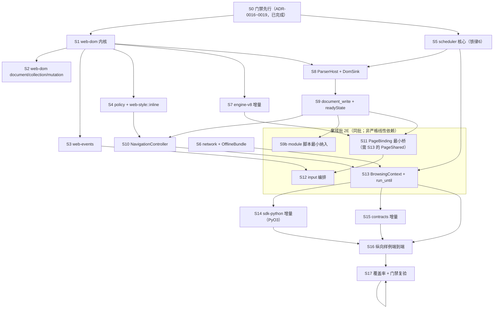

# G2 闸门「页面纵向验证」施工图（2026-10-13）

> **本文档是什么**：把技术方案 §18 的 G2 六项必产出（**流式解析、阻塞脚本、`document.write`、
> 导航、资源等待、输入**）转成**工程师可直接按图施工**的设计。深度与写法对齐
> `docs/design-g1-engine-2026-10-12.md`（§1 到函数签名级 / §2 模块设计 / §3 测试契约 /
> §5 S 编号任务表 / §6 风险 / §7 U 编号未知项）。
>
> **G2 是纵向切片，不是 DOM 全表**：够跑通 §7 末纵向样例的深度即可；
> `未纳入 G2 的广度条目`（DOM/CSSOM/API 全表、Shadow DOM、Custom Elements、完整几何与布局）
> **通过 G2 后**才开展（技术方案 §18「通过后开展 DOM/CSSOM/API 广度扩展」）。
>
> **前置 ADR（全部「已接受」）**：
> - **ADR-0006**（T2.3）：html5ever 支持脚本暂停/恢复；`<script>` 起始 → `RawData(ScriptData)`、
>   `</script>` → `Script(handle)` 暂停点；`document.write` 产出用 **`push_front`** 注入
>   （**不得**由上层直接操纵 `BufferQueue`，见 ADR-0006「对 navigation crate 的设计约束」）。
> - **ADR-0007**（T2.1）：cppgc ↔ V8 跨语言环**无法回收** ⇒ DOM 侧不得持 `Global` 强引用监听器。
> - **ADR-0013**（G1-D1）：弱引用槽表 + 显式租借；**C-2**：`web-dom`/`web-events` 类型面不得出现
>   `JsHandle`/`HandleLease`，监听器槽只允许 `NodeId` 或 `WeakJsHandle`；`node_map` 持 **`WeakJsHandle`**。
> - **ADR-0014**（G1-D2）：PyO3 回调**同线程直呼** + 截止期限 + RAII 重入禁令。
> - **ADR-0010**（T2.2）：时区是进程级单值全局（**逻辑时钟归 `scheduler`、与时区正交**）。
> - **ADR-0009**（G1-PRE-1）：`v8::` 类型**只许**出现在 `engine-v8`；不新增 workspace 成员。
>
> **纪律（硬）**：`AGENTS.md` 十条铁律。本轮**只做设计与 brief，不写功能代码、不落 ADR**
> （结论由主理人组织独立评审背对背辩论后落档；落档前工程师不得动 `web-dom`/`navigation`/`scheduler`）。
> 本文档函数签名是**设计契约**（工程师据此写测试先行）。
>
> **高风险路径声明（铁律 6）**：G2 触及 **scheduler（事件循环 / 消息泵 / 暂停恢复 / 时序）** 与
> **PyO3 回调边界**两处高风险路径 ⇒ 对应设计**必须经决策上报**（见 `docs/decision-briefs/2026-10-13-G2-*.md`
> 的 **D2（解析器宿主 + 执行协议 + 调度器核心）**、**D3（资源等待 + 导航 + PyO3 控制面）**）。

---

## 0. 一句话

> **`web-dom` 用「带 generation 的 `NodeId` + 单线程 arena」承载规范节点树；`navigation` 自建
> 可暂停/恢复的解析驱动循环（ADR-0006）把 html5ever 接到这棵树与一个继承 ADR-0013 弱引用纪律的
> JS 绑定面；`scheduler` 用「任务源队列 + 有界 `run_until` + 双时钟」驱动页面（不直接操纵输入队列）；
> `network` 以 `OfflineBundle` 先行兑现「等待注入」；`sdk-python` 把 §16 的
> `page.load / run_until / network / input / capabilities` 接成最小面。几何读取在 G2 是
> 登记口径的 stub（属 G3）。**

---

## 0.1 G2 裁决修订摘要（**S1+ 以 ADR-0016~0019 + 本节为准**）

> **来源**：主理人裁决书 `docs/decision-briefs/2026-10-13-G2-裁决-主理人.md`（D1~D4 裁决 / 12 条阻断裁决表 /
> 模块脚本裁决 / 测试修复表）。**两评审对四方向与 brief 推荐全部一致；分歧全在机制/签名层** ⇒「方向不变 + 机制修正」。
> **效力**：与本文档此前现稿冲突处，**以 ADR-0016~0019 为准**；本节给出「修订点 → 落点」总索引，工程师**无需读辩论文档**。

| # | 修订点（§7 清单） | 定稿 | ADR | 施工图落点 |
|---|---|---|---|---|
| 1 | **依赖环修复** | `scheduler` 自持 `SchedulerError`，`PageError: From<SchedulerError>`；`NavigationEpoch` **下移 `policy`** | 0017·D1 / 0018 | §1.1、§1.2、图 |
| 2 | **`BrowsingContext.plane`** | 字段改 `plane: ControlPlane`（**非**裸 `Realm`）；`realm_mut()` 转发；脚本任务走 `with_page_script` | 0017·D7 | §1.2 / §2.1 / §2.7 |
| 3 | **`ParserHost` 归宿** | 入 `BrowsingContext` 字段（**非** `PageShared`）；导航时重建 | 0017·D7 | §1.2 / §2.1 |
| 4 | **`res/rej` 表归宿** | `Rc<RefCell<FetchTable>>`，`PageShared` 持有，`__iv8_fetch` clone 捕获（受 P-1b）；`network` 零 `engine-v8` | 0018·D3 | §1.2 / §2.5 |
| 5 | **导航重绑 + 断言** | 导航 = 重建 `Document/NodeTree` + 清 `node_map`/`registry`/`mutations` + 重建 `ParserHost`；断言 `stale_document_node_rejected`；旧 JS 全局残留**具名登记偏差**（G4） | 0018·D2 | §2.4 / §7 U-9 |
| 6 | **watchdog 节**（**采纳**，P-1a可靠） | 脚本/模块任务经 `Realm::eval_with_deadline` 接 watchdog（G1 形态）；**复用既有 `JsErrorKind::Terminated`**（不新增变体）+ 全链路映射（`→PageErrorKind::Terminated`） | 0017·D2 | §2.1 / §6 R6 |
| 6b | **`NativeFn` 去 `+ Send`**（P-1b 可行） | `native_fn.rs` 移除 `+ Send`；`__iv8_fetch` 闭包**可直接捕获** `Rc<RefCell<FetchTable>>` | 0017·D9 | §1.1 / §1.2 / §2.5 |
| 7 | **`dispose` + `NodeMap` 存活校验** | `NodeTree::dispose(NodeId)`（离树+槽释放+gen bump）；`wrapper_for` 复用前 `resolve_weak`，`Collected` ⇒ unbind+重建+bind | 0016·D3/D4 | §1.2 / §3.7 |
| 8 | **结构性借用规则**（入 §2.2/§8） | 别名单元清单 + **跨 V8 边界一律 copy-out** + `try_borrow`/`try_borrow_mut`→可判定错误（非 panic） | 0016·D2 | §2.2 / §6 R4 / §8 |
| 9 | **`document.write`** | post-load = **具名错误 `DocumentWriteAfterLoad`**；**多条保序修正**（逆序 push_front）+ 回归测试 | 0017·D4 | §2.1 / §3.3 |
| 10 | **跨源顺序** | 定义 `TaskSource` 源间选择顺序 + 测试 | 0017·D3 | §2.4 / §3.5 |
| 11 | **逻辑时钟推进** | `run_until` 无立即任务 ⇒ 跳到最近 due 定时器执行（虚拟跳转、不 sleep）；`logical_clock_fires_timer` | 0017·D3 | §3.5 |
| 12 | **parked-IO** | 显式停泊态（出队停泊 + 完成再入队）；`is_idle` 计入停泊 ⇒ `WaitingIo` 可达 | 0017·D6 | §2.4 / §3.5 |
| 13 | **错误映射表 + 变体清单** | `JsError→PageError` 映射 + `PageErrorKind` 新增变体 + 同步 `ALL_KINDS` 穷举守卫 | 0017·D11 | §1.2 / §8 |
| 14 | **§1.2 补未定义类型 + 单一写缓冲** | 补 `Credentials`/`LoadBlockerKind`/`InputKind`/`PageError`/`NetLogEntry`；`PageBinding.writes` 与 `shared.writes` **合一** | 0017·D7 | §1.2 |
| 15 | **`TreeSink` 全表面** | **展开全部方法签名**（无「…」）+ `DomSink` 的 `QualName`/atom 缓存形态 | 0017·D10 | §1.2 / §2.1 |
| 16 | **seq 图双重借用修复** | 解构字段 + 独立 `Exec` executor | 0017·D8 | §2.1 / 图 |
| 17 | **JS `Event` 桥 + 监听器语义 + `el.click`** | JS 事件对象桥；`add` 去重 / `remove` 按 `(type,callback,capture)`；remove 生效/add 不生效；`call_weak` 原子；分派专用调用入口放开 | 0019·D1~D6 | §2.3 / §3.6 |
| 18 | **`activeElement` 最小态** | click⇒聚焦可观察；`transient` 明「G2 不置位」 | 0019·D7 | §2.6 |
| 19 | **模块脚本条款**（七条） | 纳入 G2 最小面；暂停点判 `type` 分流；defer 队列；TLA 具名错误；非 load-blocker | 0017·模块节 | §2.1 / §3.2 / §5 S9b |
| 20 | **URL 规范化** | query/fragment 剥离、default-port 折叠、大小写；端口断言 | 0018·D6 | §3.4 |
| 21 | **测试矩阵增补** | 各 D 内嵌 + §4（6 条写不出的测试**全部转可写**） | 0016~0019 | §3.x / §4 |
| 22 | **§8 增补** | 借用规则 / 错误映射 / 模块约束 / 导航残留登记 | 0016~0019 | §8 |

> **6 条「写不出的测试」已全部转可写**：`nodeid_generation_reuse`（+`dispose`）、`document_write_after_load_defined`
> （具名错误）、`trusted_click_*`/`untrusted_event_*`（+JS Event 桥）、`logical_clock_fires_timer`（+推进策略）、
> 「单任务长脚本中断」（P-1a 定形或登记局限）、「旧文档节点被拒」（+导航重绑）。

---

## Part A：系统设计

### 1. 文件级设计

> **crate 归属总原则**：G2 让 5 个此前为骨架的 crate 首次落地（`web-dom` / `web-events` /
> `navigation` / `scheduler` / `network`；外加最小 `policy` / `web-style` / `resources`），
> 并给 `engine-v8` / `sdk-python` / `contracts` 各加**增量**。**不新增 workspace 成员**（ADR-0009）。
> **依赖方向（ADR-0017·D1 / ADR-0018）**：`NavigationEpoch` 归 **`policy`**（`navigation`/`network` 均依赖）；
> `scheduler` **不引用** `navigation` 类型（自持 `SchedulerError`，`PageError: From<SchedulerError>`）⇒ **无环**。
> **unsafe 纪律**：新增代码**全部在 `engine-v8` 白名单之外** ⇒ G2 新增 crate **零 `unsafe`**
> （html5ever / Stylo 未介入，均为安全 Rust API）；`engine-v8` 增量（`new_object`/`resolve_weak`/`call_weak`/
> 分派专用调用入口）**预计零 `unsafe`**，若有 unsafe 逐块 `SAFETY` 并进对应 ADR。

#### 1.1 文件清单（新增/修改）

| crate | 文件 | 职责（一句话） | 关键类型 | unsafe |
|---|---|---|---|---|
| **web-dom** | `src/lib.rs` | 模块接线 + crate 文档 | — | 零 |
| | `src/node.rs` | 节点身份与内容 | `NodeId` / `NodeKind` / `NodeData` / `ElementData` | 零 |
| | `src/tree.rs` | **节点树 arena**（创建/插入/删除/遍历/属性） | `NodeTree` | 零 |
| | `src/attr.rs` | 有序属性表（HTML 名大小写折叠） | `AttributeMap` | 零 |
| | `src/document.rs` | 文档根 + `readyState` + quirks 模式 | `Document` / `ReadyState` | 零 |
| | `src/collection.rs` | Live `NodeList`/`HTMLCollection` 最小面 | `LiveCollection` | 零 |
| | `src/mutation.rs` | 变更记录缓冲 + **`MutationObserver` 最小面**（`ObserverRegistry<C = ()>`/observe 选项/`takeRecords`） | `MutationRecord` / `MutationBuffer` / `ObserverRegistry<C>` | 零 |
| | `src/error.rs` | DOM 层错误 | `DomError` / `DomErrorKind` | 零 |
| **web-events** | `src/lib.rs` | 接线 + 文档 | — | 零 |
| | `src/event.rs` | 事件对象与初值 | `Event` / `EventInit` / `EventPhase` | 零 |
| | `src/listener.rs` | 监听器条目（**弱引用槽**） | `ListenerOptions` / `ListenerRef` | 零 |
| | `src/target.rs` | 目标监听器注册表 | `ListenerRegistry` | 零 |
| | `src/dispatch.rs` | **纯算法**：传播路径 + 分派计划（不调 v8） | `DispatchStep` / `plan_dispatch` | 零 |
| | `src/trusted.rs` | 可信事件合成与 user activation 状态 | `TrustedEventKind` / `UserActivation` | 零 |
| | `src/error.rs` | 事件层错误 | `EventError` | 零 |
| **policy** | `src/lib.rs` / `src/origin.rs` / `src/epoch.rs` / `src/context.rs` / `src/error.rs` | origin / 安全上下文最小面 + **`NavigationEpoch`（共享层，ADR-0017·D1）** | `Origin` / `NavigationEpoch` / `SecurityContext` / `PagePolicy` | 零 |
| **web-style** | `src/lib.rs` / `src/inline.rs` / `src/error.rs` | **仅内联声明值**（无级联，Stylo 属 G3） | `InlineStyle` / `DeclMap` | 零 |
| **navigation** | `src/lib.rs` | 接线 + 文档 | — | 零 |
| | `src/controller.rs` | 导航协调器（URL/origin/`readyState`/blockers/**epoch**） | `NavigationController` / `NavigationEpoch` | 零 |
| | `src/parser.rs` | **可暂停/恢复的解析驱动**（ADR-0006 协议） | `ParserHost` / `ParseOutcome` | 零 |
| | `src/sink.rs` | `markup5ever::TreeSink` 落到 `web-dom` | `DomSink` | 零 |
| | `src/document_write.rs` | `document.write` 插入点账本（`push_front` 语义） | `ParserState` / `WriteMode` | 零 |
| | `src/binding.rs` | **手写最小 JS `document`/元素桥**（G3 由 `bindings-webidl` 取代） | `PageBinding` / `DomObj` | 零 |
| | `src/input.rs` | 输入分派编排（显式 target 可信事件） | `InputDispatch` | 零 |
| | `src/page.rs` | **BrowsingContext**：组合 `plane(ControlPlane)`+shared+parser+binding+runloop；`FetchTable` | `BrowsingContext` / `PageSnapshot` / `FetchTable` | 零 |
| | `src/error.rs` | 错误分阶：**parser 级 `ParserError`** + 页级 `PageError`/`PageErrorKind`（`+From<SchedulerError>`）——**已落（S10）** | `ParserError` / `PageError` / `PageErrorKind` | 零 |
| **scheduler** | `src/lib.rs` / `src/task.rs` / `src/queue.rs` / `src/runloop.rs` / `src/clock.rs` / `src/budget.rs` / `src/error.rs` | 任务源队列 / 有界 `run_until` / 双时钟 / 重入守卫 | `TaskSource` / `TaskToken` / `RunLoop` / `RunBudget` / `RunOutcome` / `Clock` / `ClockMode` | 零（**铁律 6：D2/D3 先落 ADR**） |
| **network** | `src/lib.rs` / `src/request.rs` / `src/response.rs` / `src/service.rs` / `src/transport.rs` / `src/offline.rs` / `src/log.rs` / `src/error.rs` | Fetch 语义最小面 + 可插拔传输 + netLog | `RequestSpec` / `RequestId` / `Response` / `NetworkService` / `Transport` / `OfflineBundle` / `NetLogEntry` | 零 |
| **resources** | `src/lib.rs` / `src/timing.rs` / `src/table.rs` / `src/error.rs` | 资源表 + `ResourceTiming` 最小面 | `ResourceTable` / `ResourceTiming` | 零 |
| **engine-v8**（增量） | `src/realm.rs`（改） | 新增 `new_object`/`new_array`/`resolve_weak`/**`weak_handle`**/**`call_weak`**/**`dispatch_call`**/**`eval_with_deadline`**/`set_global` | 同 `Realm` | 预计零（`dispatch_call` 若开口须 SAFETY，见 ADR-0019·D6） |
| | `src/native_fn.rs`（改） | **移除 `NativeFn` 的 `+ Send`**（P-1b；见 ADR-0017·D9） | `NativeFn` | 零 |
| | `src/node_map.rs`（改） | **覆盖死亡弱句柄语义**（`bind_force`；供 `wrapper_for` 回收后重建，ADR-0016·D3） | `NodeMap` | 零 |
| | `Cargo.toml`（改） | 新增 **`test-util` feature**（**默认关**；`collect_garbage_for_testing` 由 `#[cfg(any(test, feature = "test-util"))]` 门控）供跨 crate 弱引用测试；**不改稳定类型面**（批 2F） | — | 零 |
| | `src/error.rs`（改） | 可能新增页面类错误变体（**需同步变体可达性矩阵 + 契约**） | `JsErrorKind` | 零 |
| **sdk-python**（增量） | `src/lib.rs`（改） | `PyContext` 改持 `BrowsingContext`；新增页面方法；**新增 path 依赖 `navigation`/`network`/`scheduler`（批 2G）** | `PyContext` | 零 |
| | `src/page.rs`（新） | `page` / `network` / `input` 子对象 | `PyPage` / `PyNetwork` / `PyInput` / `PySnapshot` / `PyResponse` / `PyNetLogEntry` | 零 |
| **contracts**（增量） | `iv8_contract/page_control.py`（新） | G2 控制面的 Python 契约投影 | `RunOutcome` / `ReadyState` / `Capabilities` 投影 | — |
| | `tests/test_page_control.py`（新） | 契约测试 | — | — |

> **命名纪律（跨平台铁律 1）**：文件名全 **小写 + 下划线**；`mod` 名逐字符一致；**不用 `#[path]`**。
> **禁止** `#[pyclass]` 用 `Probe` 作名（ADR-0014 遗留坑）。

#### 1.2 关键类型与函数签名（设计契约，原文）

> 术语（给不懂 Rust 的维护者）：`pub struct Foo(u64)` ≈「一个只包一个 64 位整数的不可直接改的类型」；
> `Rc<RefCell<T>>` ≈「单线程引用计数 + 运行期借用检查的共享可变容器」（**非线程安全**，本设计确定页面单线程）。

##### `web-dom::node` / `web-dom::tree`

```rust
/// 节点身份。高 32 位 = generation（复用防呆），低 32 位 = arena 下标。
/// 打包约定与 `engine_v8::JsHandle` 一致（ADR-0009 / U-4），便于 `node_map` 用 u64 key 对接。
#[repr(transparent)]
#[derive(Clone, Copy, PartialEq, Eq, Hash, Debug)]
pub struct NodeId(u64);
impl NodeId {
    pub const fn new(index: u32, generation: u32) -> Self;
    pub const fn index(self) -> u32;
    pub const fn generation(self) -> u32;
    pub const fn raw(self) -> u64;      // 供 engine_v8::node_map 的 u64 key
}
impl From<NodeId> for u64 { fn from(id: NodeId) -> u64; }

#[derive(Clone, Copy, PartialEq, Eq, Debug)]
pub enum NodeKind { Document, DocumentType, Element, Text, Comment }

/// 元素特有数据（最小面；Shadow DOM / 自定义元素属 G3）。
#[derive(Clone, Debug)]
pub struct ElementData {
    pub name: String,             // 标签名（小写规范名）—— 另见 `DomSink` 的 `QualName`/atom 缓存（§2.1）
    pub namespace: String,       // "html" / "svg" / "mathml"
    pub attrs: crate::attr::AttributeMap,
    pub style: web_style::InlineStyle,    // 见 web-style（仅内联声明值；web-dom → web-style 单向依赖）
}
// ⚠️ ADR-0016·D6：**不设** `class_list` 字段（消除 `attrs`/`class_list` 双真相源）；
// `class_list` 由 `attrs`（`class` 属性）**惰性派生**（`fn class_list(&self) -> Vec<&str>`）。

/// 一个节点（arena 内一条记录）。树链用下标（非指针）⇒ 可序列化、无 unsafe。
#[derive(Clone, Debug)]
pub struct NodeData {
    pub kind: NodeKind,
    pub parent: Option<NodeId>,
    pub first_child: Option<NodeId>,
    pub last_child: Option<NodeId>,
    pub prev_sibling: Option<NodeId>,
    pub next_sibling: Option<NodeId>,
    pub element: Option<ElementData>,   // 仅 Element
    pub text: Option<String>,           // Text / Comment / DocumentType
}

/// 节点树：**单线程 arena**（`Vec<Option<NodeData>>` + free list）。
/// **零 unsafe**：全部按下标索引，无自引用指针。**不在类型面出现任何 v8 类型**（C-2）。
pub struct NodeTree {
    nodes: Vec<Option<NodeData>>,
    generations: Vec<u32>,
    free: Vec<u32>,
    root: NodeId,
    len: usize,
}
impl NodeTree {
    pub fn new() -> Self;
    #[must_use] pub fn root(&self) -> NodeId;
    pub fn create_element(&mut self, name: &str, namespace: &str, attrs: Vec<(String, String)>) -> NodeId;
    pub fn create_text(&mut self, data: &str) -> NodeId;
    pub fn create_comment(&mut self, data: &str) -> NodeId;
    /// 批 2C：供 `TreeSink::append_doctype_to_document` 使用。
    pub fn create_doctype(&mut self, name: &str, public_id: &str, system_id: &str) -> NodeId;
    pub fn append_child(&mut self, parent: NodeId, child: NodeId);
    pub fn insert_before(&mut self, parent: NodeId, child: NodeId, reference: Option<NodeId>);
    pub fn remove_child(&mut self, parent: NodeId, child: NodeId);
    #[must_use] pub fn get(&self, id: NodeId) -> Option<&NodeData>;
    pub fn get_mut(&mut self, id: NodeId) -> Option<&mut NodeData>;
    #[must_use] pub fn parent(&self, id: NodeId) -> Option<NodeId>;
    pub fn children(&self, id: NodeId) -> impl Iterator<Item = NodeId> + '_;
    /// 汇总子树文本（供脚本宿主取 `<script>` 体内文本）。
    #[must_use] pub fn text_content(&self, id: NodeId) -> String;
    pub fn set_attribute(&mut self, id: NodeId, name: &str, value: &str);
    #[must_use] pub fn get_attribute(&self, id: NodeId, name: &str) -> Option<&str>;
    /// ⚠️ ADR-0016·D4：最小组件回收——离树 + 释放 arena 槽（入 `free`）+ **generation bump**。
    /// 使 `nodeid_generation_reuse` 可写（旧 `NodeId` 于新节点必须判失效）。`remove_child` 只离树、**不**回收槽。
    pub fn dispose(&mut self, id: NodeId);
    #[must_use] pub fn len(&self) -> usize;
    #[must_use] pub fn is_empty(&self) -> bool;
}
```

> **形态依据 D1**：**裁决已落 ADR-0016**（扁平 arena + generation + `NodeId(u64)` + 结构性借用规则）。
> 备选（`slotmap` / 每节点 `Rc<RefCell<Node>>`）**均被驳回**（理由见 ADR-0016 决策 8）。

##### `web-events`

```rust
#[derive(Clone, Copy, PartialEq, Eq, Debug)]
pub enum EventPhase { None, Capturing, AtTarget, Bubbling }

#[derive(Clone, Debug, Default)]
pub struct EventInit { pub bubbles: bool, pub cancelable: bool, pub composed: bool }

#[derive(Clone, Debug)]
pub struct Event {
    pub type_: String,
    pub bubbles: bool,
    pub cancelable: bool,
    pub composed: bool,
    pub is_trusted: bool,             // 宿主 input 合成 ⇒ true；new Event ⇒ false
    pub target: Option<NodeId>,
    pub current_target: Option<NodeId>,
    pub phase: EventPhase,
    pub time_stamp: f64,              // 从 scheduler 双时钟派生（§6）
    pub default_prevented: bool,
    pub propagation_stopped: bool,
}
impl Event {
    pub fn new(type_: &str, init: EventInit) -> Self;
    pub fn new_trusted(type_: &str, init: EventInit) -> Self;   // is_trusted = true
    pub fn prevent_default(&mut self);
    pub fn stop_propagation(&mut self);
}

#[derive(Clone, Copy, Debug, Default)]
pub struct ListenerOptions { pub capture: bool, pub passive: bool, pub once: bool }

/// 监听器条目：**只存弱句柄**（C-2 / ADR-0013 决策 6）。回调的调用由编排层经 engine-v8 完成。
#[derive(Clone, Copy, Debug)]
pub struct ListenerRef { pub callback: engine_v8::WeakJsHandle, pub options: ListenerOptions }

/// 稳定注册 id（ADR-0019·D2：分派期监听器变更靠它查活性；`once`/`removeEventListener` 共用「移除即置 dead」）。
#[repr(transparent)] #[derive(Clone, Copy, PartialEq, Eq, Hash, Debug)] pub struct ListenerId(u64);

/// 目标 → 监听器列表。**注册/移除按 `(type, callback, capture)` 匹配**（ADR-0019·D3）。
#[derive(Default)]
pub struct ListenerRegistry { /* map: (NodeId, type) -> Vec<(ListenerId, ListenerRef, bool/*dead*/)> */ }
impl ListenerRegistry {
    /// 去重：已存在同 `(type, callback, capture)` ⇒ **no-op**（不重复添加）。返回注册 id。
    pub fn add(&mut self, target: NodeId, type_: &str, callback: engine_v8::WeakJsHandle, options: ListenerOptions) -> ListenerId;
    /// 只按 `(type, callback, capture)` 匹配（**忽略** `passive`/`once`）；命中即置 dead。
    pub fn remove(&mut self, target: NodeId, type_: &str, callback: engine_v8::WeakJsHandle, capture: bool);
    /// 取该目标的**候选**监听器（含 id）；**活性在调用时由编排层查询**（ADR-0019·D2）。
    pub fn listeners(&self, target: NodeId, type_: &str) -> Vec<ListenerId>;
    /// 该 id 当前是否仍有效（未被 `once`/`remove` 置 dead）。
    #[must_use] pub fn is_live(&self, id: ListenerId) -> bool;
    #[must_use] pub fn get(&self, id: ListenerId) -> Option<ListenerRef>;
}

/// 分派计划的一步：在 `target` 上按 `phase` 触发 `listeners`。**纯数据（owned），不调 v8**。
/// `listeners` 是**候选 id 列表**——调用前须逐个 `is_live` 查活性（ADR-0019·D2）。
#[derive(Clone, Debug)]
pub struct DispatchStep { pub target: NodeId, pub phase: EventPhase, pub listeners: Vec<ListenerId> }

/// 传播路径（target → root）与计划生成（capture → at-target → bubble）。**纯函数，返回 owned Vec**
/// （借用在任何 `Realm::call` 前释放——ADR-0016·D2 / B-断链 10 序列②）。
pub fn plan_dispatch(
    tree: &web_dom::tree::NodeTree,
    registry: &ListenerRegistry,
    target: NodeId,
    event: &Event,
) -> Vec<DispatchStep>;

/// user activation 状态。**G2 只置位 `sticky`**；`transient` **G2 不置位**（G3 再用，ADR-0019·D7）。
#[derive(Clone, Copy, Debug, Default)]
pub struct UserActivation { pub sticky: bool, pub transient: bool }
```

##### `navigation`（核心）

```rust
#[derive(Clone, Copy, PartialEq, Eq, Debug)]
pub enum ReadyState { Loading, Interactive, Complete }
// 同名类型注（批 2D）：`navigation::ReadyState`（本处）= **导航生命周期**（由 controller/blockers 推进）；
// `web-dom::document::ReadyState` = **文档自身状态**。二者**按 §1.1 并存、职责区分**，不得混用（防混淆）。

/// 导航代次：新导航 +1；旧代次的异步完成消息据此作废（技术方案 §4「导航代次」）。
/// ⚠️ **ADR-0017·D1：本类型归 `policy` crate**（`policy::NavigationEpoch`）——`navigation`/`network`
/// 均依赖 `policy`，**避免 `navigation ↔ network` 依赖环**。（下方出现处一律指 `policy::NavigationEpoch`。）
#[repr(transparent)]
#[derive(Clone, Copy, PartialEq, Eq, Hash, Debug, PartialOrd, Ord)]
pub struct NavigationEpoch(u64);
impl NavigationEpoch { pub const fn get(self) -> u64; }

/// load blocker 种类（ADR-0017·D7 补齐先前未定义类型）。
#[derive(Clone, Copy, PartialEq, Eq, Debug)]
pub enum LoadBlockerKind { ExternalScript, Stylesheet, Image, Other }

/// 请求凭据模式（ADR-0017·D7 补齐）。
#[derive(Clone, Copy, PartialEq, Eq, Debug)]
pub enum Credentials { Omit, SameOrigin, Include }

/// 输入事件种类（ADR-0017·D7 补齐；此前只在 D4 brief 出现）。
#[derive(Clone, Copy, PartialEq, Eq, Debug)]
pub enum InputKind { Click, KeyDown, Focus }

// 错误分阶（**已落（S10）**）：**parser 级用 `ParserError`**（解析相关，`navigation::error`）；**页级 `PageError`/`PageErrorKind`**（+`From<SchedulerError>`）——已含 `InvalidUrl`/`NavigationAborted`/`StaleDocumentNode`/`TargetNotInDocument`/`DocumentWriteAfterLoad`/`ModuleTopLevelAwaitUnsupported`/`Reentrancy`/`Terminated`/…。

pub struct NavigationController {
    url: String,
    origin: policy::Origin,
    ready_state: ReadyState,
    epoch: NavigationEpoch,
    load_blockers: std::collections::BTreeSet<u64>,
    document: NodeId,
}
impl NavigationController {
    pub fn new(url: &str) -> Result<Self, PageError>;
    /// 开启一次导航：epoch += 1、重置 readyState=Loading、清 blockers、返回新 epoch。
    /// ⚠️ **ADR-0018·D2**：本方法只动「导航状态」；**文档/树/绑定的重建**由 `BrowsingContext::load` 编排
    /// （见下 `BrowsingContext`）——重建全新 `NodeTree` + 清 `node_map`/`registry`/`mutations` + 重建 `ParserHost`。
    pub fn begin_navigation(&mut self, url: &str) -> Result<NavigationEpoch, PageError>;
    pub fn epoch(&self) -> NavigationEpoch;
    pub fn url(&self) -> &str;
    pub fn origin(&self) -> &policy::Origin;
    pub fn ready_state(&self) -> ReadyState;
    pub fn set_ready_state(&mut self, s: ReadyState);
    /// 登记/注销 load blocker（外部脚本、图片等）；仅当无 blocker 且解析完成才可 Complete。
    pub fn add_blocker(&mut self, kind: LoadBlockerKind) -> u64;   // 返回 blocker id
    pub fn remove_blocker(&mut self, id: u64);
    pub fn try_finish(&mut self) -> bool;   // true = 已推进到 Complete
    #[must_use] pub fn is_current(&self, epoch: NavigationEpoch) -> bool;
}

/// 解析驱动结果。暂停点携带**脚本节点**（`Sink::Handle = NodeId`）。
#[derive(Debug)]
pub enum ParseOutcome { Done, BlockedOnScript(NodeId) }

/// **自建的**可暂停/恢复解析驱动（ADR-0006：不得封装成一次性 `parse_document`）。
/// ⚠️ **ADR-0017·D7：本结构是 `BrowsingContext` 的字段**（非 `PageShared` 内）；导航时**重建**。
pub struct ParserHost {
    tokenizer: html5ever::tokenizer::Tokenizer<html5ever::tree_builder::TreeBuilder<NodeId, DomSink>>,
    input: html5ever::tokenizer::BufferQueue,
    pending_writes: std::collections::VecDeque<tendril::StrTendril>,
}
impl ParserHost {
    /// `opts` 为 `ParseOpts`；**内部分发**：`Tokenizer::new(sink, opts.tokenizer)` +
    /// `TreeBuilder::new(sink, opts.tree_builder)`（`Tokenizer::new` 只收 `TokenizerOpts`——A-§2.9）。
    pub fn new(tree: std::rc::Rc<std::cell::RefCell<NodeTree>>, opts: html5ever::ParseOpts) -> Self;
    /// 喂入一个 chunk；返回 Done 或 BlockedOnScript(node)。
    /// ⚠️ 暂停点**对 `type` 无感**：`<script type=module>` 同样返回 `BlockedOnScript`——**由调用方判 `type` 分流**
    /// （classic ⇒ ScriptBlocking 任务；module ⇒ defer 队列，**永不在暂停点执行**）。见 §2.1 模块脚本条款。
    pub fn feed(&mut self, chunk: &str) -> ParseOutcome;
    /// `document.write` 产出：**以 `push_front` 表达插入点**（ADR-0006）。
    /// **上层不得直接操纵 `BufferQueue`**；多条写入须**保序**（见 `resume`）。
    pub fn enqueue_document_write(&mut self, text: &str);
    /// 脚本执行完毕，恢复解析。**ADR-0017·D4：注入 `pending_writes` 时逆序 `push_front`（或拼接）以保证调用序**
    /// （逐条 `push_front` 会**倒置** `write("a");write("b")`）。
    pub fn resume(&mut self) -> ParseOutcome;
    /// 收尾：`Tokenizer::end()` 后经 `self.tokenizer.sink.finish()` 取 `TreeSink::finish(self)`（层序一致——A-§2.9）。
    pub fn finish(self);
}

/// `markup5ever::TreeSink` 落到 `web-dom`（`Handle = NodeId`）。**零 unsafe**。
/// ⚠️ **ADR-0017·D10：必须展开全部方法签名（无「…」省略）**；`elem_name<'a>` 的 lifetime 须借住
/// interned atom ⇒ **`DomSink` 维护 `HashMap<NodeId, QualName>` + `LocalName`/`Namespace` atom 缓存**
/// （或让 `NodeTree` 直接存 `QualName`）。须逐一实现的 `TreeSink` 方法（`markup5ever-0.12.1`）：
/// `finish / parse_error / get_document / elem_name<'a> / create_element(QualName,Vec<Attribute>,ElementFlags) /
/// create_comment / create_pi / append / append_based_on_parent_node（无默认实现）/ append_doctype_to_document /
/// mark_script_already_started / pop / get_template_contents / same_node / set_quirks_mode /
/// append_before_sibling / add_attrs_if_missing / associate_with_form / remove_from_parent /
/// reparent_children / is_mathml_annotation_xml_integration_point / set_current_line / complete_script / trace_handle`。
/// **S8 定稿**（P-2：确认 `pop()` 出来的是 `<script>` 元素本身）。
pub struct DomSink { /* Rc<RefCell<NodeTree>> + qualname/atom 缓存 + 记账字段 */ }
impl markup5ever::interface::TreeSink for DomSink {
    type Handle = NodeId;
    type Output = ();
    // （全部方法见上；S8 落定）
}

/// **手写最小 JS `document`/元素桥**（G3 由 `bindings-webidl` 生成物取代；非生成物，不触铁律 7）。
/// 经 `engine-v8` 的**安全类型面**安装原生函数；节点↔wrapper 复用由 `engine_v8::node_map::NodeMap` 承担。
/// ⚠️ **ADR-0017·D7 + 批 2E 定稿**：`PageShared` 为**值持有**（见下）⇒ 本结构**不持整个 `PageShared`**，
/// 只持其**子单元 `Rc<RefCell<…>>`**（`tree` / `writes`），与「闭包直接捕获子单元 `Rc`」（P-1b）一致；
/// `document.write` 缓冲的**单一真相源** = `PageShared.writes`（本字段与其为**同一 `Rc`**，非二义）。
pub struct PageBinding {
    tree: std::rc::Rc<std::cell::RefCell<NodeTree>>,
    node_map: engine_v8::node_map::NodeMap,
    parser_active: std::rc::Rc<std::cell::Cell<bool>>,
    writes: std::rc::Rc<std::cell::RefCell<Vec<String>>>,   // = PageShared.writes 的同一 Rc
}
/// 批 2F 定稿：`PageBinding::install` 入参收敛为 [`BindingInputs`]（聚合各子单元 `Rc`，按「值持有」裁定）。
pub struct BindingInputs {
    pub tree: std::rc::Rc<std::cell::RefCell<NodeTree>>,
    pub writes: std::rc::Rc<std::cell::RefCell<Vec<String>>>,
    // 其余子单元随 S11/S12 增补
}
impl PageBinding {
    pub fn install(
        realm: &mut engine_v8::realm::Realm,
        inputs: BindingInputs,
    ) -> Result<Self, engine_v8::error::JsError>;
    /// 节点 → wrapper。⚠️ **ADR-0016·D3：复用前必须存活性校验**——
    /// 查 `node_map` → 若中，`resolve_weak`；`Some` ⇒ 复用；`None`（`Collected`）⇒ **`unbind` + 新建 wrapper + `bind`**
    /// （现有 `node_map.rs:28-38` 的 `bind` 只看有无比对、**不判存活**；须改其语义，落 ADR-0013 修正注记）。
    /// 不阻止 GC（弱句柄）。测试 `node_wrapper_recreated_after_collection`。
    pub fn wrapper_for(&mut self, realm: &mut engine_v8::realm::Realm, node: NodeId)
        -> Result<engine_v8::HostValue, engine_v8::error::JsError>;
}

/// 页面共享状态。**批 2E 定稿：由 `BrowsingContext` 值持有（非 `Rc<RefCell<PageShared>>`）**——
/// 与 ADR-0016·D2 细粒度借用规则（别名单元越细、借用域越小）与 P-1b 捕获模式一致，并消除
/// 「`network()` 返回 `&mut` vs 外层 `RefCell`」的固有张力。**跨 V8 回调边界共享的子单元**用 `Rc<RefCell<…>>`
/// （`tree`/`writes`/`fetch_table`），供原生闭包**直接捕获**；其余字段按值持有。**别名单元清单**见 §2.2 / ADR-0016·D2。
pub struct PageShared {
    pub controller: NavigationController,          // 值持有
    pub tree: std::rc::Rc<std::cell::RefCell<NodeTree>>,   // 子单元 Rc（闭包捕获）
    pub style: web_style::InlineStyle,             // 极简；级联属 G3
    pub registry: web_events::ListenerRegistry,
    pub activation: web_events::UserActivation,
    pub network: network::NetworkService,          // 值持有；`network()` 返回 `&mut`（无 RefMut 张力）
    pub mutations: web_dom::mutation::MutationBuffer,
    pub observers: web_dom::mutation::ObserverRegistry<engine_v8::WeakJsHandle>,   // ADR-0016·D5：泛型回调槽（navigation 侧实例化为 WeakJsHandle）
    pub writes: std::rc::Rc<std::cell::RefCell<Vec<String>>>,   // 子单元 Rc（闭包捕获）；document.write 缓冲（**单一真相源**）
    pub fetch_table: std::rc::Rc<std::cell::RefCell<FetchTable>>,   // 子单元 Rc（闭包捕获）；ADR-0018·D3：res/rej 的 HandleLease 表
}

/// ADR-0018·D3：`__iv8_fetch` 关闭捕获的 res/rej 表（`HandleLease` 只在 navigation 类型面，`network` 保持零 engine-v8）。
pub struct FetchTable { /* HashMap<RequestId, PendingRequest { resolve: HandleLease, reject: HandleLease }> */ }

/// 页面快照（`page.load(snapshot)` 的入参）。
#[derive(Clone, Debug)]
pub struct PageSnapshot {
    pub url: String,
    pub html: String,
    pub headers: Vec<(String, String)>,
    pub resources: Vec<OfflineResource>,   // 预置离线资源（供 fetch/外链脚本）
}

#[derive(Clone, Debug)]
pub struct OfflineResource { pub url: String, pub status: u16, pub headers: Vec<(String, String)>, pub body: Vec<u8> }

/// **BrowsingContext**：组合页面全部状态 + 一个 `ControlPlane`（内含 `Realm`）+ 一个 `RunLoop`（技术方案 §4）。
/// ⚠️ **ADR-0017·D7**：字段是 `plane: ControlPlane`（**非**裸 `Realm`）——否则 `with_page_script` 无从调用，
/// G1 已验收的 `ControlRevoked`/`inline_script_runs_in_page_scope` 会在 G2 丢失。`ParserHost` 是本结构的字段。
pub struct BrowsingContext {
    plane: engine_v8::control::ControlPlane,
    shared: PageShared,              // 批 2E 定稿：**值持有**（非 `Rc<RefCell<PageShared>>`）
    runloop: scheduler::RunLoop,
    parser: Option<ParserHost>,      // ADR-0017·D7（导航时重建）；脚本任务体走 plane.with_page_script(...)
    binding: Option<PageBinding>,    // **S11 增补**
    // `input_dispatch` 所需字段随 **S12 增补**（本结构字段随后续步骤补齐）
}
impl BrowsingContext {
    pub fn new(url: &str) -> Result<Self, PageError>;
    /// `page.load`：调 `controller.begin_navigation`（epoch+1）+ **重建文档/树/绑定/ParserHost**（ADR-0018·D2）。
    pub fn load(&mut self, snapshot: &PageSnapshot) -> Result<NavigationEpoch, PageError>;
    /// 有界推进（D3）：返回 RunOutcome。**不得无限等待**（技术方案 §16「禁止 eval 悄悄无限等待」）。
    /// ⚠️ **ADR-0017·D8**：内部**先解构字段**再传独立 `Exec` executor（`runloop.run_until(budget, &mut exec)`），
    /// 避免 `run_until(budget, self)` 的 E0499 双重借用。
    pub fn run_until(&mut self, budget: scheduler::RunBudget) -> Result<scheduler::RunOutcome, PageError>;
    pub fn network(&mut self) -> &mut network::NetworkService;
    pub fn input_dispatch(&mut self, kind: InputKind, target: Option<NodeId>) -> Result<(), PageError>;
    /// 转发 `plane.realm_mut()`（ADR-0017·D7）。
    pub fn realm_mut(&mut self) -> &mut engine_v8::realm::Realm;
    pub fn capabilities(&self) -> Capabilities;
    /// 测试钩子（批 2H）：缩短 watchdog 等待（默认 **2000 ms**）；**不改执行模型**（仍为 `load` 内同步执行）。
    pub fn set_script_deadline_ms(&mut self, ms: u64);
    pub fn close(&mut self) -> Result<(), PageError>;
}

#[derive(Clone, Debug)]
pub struct Capabilities {
    pub parsing: &'static str,     // "streaming"
    pub document_write: bool,      // true
    pub navigation: bool,          // true
    pub network: &'static str,     // "offline"（G2；批量接口留 G6）
    pub input: &'static str,       // "explicit_target"（命中测试属 G3）
    pub geometry: &'static str,    // "stub"  ← 明确口径（§6）
    pub shadow_dom: bool,          // false（G3）
    pub script_interruptible: bool,// ← ADR-0017·D2：**恒 `true`**（P-1a 已证 watchdog 可靠，采纳截断）
    pub input_user_activation: &'static str, // "sticky_only"（transient 未置位）
    pub single_realm_navigation: bool,       // true = 旧 JS 全局残留（具名登记偏差；Realm 级替换属 G4）
}
```

##### `scheduler`（**铁律 6 高风险**）

```rust
#[derive(Clone, Copy, PartialEq, Eq, PartialOrd, Ord, Hash, Debug)]
pub enum TaskSource { Timer, Network, UserInput, Message, Microtask, ScriptBlocking }

/// 不透明的任务令牌（由生产者分配并自行映射到具体工作；scheduler 不依赖 navigation/network）。
#[repr(transparent)]
#[derive(Clone, Copy, PartialEq, Eq, Hash, Debug)]
pub struct TaskToken(u64);

#[derive(Clone, Copy, Debug)]
pub struct RunBudget {
    pub max_tasks: u64,      // **约定：0 = 不限**（ADR-0017·D3）
    pub deadline: Option<std::time::Duration>,   // 在**任务边界**检查（不在任务内）
}

#[derive(Clone, Copy, PartialEq, Eq, Debug)]
pub enum RunOutcome {
    Idle,               // 本轮无任务可跑且无停泊任务/未完成 I/O
    BudgetExhausted,    // 达到 max_tasks
    DeadlineExceeded,   // 达到 deadline（**任务边界**检查——ADR-0017·D2）
    WaitingIo,          // ADR-0017·D6：**队列为空且存在停泊任务或未完成 I/O**（§6：不凭空完成请求）
    Closed,
}

/// ⚠️ scheduler **自持错误类型**（ADR-0017·D1）。
pub struct SchedulerError { /* kind: Reentrancy / ... */ }

/// 执行器：把「令牌」翻译成具体工作（由 `BrowsingContext` 的独立 `Exec` 结构实现）。scheduler 只驱动、不理解语义。
/// ⚠️ **ADR-0017·D1**：返回 **`SchedulerError`**（scheduler 自持错误类型）——**不引用 `navigation::PageError`**，
/// 避免 `navigation ↔ scheduler` 依赖环；`navigation` 侧 `PageError: From<SchedulerError>`。
pub trait TaskExecutor {
    fn run_task(&mut self, source: TaskSource, token: TaskToken) -> Result<TaskVerdict, SchedulerError>;
    fn has_pending_io(&self) -> bool;
    /// ADR-0017·D6：是否存在**停泊任务**（parked-awaiting-IO）；`RunLoop` 据此把队列空判为 `WaitingIo`。
    fn has_parked(&self) -> bool { false }
}
#[derive(Clone, Copy, PartialEq, Eq, Debug)]
pub enum TaskVerdict { Done, Park, Requeue, Abort }   // ADR-0017·D6：新增 Park（出队停泊，完成后再入队）

/// 单线程消息泵 + 双时钟。**不重入**：`run_until` 运行期再次进入 ⇒ 显式 `SchedulerError`（D2/D3；非 panic）。
/// **ADR-0017·D3**：记 `TaskSource` **源间选择顺序**（按枚举定义并测试）；逻辑模式下无立即任务 ⇒ **跳最近 due 定时器**。
pub struct RunLoop {
    queues: std::collections::BTreeMap<TaskSource, std::collections::VecDeque<TaskToken>>,
    timer_deadlines: std::collections::BTreeMap<TaskToken, f64>,   // ADR-0017·D3：Timer 按到期升序（「最近 due」依据）
    parked: std::collections::BTreeSet<TaskToken>,               // ADR-0017·D6：停泊任务（等 I/O/ promise）
    clock: Box<dyn Clock>,
    in_run: bool,                                               // 重入守卫（白盒测试直置）
    closed: bool,
}
impl RunLoop {
    pub fn new(clock: Box<dyn Clock>) -> Self;
    pub fn schedule(&mut self, source: TaskSource, token: TaskToken);
    /// ADR-0017·D3：登记定时器到期（`due_ms`，逻辑/系统时钟口径），Timer 队按到期升序维护。
    pub fn schedule_timer(&mut self, token: TaskToken, due_ms: f64);
    /// ⚠️ 返回 `Result<_, SchedulerError>`（ADR-0017·D1）。**ADR-0017·D8**：调用方先解构再传独立 executor。
    /// 逻辑模式：无立即任务时 `clock.advance` 跳到最近 due 定时器（虚拟跳转、不 sleep）——ADR-0017·D3。
    pub fn run_until(&mut self, budget: RunBudget, exec: &mut dyn TaskExecutor) -> Result<RunOutcome, SchedulerError>;
    pub fn close(&mut self);
    #[must_use] pub fn is_idle(&self) -> bool;   // ADR-0017·D6：含「无停泊任务」
}

/// 双时钟（技术方案 §6；ADR-0010：逻辑时钟归 scheduler、与时区正交）。
pub trait Clock {
    fn monotonic_now(&self) -> std::time::Instant;
    fn logical_now_ms(&self) -> f64;              // performance.now 口径
    fn advance(&mut self, d: std::time::Duration); // ADR-0017·D3：由 RunLoop 在跳转时调用（不再是「无调用者」）
    fn mode(&self) -> ClockMode;
}
#[derive(Clone, Copy, PartialEq, Eq, Debug)]
pub enum ClockMode { Logical, System }
```

##### `network`

```rust
#[repr(transparent)]
#[derive(Clone, Copy, PartialEq, Eq, Hash, Debug)]
pub struct RequestId(u64);

#[derive(Clone, Debug)]
pub struct RequestSpec {
    pub id: RequestId,
    pub url: String,
    pub method: String,
    pub headers: Vec<(String, String)>,   // 保序（多个 Set-Cookie 场景，§9）
    pub body: Option<Vec<u8>>,
    pub epoch: policy::NavigationEpoch,   // 关联导航代次（§4；类型归 policy——ADR-0017·D1）
    pub credentials: Credentials,
}

#[derive(Clone, Copy, PartialEq, Eq, Debug)]
pub enum ResponseKind { Ok, NetworkError, Aborted }

#[derive(Clone, Debug)]
pub struct Response { pub status: u16, pub headers: Vec<(String, String)>, pub body: Vec<u8>, pub kind: ResponseKind }

/// ADR-0017·D7 补齐（此前未定义）。
#[derive(Clone, Debug)]
pub struct NetLogEntry { pub url: String, pub status: Option<u16>, pub phase: NetLogPhase, pub epoch: policy::NavigationEpoch }
#[derive(Clone, Copy, PartialEq, Eq, Debug)]
pub enum NetLogPhase { RequestSent, ResponseReceived, Failed }

/// `Ready` = OfflineBundle 命中（`__iv8_fetch` 内**就地 resolve**）；`Pending` = 待 host `complete`（走 Network 任务）。
#[derive(Clone, Copy, PartialEq, Eq, Debug)]
pub enum FetchOutcome { Ready(RequestId), Pending(RequestId) }

/// ADR-0018·D3。**本 crate 零 `engine-v8` 依赖**（`HandleLease` 表在 `navigation`）。
pub struct NetworkService { /* pending: BTreeMap<RequestId, PendingState>; log: Vec<NetLogEntry>; transport: Box<dyn Transport>; next_id */ }
impl NetworkService {
    /// ⚠️ **约定（批 2B）**：transport 未命中经 **`NetworkErrorKind::NotFound`** 表达（**错误值承载控制流**，已代码注记）
    /// ⇒ `fetch` 转为 **`Pending`**（**不**上抛）。
    pub fn fetch(&mut self, spec: RequestSpec) -> Result<FetchOutcome, NetworkError>;
    #[must_use] pub fn pending(&self) -> Vec<RequestId>;
    /// ADR-0018·D3 语义：pending 且 epoch 当前 ⇒ `Ok`（入队 resolve 任务）；**同一 id 已完成再次 complete ⇒ 幂等 `Ok`（no-op）**；
    /// **已 abort / epoch 过期 ⇒ `Err(NetworkError::Stale)`**（不写入）。
    pub fn complete(&mut self, id: RequestId, resp: Response) -> Result<(), NetworkError>;
    /// 旧代次请求作废（不回写新文档）；**释放该请求的 res/rej `HandleLease`**（ADR-0018·D3）。
    pub fn abort_epoch(&mut self, epoch: policy::NavigationEpoch);
    #[must_use] pub fn export_log(&self) -> Vec<NetLogEntry>;
}

pub trait Transport { fn send(&mut self, spec: &RequestSpec) -> Result<Response, NetworkError>; }

/// 离线资源束（社区版主路径 + 可重复测试，§9）。命中即同步解决；未命中 ⇒ Pending（等待宿主注入）。
pub struct OfflineBundle { /* HashMap<String, (u16, Vec<(String,String)>, Vec<u8>)> */ }
impl OfflineBundle {
    pub fn new() -> Self;
    pub fn insert(&mut self, url: &str, status: u16, headers: Vec<(String, String)>, body: Vec<u8>);
    #[must_use] pub fn resolve(&self, url: &str) -> Option<Response>;
}
impl Transport for OfflineBundle { fn send(&mut self, spec: &RequestSpec) -> Result<Response, NetworkError>; }
```

##### `engine-v8` 增量（**保持窄**）

```rust
impl Realm {
    /// 建一个空普通对象（供 DOM wrapper / JS Event 对象）。**安全 API**（`Object::new`）。
    pub fn new_object(&mut self) -> Result<JsHandle, JsError>;
    /// 建一个空数组。
    pub fn new_array(&mut self) -> Result<JsHandle, JsError>;
    /// ADR-0017·D2（P-1a 采纳）：**带 watchdog 的求值**——脚本/模块任务统一经此（独立线程 + 超时 `terminate_execution`）。
    /// 被打断 ⇒ **`JsErrorKind::Terminated`（既有，复用）**（专有判据，替代偶发 message `"null"`）。
    /// **上限（as-built 2G）**：G2 **固定 2 s**（`load` 期；**非** `RunBudget.deadline`），后续闸门改为可配。
    pub fn eval_with_deadline(&mut self, src: &str, deadline: std::time::Duration) -> Result<HostValue, JsError>;
    /// 弱句柄 → `HostValue`（回收 ⇒ `None`）。**不 root**。
    pub fn resolve_weak(&mut self, w: WeakJsHandle) -> Result<Option<HostValue>, JsError>;
    /// 批 2D / C-3 接线：由 `JsHandle` 生成弱句柄（转发 `HandleTable::weak`；**零新 unsafe**）。供 `node_map` 使用。
    pub fn weak_handle(&mut self, h: JsHandle) -> Result<WeakJsHandle, JsError>;
    /// ADR-0019·D5：**解析 + 调用原子**（消除 `resolve_weak`→`call` 两步间的 GC 窗口）；监听器调用只走此入口。
    pub fn call_weak(&mut self, w: WeakJsHandle, this: Option<JsHandle>, args: &[HostValue]) -> Result<HostValue, JsError>;
    /// ADR-0019·D6：**事件分派专用调用入口**——放开「分派期调用监听器」的受限重入（求值类重入仍禁）。
    /// 实现形态（批 2C）= `call_impl` **同款裸指针形态**、**仅跳过 `in_callback` 禁令**；**无新增 `unsafe` 块**
    /// （复用既有 `#[allow(unsafe_code)]` 块）；论证随码在 ADR-0019·D6。
    pub fn dispatch_call(&mut self, callee: JsHandle, this: Option<JsHandle>, args: &[HostValue]) -> Result<HostValue, JsError>;
    /// 设全局属性（供 binding 安装 `document`）。
    pub fn set_global(&mut self, name: &str, value: HostValue) -> Result<(), JsError>;
}
```

> **C-1 纪律**：上述方法均**不改变**「持有 `JsHandle` 不 root」的既有语义；`resolve_weak` 只读弱槽，不产生 `Global`。
> **预计零 `unsafe`**（`Object::new`/`Array::new`/`set`/`call` 均为安全 API）；`dispatch_call` 若需逐块开口，
> 按铁律 6 走决策上报并在本文件登记 `SAFETY` 落点。
> **`node_map` 改动（ADR-0016·D3）**：`bind`/`handle_for` 需增「覆盖死亡弱句柄」语义（供 `wrapper_for` 回收后重建）。
> **`native_fn.rs` 改动（ADR-0017·D9，P-1b）**：**移除 `NativeFn` 的 `+ Send`**（`Realm` 含 `!Send` 的 `OwnedIsolate`，
> 链路本不要求 `Send`；0 反例）⇒ `__iv8_fetch` 闭包**可直接捕获** `Rc<RefCell<FetchTable>>`，**不再需要侧通道**。
> **批 2F：engine-v8 新增 `test-util` feature（默认关）** —— `collect_garbage_for_testing` 由
> `#[cfg(any(test, feature = "test-util"))]` 门控，供**跨 crate 弱引用测试**；**不改稳定类型面**（默认构建不暴露）。

##### `sdk-python` 增量（**铁律 6：PyO3 边界**）

```rust
/// ⚠️ ADR-0018·D5：`PyPage`/`PyNetwork`/`PyInput` 各持 **`Rc<RefCell<BrowsingContext>>`**
/// （**不**用 `Py<PyContext>` 反向引用，避免 Python 级环 + 借用交织）；`PyContext` 亦持同一 `Rc`。
#[pyclass(name = "Page", module = "iv8")]
pub struct PyPage { bcx: std::rc::Rc<std::cell::RefCell<BrowsingContext>> }
#[pymethods]
impl PyPage {
    /// 每个方法首步 `self.bcx.try_borrow_mut().map_err(|_| reentrant_pyerr())?`（ADR-0014 修正注记 A）。
    fn load(&self, snapshot: &PySnapshot) -> PyResult<()>;
    #[getter] fn ready_state(&self) -> PyResult<String>;
    #[getter] fn url(&self) -> PyResult<String>;
    #[getter] fn origin(&self) -> PyResult<String>;
}

#[pyclass(name = "Network", module = "iv8")]
pub struct PyNetwork { bcx: std::rc::Rc<std::cell::RefCell<BrowsingContext>> }
#[pymethods]
impl PyNetwork {
    fn pending(&self) -> PyResult<Vec<u64>>;                       // RequestId raw
    fn complete(&self, id: u64, resp: &PyResponse) -> PyResult<()>;
    fn export_log(&self) -> PyResult<Vec<PyNetLogEntry>>;
}

#[pyclass(name = "Input", module = "iv8")]
pub struct PyInput { bcx: std::rc::Rc<std::cell::RefCell<BrowsingContext>> }
#[pymethods]
impl PyInput {
    fn dispatch(&self, kind: &str, target: Option<u64>) -> PyResult<()>;   // target = NodeId raw（显式）
}

#[pymethods]
impl PyContext {
    fn run_until(&self, max_tasks: u64, deadline_ms: u64) -> PyResult<String>;  // 返回 RunOutcome 名
    #[getter] fn page(&self) -> PyResult<Py<PyPage>>;
    #[getter] fn network(&self) -> PyResult<Py<PyNetwork>>;
    #[getter] fn input(&self) -> PyResult<Py<PyInput>>;
    fn capabilities(&self, py: Python<'_>) -> PyResult<Py<PyDict>>;
    // —— G1 既有面保持不变（13 pytest 必须继续绿）——
    // fn eval / eval_module / expose / perform_checkpoint / control_eval / close / set_callback_deadline_ms
}
```

> **PyO3 纪律（ADR-0014 + G2 修正注记 A）**：`run_until` 与 `network.complete` 全程在该 Python 线程内执行，
> **不发起跨线程阻塞式取锁**。**G2 全部新增 PyO3 入口一律 `try_borrow_mut()` → 投影为 `ReentrantEval`**
> （可判定错误，**非 `RefCell` panic**；铁律 10）；**专测** `py_control_reentry_is_error`；**S14 首步验收项**。
> `BrowsingContext` 内含 `ControlPlane`→`Realm`（`!Send`）⇒ `PyContext` 继续 `unsendable`；
> `network.complete` 触发的 promise resolve 只**入队**任务，不在调用内同步跑 JS（避免重入 + 保持有界性）。

---

### 2. 模块设计

#### 2.1 驱动模型（解析器宿主 ↔ 调度器/Realm 的暂停-恢复握手）

**机制（源码级核实）**：`html5ever 0.27` 的 `Tokenizer<TreeBuilder<Sink>>` 中 **`TreeBuilder` 即 `TokenSink`**
（`tree_builder/mod.rs:450` 实现 `process_token`）。`TreeBuilderOpts::default()` 的 `scripting_enabled = true`；
`<script>` 起始标签 ⇒ `RawData(ScriptData)`（`mod.rs:245`），`</script>` ⇒ `ProcessResult::Script(node)`
⇒ `TokenSinkResult::Script(node)`（`mod.rs:371`）⇒ `Tokenizer::feed` 返回 **`TokenizerResult::Script(node)`**
（`tokenizer/mod.rs:49`）。`Sink::Handle = NodeId`。html5ever 自带 driver 把 `Script(_)` 直接丢弃
（`driver.rs` 的 `// FIXME: Properly support </script> somehow.`）⇒ **必须自建驱动**（ADR-0006）。

**握手时序（阻塞 classic 脚本）**：

1. `ParserHost::feed(chunk)` 内部 `input.push_back(chunk)`；
2. 循环 `tokenizer.feed(&mut input)`：`Done` ⇒ 返回 `ParseOutcome::Done`；
   `Script(node)` ⇒ 返回 `ParseOutcome::BlockedOnScript(node)`（**此刻解析已停在 `</script>` 之后**）；
3. `BrowsingContext` 取脚本文本（`tree.text_content(node)`），**在 `load` 内同步执行**该脚本
   （经 `Realm::eval_with_deadline` + `ControlPlane::with_page_script`，保持「解析与执行两个关注点分离」）。
   **⚠️ as-built（批 2G）**：G2 **不经 `ScriptBlocking` 任务入队**（「脚本任务化」列为**延期项**，见 ADR-0017 as-built 注）；
4. 脚本内 `document.write(...)` 经 `PageBinding` 落到 `shared.writes`（`Rc<RefCell<Vec<String>>>`，单一真相源）；
5. 脚本执行后回填：把 `shared.writes`（`take`）交给 `ParserHost::enqueue_document_write(...)`（**保序 push_front**）；随后 `resume`；
6. `ParserHost::resume()` 先注入 `pending_writes`（push_front）再继续 `feed`，直到下一次暂停或 `Done`。

> **铁律 6 / ADR-0017·D2（P-1a 采纳 · as-built 2G 校正）**：脚本执行属高风险路径 ⇒ 已由 **ADR-0017** 裁决。
> **裁决要点（含 as-built 2G 校正）**：**阻塞脚本在 `load` 内同步执行**（经 `Realm::eval_with_deadline`），
> 上限 = **load 期固定 2 s**（**非** `RunBudget.deadline`；as-built，后续闸门改为可配）；
> 打断 ⇒ **`JsErrorKind::Terminated`（既有，复用；专有判据，替代偶发 message `"null"`）**。`run_until` 驱动**网络/MO/输入任务泵 + 微任务检查点**；
> `capabilities.script_interruptible` **恒 `true`**。
> **延期项（登记，非缺陷）**：脚本任务化（入 `ScriptBlocking` 队列）、timer 驱动的页面事件循环。见 ADR-0017「as-built 修正注记」。
>
> **模块脚本条款（ADR-0017 · 裁决书 §3 · 七条）**：**纳入 G2 最小面**。
> ① **暂停点对 `type` 无感** ⇒ 驱动在 `Script(node)` 处**先判 `type`**：classic ⇒ `ScriptBlocking` 任务；
> **module ⇒ defer 队列（独立于 ScriptBlocking）+ 立即 `resume()`**，**永不在暂停点执行**（否则模块看不到其后的 DOM）。
> ② 执行点 = **解析完成后、`DOMContentLoaded` 之前**，按文档序；**三条顺序回归测试**（classic-defer / module / DOMContentLoaded）。
> ③ **整图必须可同步解析**（OfflineBundle 同步查表）；未命中 = **可判定失败**（**绝不静默挂起**）；
> `module_resolver` 的 `None` 语义与解析失败区分（**ADR-0015 空返回纪律覆盖**）。
> ④ **TLA 在 G2 显式报错**（`PageErrorKind::ModuleTopLevelAwaitUnsupported`）——**G2 局限**：TLA 检测为**粗粒度 brace 深度扫描**（非精确语法分析），误报/漏报边界登记。⑤ 模块求值任务**同样受 watchdog 覆盖**（①）——**⚠️ as-built 2G/2H：未兑现**，module eval **未接 watchdog**（见 §7 U-12；**已复核（QA-R2）：属实**）。
> ⑥ `import.meta` base URL：内联合成 URL 口径**登记**。⑦ 失败**须可在 `run_until` 观测**；
> **「模块 ≠ load-blocker（defer、不阻塞解析）」关系写清**。（落 §5 **S9b**。）

#### 2.2 DOM 内核（最小但规范）

- **结构性借用规则（ADR-0016·D2；技术方案 §7 docx:189 明文要求，**非**纪律）**：
  ① **别名单元清单**：`NodeTree`/`NodeMap`/`ListenerRegistry`/`MutationBuffer`/`PageShared 的子单元（`tree`/`writes`/`fetch_table`）` —— 任一单元可变借用**不得跨 V8 回调边界**；
  ② **跨 V8 边界一律 copy-out**：MO 交付前 `mem::take` 出 owned 记录；`plan_dispatch` 结果为 owned `Vec`；监听器调用前释放全部借用；
  ③ **取借用一律 `try_borrow`/`try_borrow_mut` → 可判定错误**（`DomError`/`PageError`），**非 panic**；专测 `refcell_reentry_is_error_not_panic`。
- **节点面**：`Document` / `Element` / `Text` / `Comment` / `DocumentType`（G2 不做 `DocumentFragment`、
  Shadow tree、`Attr` 节点对象）。节点树操作统一走 `NodeTree`（层级检查、父子/兄弟维护）。
- **属性面**：`AttributeMap` 保序；HTML 名大小写折叠（不区分大小写）。**`class_list` 由 `attrs` 惰性派生**（ADR-0016·D6，无第二写点）。
- **Live collection 最小面**：`LiveCollection` 按查询谓词惰性求值（`getElementsByTagName` / 子元素列表）；
  G2 **不做** Range、不做完整 `HTMLCollection`（那属 G3）。
- **变更记录 + MutationObserver（ADR-0016·D5 / ADR-0017·D5）**：`MutationBuffer` 追加 `MutationRecord`；
  **`web_dom::mutation::ObserverRegistry<C = ()>`**（观察器注册表 + `observe` 选项 + `takeRecords`）——**泛型回调槽**：
  web-dom 借此**不依赖 engine-v8**；**navigation 侧实例化为 `ObserverRegistry<engine_v8::WeakJsHandle>`**（S13 口径）。
  **交付点一处定死**：微任务 checkpoint 的**宿主前段**（先 `mem::take` 出 owned 记录、**释放借用后**再回调、再 `perform_checkpoint`）；
  **显式登记为相对规范的偏差**（V8 不允许宿主把 MO 回调插进原生微任务队）。绑定 §3.9 纵向断言（Promise→DOM→MO）。
- **与 JS 的绑定**：`PageBinding` 用 `engine_v8::node_map::NodeMap`（**弱句柄**）保证「同一 node 复用同一 wrapper」；
  **复用前须存活性校验**（ADR-0016·D3）；**DOM 侧不持任何 `JsHandle`/`Global`**（C-2）。
- **几何口径在 G2 = stub**（§6 明确登记）：`offsetWidth/Height`、`getBoundingClientRect`、
  `getComputedStyle` 的**计算值**一律返回**确定值**（数值 `0` / 空 rect / 仅内联声明值），
  `capabilities.geometry == "stub"`。**这是有意为之的分流**：完整几何 + 布局 flush 属 G3（技术方案 §7）。

#### 2.3 事件模型（capture/target/bubble + 弱引用纪律）

- 分派算法在 `web-events` 内为**纯函数**（`plan_dispatch`）：算传播路径（target→root）、按
  `capture → at-target(capture) → at-target(bubble) → bubble` 生成 **owned `Vec<DispatchStep>`**（借用在任何 `call` 前释放）。
  **at-target 拆两段模型** 以固定修订版 DOM Standard/WPT **锚定**（登记 U-A；测试 `listener_order_at_target_mixed_registration`）。
- **JS `Event` 对象桥（ADR-0019·D1）**：由 `navigation::input` 经 `Realm::new_object`/`set_prop` 构造；
  进入每 step **更新 `currentTarget`/`phase`**；`preventDefault`/`stopPropagation` 由桥接 native fn **回读**到 Rust `Event`。
- **调用走 `Realm::call_weak`（解析+调用原子；ADR-0019·D5）**；**调用前 `registry.is_live(id)` 查活性**：
  已回收（`Collected`）或已 dead ⇒ **跳过**。`once`/`removeEventListener` **共用「移除即置 dead」**（ADR-0019·D2）。
- **注册/移除语义（ADR-0019·D3）**：`add` 按 `(type, callback, capture)` **去重**（重复添加 no-op）；
  `remove` **只按 `(type, callback, capture)` 匹配**（忽略 `passive`/`once`）；**分派期 `remove` 生效、`add` 不参与本次**。
- **`el.click()`/脚本内 `dispatchEvent`（ADR-0019·D6）**：走 `Realm::dispatch_call`（**分派专用入口**，放开「分派期调用监听器」的受限重入；
  形态 = `call_impl` 同款裸指针、**仅跳过 `in_callback` 禁令、无新增 unsafe 块**）；
  **求值类重入（`eval`/`eval_module`）仍禁**（ADR-0014 修正注记 B）。
- **监听器槽只允许 `NodeId` / `WeakJsHandle`**（C-2）——**`web-events` 依赖 `engine-v8` crate**（*仅为* `WeakJsHandle` abi 类型；**非**「不依赖 engine-v8」）。
- **可信 vs 非可信**：`new Event(...)`/`dispatchEvent` ⇒ `is_trusted = false`；宿主 `input.dispatch` 合成 ⇒ `true`。
  **可信事件≠真实硬件输入**（§7 原文），不得当证明。

#### 2.4 NavigationController + 调度

- **状态**：`url` / `origin` / `readyState` / `load_blockers` / `navigation_epoch`（`policy::NavigationEpoch`）/ `document`。
- **URL/origin 规范化（ADR-0018·D6）**：`Origin` 由 `url` crate 解析；**query/fragment 剥离、default-port 折叠
  （`https://a:443`≡`https://a`）、scheme/host 小写**；测试含**端口断言**。
- **readyState**：`Loading → Interactive`（解析完成、defer/module 脚本执行前）`→ Complete`（blockers 清零 + load）。
- **load blockers**：外部脚本、样式、图片各登记 blocker id；`try_finish` 仅在无 blocker 时推进。**模块 ≠ load-blocker**（defer、不阻塞解析）。
- **导航重绑过程（ADR-0018·D2，定稿）**：`load` = `controller.begin_navigation`（epoch+1、readyState=Loading、清 blockers）
  **+ 重建全新 `NodeTree`（generation 基线单调，`NodeId` 跨导航不别名）+ 清 `node_map` + 清 `registry` + 清 `mutations`
  + 重建 `ParserHost`**。可观察断言 `stale_document_node_rejected` / `node_id_not_aliased_across_navigation`。
  **具名登记偏差**：单 Realm 下**旧 JS 全局残留**（Realm 级替换属 G4）。
- **附带行为（D6，`load` 实现）**：`load` 现**先 `abort_epoch(previous)`**（导航即**作废旧代次**）再走重绑。
- **epoch 覆盖面（ADR-0018·D4）**：**network/timer/input 任务同挂代次**；`TaskToken` 仍 opaque u64，
  `navigation` 侧维护 `TaskToken → epoch` 关联表；落地前 `is_current(epoch)` 校验，**旧代次一律丢弃**。
- **调度（ADR-0017·D3）**：`RunLoop` 记录 `TaskSource` **源间选择顺序**并测试；**逻辑模式无立即任务 ⇒
  跳最近 due 定时器执行**（虚拟跳转、不 sleep；`Clock::advance` 由 RunLoop 调用）。
- **parked-awaiting-IO（ADR-0017·D6）**：任务可**出队停泊**（登记「等某请求/promise」）、完成时**再入队**；
  `is_idle` 计入停泊 ⇒ `WaitingIo` **可达**（否则 `Requeue` 自旋只会 `BudgetExhausted`）。

#### 2.5 资源（OfflineBundle 先行的 fetch 最小路径）

- **`NetworkService::fetch`**：命中 `OfflineBundle` ⇒ `FetchOutcome::Ready`；未命中 ⇒ `Pending`（**不凭空成功**，§6）。
  **约定（批 2B）**：transport 未命中经 **`NetworkErrorKind::NotFound`** 表达（**错误值承载控制流**）⇒ `fetch` 转 `Pending`（不上抛）。
- **JS `fetch` 路径（`res/rej` 表归宿定稿，ADR-0018·D3）**：页面预置 JS shim
  `function fetch(u){ return new Promise((res,rej)=>{ __iv8_fetch(u, res, rej); }); }`；
  `__iv8_fetch` 是 native fn，把 `res`/`rej` 经 `Realm::root` 存为 `HandleLease` 到 **`PageShared.fetch_table`（`Rc<RefCell<FetchTable>>`）**，
  `__iv8_fetch` 闭包 **直接捕获**该 `Rc`（**P-1b 已定**：`NativeFn` 去 `+ Send`）。**不使用 `PromiseResolver`**（K-11 FATAL 风险面）。
  `network` crate **保持零 `engine-v8` 依赖**（`HandleLease` 只出现在 `navigation` 类型面）。
- **两条 resolve 路径（各一条测试）**：① OfflineBundle 命中 ⇒ **该 Promise 于随后 `run_until` 泵入时 resolve**
  （**非** native 内就地——宿主 native 回调内 `Realm::call` 受 `in_callback` 禁令，ADR-0014/0017）；`network` 仍**全参与**（pending/netLog/epoch）；
  ② host `complete` ⇒ **入队** `TaskSource::Network` 任务 ⇒ `run_until` 内 `call(res, ...)`。
- **`complete` 语义（ADR-0018·D3，写死）**：pending 且 epoch 当前 ⇒ `Ok`；**同 id 已完成再次 `complete` ⇒ 幂等 `Ok`（no-op）**；
  **已 abort / epoch 过期 ⇒ `Err(NetworkError::Stale)`**（**不写入**）。
- **`abort_epoch`**：作废旧代次 pending 并 **drop 该请求 `res/rej` 的 `HandleLease`**；`close` 排空全表。
- **批量 `complete`**：**留 G6**（在线传输）——登记，非遗漏（§16 docx:412）。

#### 2.6 输入（显式 target 可信事件；命中测试是否推 G3）

- **显式 target**：`input.dispatch(kind, Some(node))` 校验该节点**属于当前 Document**，否则报错；
  合成 `Event::new_trusted`，走 §2.3 分派；`UserActivation` 在「可信激活类事件」（click/keydown）后置位。
- **命中测试（坐标 → 目标）**：**推 G3**（依赖布局几何，G2 几何是 stub ⇒ 无可靠命中依据）。
  G2 `input.dispatch` **要求显式 target**；`capabilities.input == "explicit_target"`。
  这是**明确的范围裁定**（见 `2026-10-13-G2-D4-input-model.md`）。
- **默认动作**：G2 只做最小状态机（click ⇒ 焦点/激活；不做表单提交、不做导航默认动作——除显式导航）。
- **`document.activeElement` 最小态（ADR-0019·D7）**：click⇒聚焦**可观察**（`activeElement` 更新）。
- **`UserActivation`**：G2 只置位 `sticky`；**`transient` G2 不置位**（`capabilities.input_user_activation="sticky_only"`，G3 再用）。
- **as-built（批 2G）**：`input.dispatch` 的 `NodeId` 由 JS 桥经**内部键 `__iv8_node`** 读取（暴露形态）。

#### 2.7 Python 控制面增量（§16 最小兑现子集）

对齐 §16 示例：`page.load(snapshot)` / `run_until(max_tasks, deadline_ms)` /
`network.pending()/complete(id, resp)/export_log()` / `input.dispatch(...)` / `capabilities`。
- `PyContext` 由「持 `ControlPlane`」升级为「持 `BrowsingContext`（内含 `ControlPlane`→`Realm`）」，
  **G1 的 `eval/eval_module/expose/perform_checkpoint/control_eval/close` 语义与签名不变**（13 pytest 继续绿）。
- **`PyPage`/`PyNetwork`/`PyInput` 各持 `Rc<RefCell<BrowsingContext>>`（ADR-0018·D5）**，**不**用 `Py<PyContext>` 反向引用。
- **G2 全部新增 PyO3 入口一律 `try_borrow_mut()` → 投影为 `ReentrantEval`（可判定错误，非 panic）**；
  专测 `py_control_reentry_is_error`；**S14 首步验收项**。
- `run_until` 返回 `RunOutcome` 名（`"Idle"` / `"WaitingIo"` / `"BudgetExhausted"` / `"DeadlineExceeded"` / `"Closed"`）。
- **异常约定 / 错误映射（ADR-0017·D11）**：`Iv8Error` 消息前缀携带错误类别名（沿用 G1 口径）；
  `JsError(JsErrorKind) → PageError(PageErrorKind)` **映射表** + **`JsErrorKind` 变体清单**逐项固定（同步 `ALL_KINDS` 穷举守卫）。
- **as-built（批 2G）**：`PyContext` **默认 URL = `https://localhost/`**。`sdk-python` 新增 **path 依赖 `navigation`/`network`/`scheduler`**（见 §1.1）。

---

### 3. 各项能力的可测判据（验收测试名 + 断言要点）

> **口径**：每条给出「**证明它成立的**最小测试集合」；删掉任一条，该能力即不算被证明。
> 命名对齐 G1 §3.x 风格；Rust 用 `cargo test`，Python 用 `uv run pytest`。

#### 3.1 流式解析（`web-dom` + `navigation::parser/sink`）

| 测试名 | 断言要点 |
|---|---|
| `streaming_parse_incremental_nodes` | 前缀 `feed` 后 DOM **已有节点**（未喂完即产出，证增量） |
| `parser_handles_split_tags_across_chunks` | 标签/文本跨 chunk 边界仍正确（`<di` + `v>` 拼成 `<div>`） |
| `tree_building_builds_expected_shape` | `<html><body><p>x` ⇒ 结构正确，`html/head/body` 按规范补全 |
| `sink_maps_element_text_comment` | `TreeSink` 回调落到 `NodeTree` 的 Element/Text/Comment |

#### 3.2 阻塞脚本（`navigation::parser` + `page`）

| 测试名 | 断言要点 |
|---|---|
| `blocking_script_pauses_parser` | 内联 `<script>` ⇒ `feed` 返回 `BlockedOnScript(node)` |
| `script_executes_then_resumes` | 执行后 `resume`，`</script>` 之后节点继续解析 |
| `inline_script_runs_in_page_scope` | 脚本内 `typeof __iv8__ === "undefined"`（控制入口隔离延续） |
| `external_script_blocks_until_loaded` | `<script src>` ⇒ 登记 load blocker；OfflineBundle 命中后执行；未命中 ⇒ **停泊**（非 `Requeue` 自旋）⇒ `WaitingIo` **（已落·修复批；R2 判别力获证）** |
| `script_interruptible_by_deadline` | 长脚本（死循环）经 `eval_with_deadline` watchdog 截断 ⇒ **`Terminated`**（既有变体；P-1a 可靠；**as-built 上限固定 2s**）；**补测随 2H 下发——落成后标「已落（2H）」** |

> **范围裁定（QA-R1 · D2 · 已定稿）**：classic **`<script src>`（外部脚本）路径在 G2 内**（§3.2 契约）。
> **实现落点（按此定稿，无偏离）**：`pending_external: Rc<Cell<bool>>` + `add_blocker(LoadBlockerKind::ExternalScript)`
> + `WaitingIo` 等待条件纳入 + 测试 `external_script_blocks_until_loaded`（命中 ⇒ 页面 scope 执行；未命中 ⇒ 停泊）。

> **模块脚本（ADR-0017 模块条款）**：增补 `module_script_deferred_and_executes`（module **不在暂停点执行**、按 defer 在解析后执行）、
> `classic_defer_module_domcontentloaded_order`（**三条相对顺序**）、`dynamic_import_resolves_namespace`、
> `module_unsynced_specifier_fails_deterministically`（未命中 ⇒ **可判定失败**，不静默挂起）、
> `module_top_level_await_unsupported`（TLA 具名报错）。**模块 ≠ load-blocker**。

#### 3.3 `document.write`（`navigation::document_write`）

| 测试名 | 断言要点 |
|---|---|
| `document_write_inserted_at_script_point` | 注入内容出现在 `</script>` **之后**、后续输入**之前**（ADR-0006 push_front，**回归测试**） |
| `document_write_parses_as_html` | 注入 `<u>x</u>` ⇒ DOM 中产生 `<u>` 节点 |
| `document_write_after_load_defined` | load 完成后 `write` ⇒ **具名错误 `PageErrorKind::DocumentWriteAfterLoad`**（ADR-0017·D4；**JS 路径** post-load 拦截随 **2G** 闭合；「清空重开」登记 G3+） |
| `document_write_multiple_in_order` | `write("a");write("b")` ⇒ 注入序与**调用序一致**（ADR-0017·D4 修正倒置） |

> **as-built（批 2G）**：`document.write` 的 **JS 路径**机制 = `parser_active: Rc<Cell<bool>>` 门控；post-load 拦截的错误消息带**稳定前缀** `DocumentWriteAfterLoad`。
> **QA-R1 · D5**：`document_write_inserted_at_script_point` / `document_write_multiple_in_order` **强化为「断言 DOM 注入序」**（判别力；无文档语义变化）。**已落（修复批）；R2 判别力获证**（倒置必红、还原 sha256 一致）。

#### 3.4 导航（`navigation::controller`）

| 测试名 | 断言要点 |
|---|---|
| `navigation_bumps_epoch` | `begin_navigation` 后 epoch 严格 +1 |
| `stale_epoch_task_dropped` | 旧 epoch 的 network/**timer/input** 完成消息落地被拒（不写入新文档；ADR-0018·D4） |
| `stale_document_node_rejected` | 导航后**旧文档 `NodeId`** 在新文档被拒（`PageErrorKind::StaleDocumentNode`；ADR-0018·D2） |
| `node_id_not_aliased_across_navigation` | 重建 `NodeTree` ⇒ 旧 `NodeId` 不与新节点**别名**（ADR-0018·D2） |
| `ready_state_transitions` | `Loading → Interactive → Complete` 顺序，且被 blocker 正确推迟 |
| `load_waits_for_blockers` | 有未完成 blocker 时 `try_finish() == false` |
| `origin_computed_from_url` | 规范化：query/fragment 剥离、default-port 折叠、大小写；`https://a.example:8443/x` ⇒ `(https, a.example, 8443)`（端口断言） |

#### 3.5 资源等待（`network` + `page`）

| 测试名 | 断言要点 |
|---|---|
| `fetch_offline_hit_is_ready` | OfflineBundle 命中 ⇒ `FetchOutcome::Ready`；**该 Promise 于随后 `run_until` 泵入时 resolve**（非 native 内就地，批 2F） |
| `fetch_miss_is_pending` | 未命中 ⇒ `Pending`；`run_until` 返回 `WaitingIo` |
| `network_complete_resolves_promise` | host `complete` ⇒ promise resolve ⇒ `then` 在 checkpoint 执行 |
| `complete_is_idempotent_and_stale_rejected` | 同 id 重复 `complete` ⇒ `Ok`（no-op）；已 abort/过期 epoch ⇒ `Err(Stale)`（ADR-0018·D3） |
| `fetch_aborted_on_navigation` | 导航后旧代次请求 `Aborted`，不再 resolve |
| `netlog_records_request_and_response` | `export_log` 含发起 + 完成两条（带 url/status） |
| `run_until_respects_max_tasks` | 达到 `max_tasks` ⇒ `BudgetExhausted` |
| `run_until_respects_deadline` | 达到 `deadline_ms` ⇒ `DeadlineExceeded`（**任务边界**检查；ADR-0017·D2） |
| `run_until_returns_waiting_io_when_parked` | 队列空 + 停泊任务 ⇒ `WaitingIo`（ADR-0017·D6）；**非** `Requeue` 自旋 |
| `logical_clock_fires_timer` | 逻辑模式：无立即任务 ⇒ 跳最近 due 定时器**并执行**（虚拟跳转、不 sleep；ADR-0017·D3） |
| `task_source_cross_order_defined` | `TaskSource` **源间选择顺序**按定义（可观测；ADR-0017·D3） |

> **附帯行为（D6，批 2H 实现）**：`load` 现**先 `abort_epoch(previous)`**（导航即作废旧代次）⇒ `fetch_aborted_on_navigation` 覆盖。

#### 3.6 输入（`navigation::input` + `web-events`）

| 测试名 | 断言要点 |
|---|---|
| `trusted_click_dispatches_to_target` | 显式 target 收到 click；JS `event.isTrusted === true`（**依赖 JS Event 桥**，ADR-0019·D1） |
| `listener_phase_order_capture_target_bubble` | 冒泡路径顺序：root→...→target（capture），target，target→...→root（bubble） |
| `listener_order_at_target_mixed_registration` | at-target 上 capture/bubble 监听器按**注册序混合**（规范锚定；U-A） |
| `untrusted_event_not_trusted` | `new Event('click')` 的 `isTrusted === false`（依赖 Event 桥） |
| `trusted_activation_sets_user_activation` | 可信 click 后 `UserActivation.sticky == true`（`transient` G2 不置位） |
| `active_element_after_click` | click 默认动作 ⇒ `document.activeElement` 更新（ADR-0019·D7） |
| `once_listener_removed_after_fire` | `{once:true}` 监听器第二次不再触发 |
| `listener_removed_during_dispatch_not_invoked` | 分派期 `removeEventListener` 移除「尚未调用者」⇒ 跳过（ADR-0019·D2） |
| `listener_added_during_dispatch_not_invoked` | 分派期新增 ⇒ 不参与本次（ADR-0019·D2） |
| `duplicate_add_is_noop` / `remove_ignores_passive_once` | 去重 / `remove` 只按 `(type,callback,capture)`（ADR-0019·D3） |
| `listener_collected_before_call_skipped` | `call_weak` 原子；已回收 ⇒ 跳过（ADR-0019·D5） |
| `explicit_target_must_belong_to_document` | target 不属于当前 Document ⇒ `TargetNotInDocument`；旧文档节点 ⇒ `StaleDocumentNode` |

#### 3.7 DOM 内核最小面（JS 侧，经 `PageBinding`）

| 测试名 | 断言要点 |
|---|---|
| `js_create_element_and_append` | `document.createElement/appendChild` 反映到 `NodeTree` |
| `js_set_classname_and_style` | `el.className`/`el.style.color` 反映到属性/内联声明 |
| `js_get_element_by_id` | `document.getElementById` 命中正确节点 |
| `node_wrapper_identity_stable` | 同一节点两次取回（**不强制 GC**）⇒ **同一 wrapper**（node_map 复用，C-2/ADR-0013） |
| `node_wrapper_recreated_after_collection` | 强制 GC 后同节点取回 ⇒ **新 wrapper**（复用前存活性校验；ADR-0016·D3；**弱路径由 `dom_wrapper_not_a_cycle_leak` 覆盖**） |
| `dom_wrapper_not_a_cycle_leak` | 只走弱引用路径 ⇒ `t2_1_leak_shape_avoided` 形状（**只证弱路径**，不得读成跨语言环可回收） |
| `refcell_reentry_is_error_not_panic` | native fn A 借树 → 回调 JS → native fn B 再借树 ⇒ **可判定错误**（`try_borrow`；ADR-0016·D2） |
| `nodeid_generation_reuse` | `dispose` 后复用槽 ⇒ 旧 `NodeId` 判**失效**（ADR-0016·D4；`web-dom::tree`） |
| `mutation_observer_delivered_at_checkpoint` | 变更在微任务 checkpoint（宿主前段）交付 MO 回调；**登记相对规范的偏差**（ADR-0017·D5） |

#### 3.8 Python 控制面（§16）

| 测试名 | 断言要点 |
|---|---|
| `page_load_streams_snapshot` | `page.load(snapshot)` 建文档并启动解析 |
| `run_until_returns_outcome` | 返回 `Idle`/`WaitingIo`/`BudgetExhausted`/`DeadlineExceeded` 之一（字符串） |
| `network_pending_and_complete_roundtrip` | `pending()` 列出 → `complete()` → resolve |
| `input_dispatch_click_from_python` | Python 触发可信 click，监听器被调 |
| `capabilities_reports_g2_surface` | 键集合与值逐项断言（含 `geometry:"stub"` / `input_user_activation` / `script_interruptible` / `single_realm_navigation`） |
| `page_geometry_is_documented_stub` | 几何读取返回确定值且 `capabilities.geometry == "stub"` |
| `py_control_reentry_is_error` | `run_until` 跑 JS 期间 Python 再入 `network.complete` ⇒ `ReentrantEval`（**非 panic**；ADR-0018·D5） |
| `close_after_navigation_idempotent` | 导航后 `close` 幂等，无泄漏报错 |

#### 3.9 纵向样例端到端（§7 末）

| 测试名 | 断言要点 |
|---|---|
| `vertical_page_blocking_write_fetch_observer_click`（engine-v8 集成） | HTML 阻塞脚本 → `document.write` 建节点 → 改 class/style → 读布局（stub）→ `fetch` 等待注入 → Promise 更新 DOM → MutationObserver → 输入 click → 导航/close **全链值可见** |
| `test_vertical_page_sample`（pytest） | 同上经 `sdk-python` 最小控制面跑通 |

---

### 4. 测试矩阵（模块 · 测试名 · 断言要点 · 类型）

| 模块 | 测试名 | 断言要点 | 类型 | 工具 |
|---|---|---|---|---|
| `web-dom::tree` | `arena_create_append_insert_remove` / `nodeid_generation_reuse`（**依赖 `dispose`**，ADR-0016·D4） | 结构正确；复用槽旧 id 失效 | 单测 | cargo |
| `web-dom::tree` | `tree_ops_state_machine` | 属性：随机结构操作后父子/兄弟一致 | 属性 | proptest |
| `web-dom::attr` | `attr_case_folds_html_names` | 大小写折叠 | 单测 | cargo |
| `web-dom::mutation` | `mutation_recorded` / `observer_observe_options` / `take_records` | MO 最小面（ADR-0016·D5） | 单测 | cargo |
| `web-events::dispatch` | `plan_dispatch_phase_order` / `plan_dispatch_stops_at_root` / `duplicate_add_is_noop` / `remove_ignores_passive_once` / `listener_removed_during_dispatch_not_invoked` / `listener_added_during_dispatch_not_invoked` | §3.6 | 单测 | cargo |
| `policy::origin` | `origin_from_url_cases`（规范化含 default-port/case）；`policy::NavigationEpoch` 定义点 | §3.4 | 单测 | cargo |
| `scheduler::runloop` | `run_until_budget` / `run_until_deadline` / `runloop_rejects_reentry` / `run_until_returns_waiting_io_when_parked` / `task_source_cross_order_defined` | §3.5 + 重入拒绝（`SchedulerError`） | 单测 | cargo |
| `scheduler::clock` | `logical_clock_fires_timer` / `logical_clock_advance_no_sleep` / `system_clock_uses_wall` | 逻辑跳转不 sleep（ADR-0017·D3） | 单测 | cargo |
| `network::service` | `offline_hit_miss` / `complete_resolves` / `complete_is_idempotent_and_stale_rejected` / `abort_epoch` / `netlog` | §3.5 | 单测 | cargo |
| `navigation::parser` | §3.1 + §3.2 各条（含 module 三序 / `document_write_multiple_in_order`） | 见 §3.1/§3.2 | 单测 | cargo |
| `navigation::document_write` | §3.3 各条 | 见 §3.3 | 单测 | cargo |
| `navigation::controller` | §3.4 各条（含 `stale_document_node_rejected` / `node_id_not_aliased_across_navigation`） | 见 §3.4 | 单测 | cargo |
| `navigation::binding` | §3.7 各条（含 `node_wrapper_recreated_after_collection` / `refcell_reentry_is_error_not_panic`） | 见 §3.7 | 单测 | cargo |
| `navigation::input` | §3.6 各条（含 JS Event 桥 / `active_element_after_click` / `listener_collected_before_call_skipped`） | 见 §3.6 | 单测 | cargo |
| `engine-v8::realm` | `new_object_roundtrip` / `resolve_weak_collected` / `call_weak_atomic` / `set_global` / `eval_with_deadline_terminates` | 增量安全 API + watchdog 截断（⇒ **`Terminated`（既有）**） | 单测 | cargo |
| `engine-v8::error` | 变体可达性矩阵（**`Terminated` 为既有变体、`ALL_KINDS` 不变**；`PageErrorKind` 映射须同步） | 穷举编译守卫 | 单测 | cargo |
| `contracts` | `test_page_control.py::*` | `RunOutcome`/`ReadyState`/`Capabilities`/**`JsErrorKind` 投影（新）**/错误前缀 逐项 | 契约 | pytest |
| `vertical` | §3.9 | 端到端 | 集成 + pytest | cargo / pytest |

**覆盖目标**：`RunLoop` 的每个 `pub` 方法至少一条正向 + 错误路径；新增 `PageErrorKind`/`JsErrorKind`
变体逐个可达；导航代次用属性测试覆盖（随机导航 + 随机延迟完成 ⇒ 无旧响应越代）。
**覆盖率盲区（如实登记）**：html5ever 的 tree-builder 内部为黑盒 ⇒ 用 `tree_building_builds_expected_shape`
行为覆盖；`Rc<RefCell>` 借用冲突**已由结构性规则**（`try_borrow`）转为**可判定错误** ⇒ 专测
`refcell_reentry_is_error_not_panic`（**不再靠「不重入」纪律 + 评审兜**，ADR-0016·D2）。
**白盒守卫口径（批 2B）**：`runloop_rejects_reentry` 为**白盒守卫测试**——安全 Rust 下**无法构造真重入**（`run_until` 内再调 `run_until`），
故**直接置 `in_run` 驱动分支**验证拒绝路径；口径如实登记，不冒充「构造了真实重入」。
**覆盖率盲区（批 2H 补充）**：`navigation/sink.rs ≈46%`（`TreeSink` 全表面部分未走）；`sdk-python` llvm-cov **0%**（pytest 不经采样）。**已复核（QA-R2）：属实**。

**QA-R2 实测（终）**：D1~D6 全闭环；双端五门禁 + 三套测试**全绿**——workspace **158** / contracts **60** / sdk-python **22**（navigation **51**）；远程 clippy **exit 0**；覆盖率 **83.47% R / 82.66% L**；**D5 判别力反向注入获证**（倒置必红、还原 sha256 一致）。**QA 判定：可进入下一闸门**（报告 `docs/gate-report-g2-2026-10-13.md` §0.0/§11）。

---

### 5. 有序任务清单（S 编号 · 门禁先行 · 每步 ≤400 行）

> **为什么这么多步**：`AGENTS.md` **铁律 3**（一事一 PR，diff ≤ 400 行）是本项目**硬约束**，
> 优先于「任务数上限」这类一般性建议（与 G1 §5 同口径）。每步**先测试后实现**（铁律 1）。
> **dependency 列只写必须先行的步骤**；同一行内多文件属同一功能面。

| 步骤 | 内容 | 主要文件 | 依赖 | 验收测试 | 优先级 |
|---|---|---|---|---|---|
| **S0（门禁先行）** | **落 ADR-0016(D1)/0017(D2)/0018(D3)/0019(D4)** + 施工图全面修订（**已完成**） | `docs/adr/*`、本文件 | D-briefs + 裁决书 | — | P0（**已完成**；S1+ 以此为据） |
| **S1** | `web-dom` 内核：`NodeId`/`NodeData`/`NodeTree`/`attr`（arena + generation） | `web-dom/src/{node,tree,attr,error,lib}.rs` | S0(D1) | §4 web-dom 三条 | P0 |
| **S2** | `web-dom`：`document`/`collection`/`mutation`（最小面） | `web-dom/src/{document,collection,mutation}.rs` | S1 | `live_collection_minimal` / `mutation_recorded` | P0 |
| **S3** | `web-events`：`Event`/`listener`(id+去重/活性)/`target`/`dispatch`（纯算法）+ `trusted` | `web-events/src/*.rs` | S1 | §3.6 分派算法条 | P0 |
| **S4** | `policy`（origin/security）+ `web-style::inline`（仅内联声明） | `policy/src/*`、`web-style/src/*` | S1 | `origin_from_url_cases` / `inline_decl_roundtrip` | P0 |
| **S5** | `scheduler` 核心：队列 + `run_until` + 双时钟 + 重入守卫 | `scheduler/src/*` | S0(D2) | §4 scheduler 条 | P0 |
| **S6** | `network`：`RequestSpec`/`Response`/`NetworkService`/`OfflineBundle`/`Transport`/`netLog` | `network/src/*` | S4 | §3.5 网络条 | P0 |
| **S7** | `engine-v8` 增量：`new_object`/`new_array`/`resolve_weak`/`weak_handle`/`call_weak`/`dispatch_call`/`eval_with_deadline`/`set_global` + `NativeFn` 去 `+ Send` + `node_map` 覆盖语义 + 变体可达性同步 | `engine-v8/src/{realm,error,native_fn,node_map}.rs` | S1 | §4 engine-v8 条 | P0 |
| **S8** | `navigation`：`ParserHost` + `DomSink`（T2.3 协议；自建驱动） | `navigation/src/{parser,sink,lib,error}.rs` | S1,S5 | §3.1 + `blocking_script_pauses_parser` | P0 |
| **S9** | `navigation`：`document_write` 插入点 + `readyState` | `navigation/src/{document_write,controller}.rs` | S8 | §3.3 条 | P0 |
| **S9b** | `navigation`：**module 脚本最小纳入（已裁决纳入）**——暂停点判 `type` 分流（module ⇒ defer 队列、**不在暂停点执行**）+ 解析后/`DOMContentLoaded` 前按序执行（走 `with_page_script` + `eval_module`）+ TLA 具名错误（**G2 局限：粗粒度 brace 深度扫描**）+ **模块非 load-blocker** | `navigation/src/parser.rs`（module 分支） | S9 **+ 与 S13 同批**（需 S13 的 `with_page_script`） | `module_script_deferred_and_executes` / `classic_defer_module_domcontentloaded_order` / `module_top_level_await_unsupported` | P1（集成批 2E；**已落 2F**） |
| **S10** | `navigation`：`NavigationController`（URL/origin/epoch/load blockers） | `navigation/src/controller.rs` | S4,S9 | §3.4 条 | P0 |
| **S11** | `navigation`：`PageBinding` 最小 `document`/元素桥 + `node_map` 接线（`install(realm, BindingInputs)`） | `navigation/src/binding.rs` | S7,S9 **+ 与 S13 同批**（`install` 需 `PageShared`） | §3.7 条 | P0（集成批 2E；**已落 2F**） |
| **S12** | `navigation`：`input` 分派编排 + `UserActivation` | `navigation/src/input.rs` | S3,S11 **+ 与 S13 同批** | §3.6 条 | P0（集成批 2E；**已落 2F**） |
| **S13** | `navigation::page`：`BrowsingContext`（组合 controller+parser+binding+realm+runloop）+ fetch shim + MutationObserver 交付 | `navigation/src/page.rs` | S5,S6,S10 **（+ 与 S9b/S11/S12 同批）** | §3.5 + `mutation_observer_delivered_at_checkpoint` | P0（集成批 2E；**已落 2F**） |
| **S14** | `sdk-python` 增量：`PyPage`/`PyNetwork`/`PyInput` + `run_until` + `capabilities`（**保持 G1 13 pytest 绿**） | `sdk-python/src/{lib,page}.rs` | S13 | §3.8 条 | P0 |
| **S15** | `contracts` 增量：`page_control.py` + `test_page_control.py` | `contracts/iv8_contract/page_control.py`、`contracts/tests/test_page_control.py` | S13 | `uv run pytest`（新增全绿） | P0 |
| **S16** | 纵向样例：**`navigation/tests/vertical_g2.rs`**（**非** `engine-v8/tests/`——engine-v8 是 navigation **上游**，dev-dep 会成 **dev 依赖环**；语义等价，批 2H）+ `sdk-python/tests/test_page.py` | 测试文件 | S11~S15 | §3.9 | P1（**已落 2H**） |
| **S17** | 覆盖率收口 + 门禁全量复验（本地 + 远程） | 无新文件 | S1~S16 | 五门禁 + 两 pytest + 守卫 | P0 |

> **S0 门禁已落（ADR-0016~0019 + 本文件修订）** ⇒ S1+ 放行。依赖：S1 依 0016(D1)；S5/S8/S9/S9b 依 0017(D2)；
> S6/S10 依 0018(D3)；S12 依 0019(D4)。S3/S4/S6/S7 仅依赖 S1。
> **集成批 2E（S9b + S11 + S12 + S13）为「同批」而非严格线性**：`PageBinding::install` 需 `PageShared`（S13）、
> S9b 需 `with_page_script`（S13）、S12 随 S11 ⇒ 四步**同批实现**（依赖图以 subgraph 表达，不画成环）。
> **P-1 已回填（定稿）**：**P-1a（watchdog）可靠 ⇒ 采纳**，ADR-0017 决策 2 定稿（`eval_with_deadline` + **复用既有 `Terminated`**）⇒ S5/S8/S13 用带 deadline 的求值；
> **P-1b（`NativeFn`）去 `+ Send` 可行并已移除** ⇒ ADR-0017 决策 9 定稿，S11/S13 的 `__iv8_fetch` 闭包**直接捕获** `Rc<RefCell<FetchTable>>`。两节无遗留分支。
> **S14 是唯一触及 PyO3 边界的步骤** ⇒ 首步验证清单：① `PyContext` 改持 `BrowsingContext` 后 G1 13 pytest 仍绿；
> ② 全部新增入口 `try_borrow_mut` ⇒ 重入报 `ReentrantEval`（**非 panic**）；③ `run_until` 无重入死锁。

---

### 6. 风险与失败清单

| # | 风险 | 触发条件 | 影响 | 对策 | 归属 |
|---|---|---|---|---|---|
| **R1** | **「读取布局」被误读为 G2 已实现布局** | 纵向样例含「读取布局」，但几何属 G3 | 高估 G2 结论 | 具名口径：几何 API 返回**确定 stub 值**、`capabilities.geometry="stub"`、专测 `page_geometry_is_documented_stub`；文档显式登记（§2.2 / §7 U-3） | 架构师 |
| **R2** | **TreeBuilder 暂停点未经全栈实测** | T2.3 只测了「低层 `Tokenizer` + 自定义 sink」，**未测** `TreeBuilder` 作为 `TokenSink` 的 `</script>` 暂停 + `Sink::Handle=NodeId` 全栈 | 驱动循环可能需要额外适配 | S8 首步做**全栈最小复现**（`Tokenizer<TreeBuilder<DomSink>>` 在 `</script>` 是否返回 `Script(node)`）；不通过则走 D2 的备选（见 §7 U-1） | 工程师 |
| **R3** | **html5ever 版本** | 本地 registry 只有 `html5ever 0.27.0`（+ `markup5ever 0.12.1`）；存在 `markup5ever 0.39.0`（来自其它依赖） | 版本混用/远程缺包 | **钉 `html5ever = "0.27"`**（与 T2.3 一致）；远程同步后先 `cargo fetch` 验证可拉（rsproxy 镜像） | 工程师 + QA |
| **R4** | **`Rc<RefCell>` 借用冲突** | parser sink 与 binding 同时借 `PageShared`/`NodeTree` | 运行期 panic | **升级为结构性规则（ADR-0016·D2）**：别名单元清单 + 跨 V8 边界 copy-out + `try_borrow(_mut)` → **可判定错误（非 panic）**；专测 `refcell_reentry_is_error_not_panic`（**已弃「靠纪律 + 评审兜」**） | 工程师 |
| **R5** | **`document.write` 时机** | parser 已结束（post-load）时的 write | 行为不确定 | **ADR-0017·D4 定：具名错误 `DocumentWriteAfterLoad`**；「清空重开」登记 G3+；专测 `document_write_after_load_defined` + `document_write_multiple_in_order` | 已定（ADR-0017） |
| **R6** | **阻塞脚本 ↔ run_until 交互** | 脚本任务内同步 `eval` 死循环 | `run_until` **永不返回**（违 §6/§16） | **ADR-0017·D2（P-1a 采纳）**：脚本/模块任务经 **`Realm::eval_with_deadline`** 接 watchdog（G1 形态），打断 ⇒ `Terminated`（既有变体）；严格 ADR-0006 两关注点分离 | 已定（ADR-0017） |
| **R7** | **模块脚本（K-11 已消解）** | `<script type=module>`/动态 import | 已无技术阻断 | **ADR-0017 模块条款：纳入 G2 最小面**（暂停点判 `type` 分流、defer 队列、TLA 具名错误、非 load-blocker）。K-11 修复见 R7 原始记录 ↓ | 架构师（ADR-0017） |
| **R7-orig** | ~~K-11 动态 import 未决~~ → **已消解（2026-10-13）** | — | — | 根因=宿主回调在无挂起异常时返回空 `MaybeLocal`（撞 `Check failed: has_exception()`）；修法=`realm.rs` `dynamic_import_callback`（失败一律 reject 为 TypeError）+ `reject_import`；`dynamic_import_specifier` 转绿、engine-v8 46 passed。见 **ADR-0015** | 已闭环 |
| **R8** | **远程 3.6 GB 内存** | 主 workspace 现已链接 V8（G1 后）；G2 再加 html5ever（轻） | 远程 `cargo test` link 期 OOM | 沿用 G1 R-1：`-j2`、V8 静态库本地中转 `RUSTY_V8_ARCHIVE`；仍 OOM ⇒ 决策上报 | 工程师 + QA |
| **R9** | **PyO3 边界回归** | `PyContext` 改持 `BrowsingContext` | G1 13 pytest 可能红 | S14 首步先跑 G1 pytest 基线；`eval/control_eval/...` 语义冻结；`unsendable` 保持 | 工程师 |

---

### 7. 与既有 ADR 冲突 / 不确定点（诚实列出）

| # | 点 | 与谁相关 | 我的判断 | 确定性 |
|---|---|---|---|---|
| **U-1** | **`Tokenizer<TreeBuilder<DomSink>>` 在 `</script>` 是否返回 `TokenizerResult::Script(node)`** | ADR-0006 / T2.3 | **源码级已核验**（主理人独立复核）：`rules.rs` Text 模式 `</script>` → `return Script(node)`（约 `:746`）→ `mod.rs:371-373` `ProcessResult::Script` → `TokenSinkResult::Script(node)`；`TreeBuilder` 即 `TokenSink`（`tree_builder/mod.rs:450`）。⇒ **应成立**；**运行时实测留 S8 首步**（T2.3 未测此全栈） | **源码级已核验；运行时实测留 S8** |
| **U-2** | **`document.write` 在 parser 结束后的语义** | ADR-0017·D4 | **已定：具名错误 `PageErrorKind::DocumentWriteAfterLoad`**（可判定、可测）；「清空重开」登记 G3+ | **已定（ADR-0017）** |
| **U-3** | **几何读取口径** | 技术方案 §7（「读取布局」） | G2 **明确为 stub**（确定值 + `capabilities.geometry="stub"`），完整几何属 G3 | **已定（G2 范围）** |
| **U-4** | **K-11 动态 import** | G1 遗留 / §7 模块脚本 | **K-11 已定（2026-10-13）：可修且已修，非 crate 限制**（详见 §6 R7）。模块脚本 G2 **技术上可纳入**，纳入与否由 D2 界定；classic 阻塞脚本独立成立 | **已消解** |
| **U-5** | **`BufferQueue::push_front` 可从上层的「push_front 语义 API」表达** | ADR-0006 | PoC 已用 `input.push_front(...)`；G2 把「插入」封装在 `ParserHost::enqueue_document_write`，**上层不直接触 `BufferQueue`** | **确定**（设计约束） |
| **U-6** | **远程能否拉到 `html5ever 0.27`** | 环境 | rsproxy 镜像应可拉；需 `cargo fetch` 验证（本地 registry 已有） | **待实测** |
| **U-7** | **`NodeId`(u64) 与 `node_map`(u64 key) 的位序一致** | ADR-0009 U-4 | 二者均约定「高 32 = generation，低 32 = 下标」⇒ 直接 `raw()` 对接 | **确定**（约定一致） |
| **U-8** | **`engine-v8` 增量是否引入 `unsafe`** | 铁律 4/6 | 增量含 `new_object`/`new_array`/`resolve_weak`/`call_weak`/`dispatch_call`/`set_global` + `node_map` 覆盖语义。预计零 `unsafe`（均安全 API）；`dispatch_call` 若需开口 ⇒ 铁律 6 决策上报 + `SAFETY` | **待实测** |
| **U-9** | **导航的文档/树重绑（原判「单 Realm 无碍」被攻破）** | 技术方案 §4 docx:146/147 + ADR-0018·D2 | **已定（ADR-0018·D2）**：导航 = epoch 作废 **+ 重建 `NodeTree`（generation 基线单调，`NodeId` 不别名）+ 清 `node_map`/`registry`/`mutations` + 重建 `ParserHost`**；断言 `stale_document_node_rejected`/`node_id_not_aliased_across_navigation`。**单 Realm 下旧 JS 全局残留 = 具名登记偏差**（Realm 级替换属 **G4**）。K-13（`REALM_DATA_SLOT` 不重写）在 G2 单 Realm 单线程下**无碍**，**本轮不改、仅登记**（G4 前复查） | **已定（ADR-0018）** |
| **U-10** | **执行模型 as-built（脚本**同步执行**，非任务化）** | ADR-0017 决策 2/5 + as-built 注 | **as-built（批 2G）**：阻塞脚本在 `load` 内**同步执行**（`eval_with_deadline`，上限**固定 2 s**）；`run_until` 驱动 网络/MO/输入 任务泵 + 微任务检查点。**延期项（登记，非缺陷）**：① 脚本任务化；② timer 驱动页面事件循环。见 ADR-0017「as-built 修正注记」 | **已定（as-built 2G）；已复核（QA-R2）：属实** |
| **U-11** | **多 Context 并存时 V8 Isolate 析构序** | ADR-0010（`OwnedIsolate` **逆创建序** drop） | 多 Context 并存 ⇒ Isolate 必须**逆创建序析构**（**单 context-per-test 无碍**）；**S17/QA 复核** | **观察项（S17/QA）** |
| **U-12** | **模块求值 watchdog 缺口** | ADR-0017 模块条款 ⑤ + as-built | **⚠️ 未兑现（登记）**：设计称「模块求值任务同受 watchdog 覆盖」，**实现未落地**（module eval **未接 watchdog**）⇒ 模块内死循环**不受** 2 s 截断。**已复核（QA-R2）：属实**；**归入 U-10 延期项视野，后续闸门补** | **未兑现（登记）；已复核（QA-R2）** |

---

## Part B：任务分解（摘要）

> 详见 §5。此处为共享知识与依赖图。

### 8. Shared Knowledge（跨切面，工程师必读）

- **类型面**：跨 crate 只可用 `engine_v8::{RealmId, JsHandle, HostValue, WeakJsHandle}` +
  各自模块的公开类型；`v8::` **只许**出现在 `engine-v8`（守卫规则 5）。
  **`web-dom`/`web-events` 类型面不得出现 `JsHandle`/`HandleLease`**（C-2）；**`web-events` 依赖 `engine-v8` crate**（*仅为* `WeakJsHandle` abi 类型——「仅依赖 WeakJsHandle」指**依赖面**，**非**「不依赖 engine-v8」）；**`web-dom` 不依赖 engine-v8**（`ObserverRegistry<C = ()>` 泛型隔离，navigation 侧实例化为 `WeakJsHandle`）。
- **句柄/GC 纪律（ADR-0013）**：`JsHandle` 是弱槽索引（不 root）；存活由 `HandleLease` 显式承载；
  失效分 `Collected`（弱空）与 `StaleHandle`（generation 不匹配）。DOM 侧**只走 `NodeId`/`WeakJsHandle`**；
  **禁止**「DOM →(强)→ 闭包 →(捕获)→ DOM」跨语言环（ADR-0007 已证泄漏）。
- **解析驱动纪律（ADR-0006）**：**必须**自建可暂停/恢复循环，**不得**用一次性 `parse_document`；
  `document.write` 插入点用 **`push_front`** 表达；**上层不得直接操纵 `BufferQueue`**；
  插入点顺序必须是**回归测试**。
- **导航纪律（技术方案 §4 + ADR-0018）**：所有异步完成消息（**network/timer/input**）携带 `navigation_epoch`；**旧代次一律丢弃**；
  导航 = **重建 `NodeTree` + 清 `node_map`/`registry`/`mutations` + 重建 `ParserHost`**；`close` 幂等。
  **单 Realm 下旧 JS 全局残留 = 具名登记偏差**（Realm 级替换属 G4；`capabilities.single_realm_navigation=true`）。
- **结构借用规则（ADR-0016·D2；技术方案 §7 docx:189 明文）**：**别名单元清单**（`NodeTree`/`NodeMap`/`ListenerRegistry`/
  `MutationBuffer`/`PageShared 子单元 tree·writes·fetch_table`）**可变借用不得跨 V8 回调边界**；**跨 V8 边界一律 copy-out**（MO 交付 `mem::take`；
  `plan_dispatch` owned `Vec`；调用前释放借用）；取借用一律 **`try_borrow(_mut)` → 可判定错误（非 panic）**。
- **错误映射（ADR-0017·D11）**：`JsError(JsErrorKind) → PageError(PageErrorKind)` **映射表** + **变体清单**；
  新增变体**必须同步** `error.rs` 的 `ALL_KINDS` 穷举守卫；测试依赖**稳定前缀**（`Iv8Error`/`PageError`）。
  新增 `PageErrorKind`（拟定，S5/S13 定稿）：`Terminated`/`DocumentWriteAfterLoad`/`TargetNotInDocument`/
  `StaleDocumentNode`/`NavigationAborted`/`ModuleTopLevelAwaitUnsupported`/`Reentrancy`；**`JsErrorKind` 侧不新增变体**
  ——**复用既有 `Terminated`**（被打断专有判据；`ALL_KINDS` **不变**）。
  **契约同步（ADR-0017·D11）**：现有「两侧变体集合相等」断言覆盖 **`HostValue`**；**`JsErrorKind` 无既有契约投影** ⇒ G2 在
  `page_control.py` **新增** `JsErrorKind` 投影 + 测试（**按既有 12 变体集合**，harness 按稳定前缀断言）。
- **模块约束（ADR-0017 模块条款）**：`<script type=module>` **不在暂停点执行**（暂停点对 `type` 无感，须判 `type` 分流）；
  module 走 **defer 队列**、解析后/`DOMContentLoaded` 前按序执行；**TLA G2 具名报错**；**模块 ≠ load-blocker**；
  整图须**可同步解析**（OfflineBundle），未命中 = **可判定失败**。**ADR-0015 空返回纪律覆盖 `module_resolver`/`__iv8_fetch`**。
- **调度纪律（§6 + 铁律 6）**：微任务默认 `Explicit`、只在规范边界 checkpoint；`run_until` **有界**；
  缺响应 ⇒ `WaitingIo`（**不凭空完成**）；`advance` **不假造网络成功**；调度器**不重入**。
- **执行模型（as-built，批 2G）**：阻塞脚本在 `load` **内同步执行**（`eval_with_deadline`，上限**固定 2 s**）；
  `run_until` 驱动 **网络/MO/输入** 任务泵 + 微任务检查点。**延期项（登记，非缺陷）**：
  ① 脚本任务化（`ScriptBlocking` 队列）；② timer 驱动的页面事件循环。见 ADR-0017「as-built 修正注记」。
- **PyO3 纪律（ADR-0014）**：回调同线程直呼、**不跨线程阻塞取锁**；`run_until` 全程持 GIL（已知代价）。
- **宿主回调「空返回」纪律（ADR-0015，G2 起强制）**：V8 宿主回调返回空 `MaybeLocal`（Rust `None`）
  **仅限存在可传播的挂起异常**；否则撞 V8 断言 `Check failed: has_exception()` ⇒ **整进程 FATAL（SIGTRAP）**。
  任何宿主侧失败必须**显式表达**（拒绝 promise / 抛异常 / 返回有效值），**禁止空返回**。
  适用 `native_fn` trampoline / `module_resolver` / 动态 import / **G2 的 `fetch`·网络·模块脚本回调**。
  （K-11 的根因即违此律，见 ADR-0015。）
- **unsafe 纪律**：G2 新增代码**全在白名单外 ⇒ 零 `unsafe`**；每个 `unsafe` 行前 ≤2 行须有 `// SAFETY:`。
- **测试**：Rust `cargo test`；Python `uv run pytest`；每条改动必须能回答「验收测试是哪一条」（铁律 9）。
- **跨平台纪律**：文件名全小写下划线；路径用 `std::path`；新增依赖须支持 linux x86_64。

### 9. 任务依赖图



---

## 附：ADR · Mermaid 图 · 决策 brief

- **权威决策（S1+ 依据）**：`docs/adr/0016`（D1 DOM 内核）·`0017`（D2 解析器+调度器；**决策 2/9 已由 P-1 定稿**）·
  `0018`（D3 资源+导航+PyO3）·`0019`（D4 输入）；`0015`（K-11 空返回纪律）。
- 裁决书：`docs/decision-briefs/2026-10-13-G2-裁决-主理人.md`（22 项修订清单见本文 §0.1）。
- 类图（G2）：`docs/class-diagram-g2.mermaid`
- 时序图（G2，关键调用流）：`docs/sequence-diagram-g2.mermaid`
- 评审意见（只读证据）：`docs/decision-briefs/2026-10-13-G2-辩论意见-{A,B}.md`
