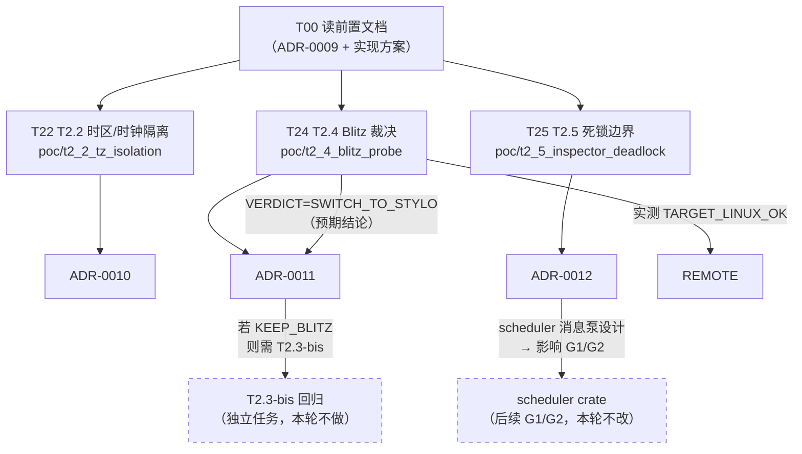

# 工程师执行清单 —— T2.2 / T2.4 / T2.5 三项 PoC

> **本文档是什么**：`docs/design-remaining-tasks-2026-10-12.md`（实现方案）的**可执行摘要**。
> 工程师**严格按本文档的编号与顺序执行**。
>
> **前置文档**（必读，已含全部设计细节与已核实事实，**不要重复核实**）：
> - `docs/adr/0009-bindings-webidl与engine-v8的V8类型边界.md`（已落档）
> - `docs/design-remaining-tasks-2026-10-12.md`（实现方案，**断言设计在这里**）
>
> **硬约束**：`AGENTS.md` 铁律十条；`poc/**` 不得进主 workspace（ADR-0008）；
> 每个 `unsafe` 前 2 行内须有 `SAFETY:`（ADR-0008 决策 4）。

---

## 0. 依赖图



**并行性判定**：

| 任务 | 能否并行 | 理由 |
|---|---|---|
| **T22 / T24 / T25** | ✅ **三者完全并行** | 各自独立 Cargo workspace（ADR-0008）；无共享文件；互不依赖对方的结论 |
| 三者的 ADR（0010/0011/0012） | ✅ 并行 | 纯文档 |
| **T2.3-bis** | ⛔ **不在本轮** | 只在 T24 裁决为 `KEEP_BLITZ` 时才需要；当前证据指向 `SWITCH_TO_STYLO` |

**唯一的串行约束**：T24 的**最终裁决**需要 `TARGET_LINUX_OK`（远程实测），
但**本地部分的 EXP1~EXP4 与远程无关**，可先跑完，远程只补 C1/C3 一项。

---

## T00 —— 前置阅读（15 分钟，不写代码）

**做什么**：读两份文档，把下面 5 条**已核实事实**抄进笔记（不要重新核实，耗时且违反指令）：

1. `v8::icu::set_default_time_zone(&str) -> bool` —— **改进程级状态**，
   对无法识别的 id 返回 `false` 且不改当前值，`Etc/Unknown` 被拒。
2. 设完时区后必须调 `isolate.date_time_configuration_change_notification(TimeZoneDetection::**Skip**)` ——
   传 `Redetect` 会**重新探测并覆盖**刚设的时区（官方文档原文：「without re-detecting
   (and overwriting) the zone just set here」）。
3. **禁用 `v8::Date::new(scope, f64)` 测时钟** —— 它是宿主喂值，根本不读 V8 时钟，**必然假绿**。
4. `blitz-dom` 的 `default` features 含 `custom-widget` → 拉入 `anyrender`（GUI）；
   必须 `default-features = false`（243 包 → 191 包）。
5. `blitz-dom` 的 shadow root **未实现**（`stylo.rs:231/238` 是 `todo!()`）⇒ C9 预期 `false`。

**完成判据**：能口述这 5 条。

---

## T22 —— T2.2 探针（目录 `poc/t2_2_tz_isolation`）

### 步骤（严格按序）

```bash
# 1. 建目录与清单
mkdir -p poc/t2_2_tz_isolation/src

# 2. Cargo.toml（照抄，注意首行空 [workspace]）
cat > poc/t2_2_tz_isolation/Cargo.toml <<'EOF'
[workspace]

[package]
name = "tzprobe"
version = "0.0.0"
edition = "2021"

[dependencies]
v8 = "152.2.0"
EOF

# 3. 先跑一次「空壳」确认依赖可解析（v8 已缓存，离线可过）
cd poc/t2_2_tz_isolation && echo 'fn main(){ println!("T2_2_SKELETON_OK"); }' > src/main.rs
cargo run --offline
# 期望：T2_2_SKELETON_OK
cd ../..

# 4. 写 src/main.rs（断言设计见实现方案 §1.4）
# 5. 跑
cd poc/t2_2_tz_isolation && cargo run --offline
cd ../..

# 6. 守卫脚本必须 PASS
bash scripts/check-unsafe-whitelist.sh
```

### 必须实现的四段实验（详见实现方案 §1.4）

| 段 | 内容 | 关键点 |
|---|---|---|
| **EXP0** | 基线自证：同一时区两个 Isolate 读**相同**偏移 | `BASELINE_VALID` **必须为 true**，否则停手 |
| **EXP1** | 两 Isolate 两时区（`Asia/Tokyo` / `America/Bogota`） | 固定 `T_REF=1_700_000_000_000`；读 `new Date(T_REF).getTimezoneOffset()` |
| **EXP2** | process-global 直接证据：改全局后看**另一个** Isolate 的读数是否也变 | `GLOBAL_LEAK_OBSERVED isolate=B tz_before=X tz_after=Y` |
| **EXP3** | `Date.now()` 时间值隔离 | 二值 + 证据 |
| **EXP4** | 替代路线：JS 侧替换全局 `Date`，宿主喂两个固定时刻 | `DATE_SHIM_WORKS` |

### 三个最容易踩的坑（写代码时对照）

1. **通知必须传 `Skip` 不是 `Redetect`**（否则测出「隔离失败」是通知参数错，不是机制问题）。
2. **必须检查 `set_default_time_zone` 的 `bool` 返回值**（远程 Linux 可能 tzdata 缺失）。
3. **禁用 `Date::new(scope,f64)`**（见 T00-3）。

### 完成判据

- `cargo run --offline` 输出末行为 `T2_2_PROBE_OK`。
- `bash scripts/check-unsafe-whitelist.sh` 退出码 0。
- ADR `docs/adr/0010-T2.2-逻辑Date与多Profile时钟时区隔离.md` 已落档，
  含「**判定方法**」章节（对齐 ADR-0007 的「这一段比结论更重要」）。

---

## T24 —— T2.4 探针（目录 `poc/t2_4_blitz_probe`）

### 步骤（严格按序）

```bash
mkdir -p poc/t2_4_blitz_probe/src

cat > poc/t2_4_blitz_probe/Cargo.toml <<'EOF'
[workspace]

[package]
name = "blitzprobe"
version = "0.0.0"
edition = "2021"

[dependencies]
blitz-dom    = { version = "=0.3.0-beta.2", default-features = false }
blitz-traits = "=0.3.0-beta.2"
markup5ever  = "0.39"
EOF

# 依赖解析检查（架构师已实测可通过，191 包）
cd poc/t2_4_blitz_probe && cargo generate-lockfile --offline
# 断言锁定包里无 GUI 栈：
grep -E '^name = "(blitz|blitz-shell|blitz-paint|anyrender|anyrender_vello|winit|accesskit|usvg|wuff|tracing)"' Cargo.lock \
  && echo "FAIL: 有 GUI 依赖" || echo "PASS: 无 GUI 依赖"
cd ../..

# 空壳确认可编译（架构师已实测：191 包全部编译通过）
cd poc/t2_4_blitz_probe && echo 'fn main(){ println!("T2_4_SKELETON_OK"); }' > src/main.rs
cargo run --offline
cd ../..
```

### 必须实现的四段实验（详见实现方案 §2.4）

| 段 | 内容 | 关键点 |
|---|---|---|
| **EXP0** | 依赖形态：输出锁定版本 + `NO_GUI_DEP` | 读 `Cargo.lock` 断言无 GUI 栈 |
| **EXP1** | 动态 DOM：`resolve()` → 读宽度 → `set_style_property` → `resolve()` → 再读 | `DYNAMIC_DOM_WORKS`；**必须用 `StyleThreading::Sequential`** 避开 rayon |
| **EXP2** | NodeId 稳定性：变更序列中 NodeId 不漂移 | `NODE_ID_MAP_CONSISTENT` |
| **EXP3** | 后端树只是缓存：删后端后重建，读数一致 | `BACKEND_IS_CACHE` |
| **EXP4** | Shadow DOM：**真去尝试**，预期 panic 或失败 | **见下方「最重要的一条」** |

### ⚠️ 最重要的一条：C9 必须是**真尝试**，不能直接写 `false`

理由（ADR-0007 方法论）：若直接写 `SHADOW_DOM_WORKS=false`，
这条断言就是**恒假**的门禁 —— **无法区分「确实不支持」与「没测出来」**。

正确做法：
```rust
// 真去调 shadow 相关 API；若 panic 则捕获并记 false + panic 消息
let shadow_result = std::panic::catch_unwind(|| { /* 尝试挂 shadow root */ });
let shadow_ok = shadow_result.is_ok() && /* …实际验证作用域隔离 + slot 分发… */;
```
预期会命中 `blitz-dom-0.3.0-beta.2/src/stylo.rs:231` 的
`todo!("Shadow roots not implemented")` ⇒ panic 消息
`not implemented: Shadow roots not implemented`。
**把这条 panic 消息原文记入 ADR** —— 它是 C9 判定的直接证据。

### 完成判据

- `cargo run --offline` 末行 `T2_4_PROBE_OK`（**注意**：`PROBE_OK` + `VERDICT=SWITCH_TO_STYLO`
  是**合法且预期**的组合，不是失败）。
- 裁决行 `T2_4_VERDICT=SWITCH_TO_STYLO`（按已核实事实，这是预期结论）。
- ADR `docs/adr/0011-T2.4-Blitz裁决与Stylo替代路线.md` 已落档，
  **必须含 C13 差异清单（12 项自建能力）与 C15 成本依据**。
- **远程复跑**（见 T24R）。

---

## T24R —— T24 的远程 Linux 复跑（**C1/C3，与 T24 本地部分串行**）

```bash
# 同步（AGENTS.md:66 的既定命令）
rsync -av --delete --exclude='.workbuddy' /Users/dennis/WorkBuddy/mmv8/ ubuntu@124.221.1.78:~/mmv8/

# 远程跑（注意：前台 ssh 长命令会被 SIGTERM exit 137 —— 用 nohup + 轮询）
ssh ubuntu@124.221.1.78 'export PATH=$HOME/.cargo/bin:$PATH; cd ~/mmv8/poc/t2_4_blitz_probe && nohup cargo run --offline > /tmp/t24.log 2>&1 &'
# 轮询
ssh ubuntu@124.221.1.78 'tail -5 /tmp/t24.log'
```

**期望**：远程输出 `TARGET_LINUX_OK=true` + 末行 `T2_4_PROBE_OK`。

**若远程 OOM**（远程仅 3.6 GB，`AGENTS.md:67`）：
按既有对策顺序 `cargo build -j2` → 仍失败则**走决策上报**。
⛔ **不许自行修改远程系统配置**（`AGENTS.md:67` 明令）。

**把远程输出原文记入 ADR-0011**（C1/C3 的证据）。

---

## T25 —— T2.5 探针（目录 `poc/t2_5_inspector_deadlock`）

### ⚠️ 本探针含**故意挂起**的场景，必须先做 D0

```bash
mkdir -p poc/t2_5_inspector_deadlock/src

cat > poc/t2_5_inspector_deadlock/Cargo.toml <<'EOF'
[workspace]

[package]
name = "deadlockprobe"
version = "0.0.0"
edition = "2021"

[dependencies]
v8 = "152.2.0"
pyo3 = { version = "0.23", features = ["extension-module"] }
EOF

# ⚠️ pyo3 本地缓存里没有（已核实）→ 首次 build 需要联网（走 rsproxy 镜像）
cd poc/t2_5_inspector_deadlock && cargo build 2>&1 | tail -20
# 若 extension-module 链接失败 → 去掉该 feature 并在 ADR 记录
cd ../..
```

### 文件结构（4 个文件）

```
poc/t2_5_inspector_deadlock/src/
├── main.rs        # 实验编排 + 断言
├── inspector.rs   # ChannelImpl / V8InspectorClientImpl 的探针实现
├── watchdog.rs    # D0 的超时机制
└── pyside.rs      # PyO3 侧：构造 GIL 互等的最小交错
```

### 实施顺序（**D0 必须最先做完并单独验证**）

| 步 | 做什么 | 完成判据 |
|---|---|---|
| **1** | 实现 `watchdog.rs`：独立线程 + `Instant` 计时 + `terminate_execution()` + `AtomicBool` + 兜底 `exit(70)` | 单元可跑 |
| **2** | **D0 自证**：实现「必然挂起」场景（`run_message_loop_on_pause` 里 `loop { sleep(1ms) }`） | 进程**正常退出**并打印 `WATCHDOG_FIRED=true` / `HUNG_SCENARIO_REPORTED=DIMAGINATION` / `WATCHDOG_SELFTEST_OK=true` |
| **3** | 实现 `ChannelImpl`（三方法）+ `V8InspectorClientImpl`（关键 4 方法） | 能建 Inspector 与 Session |
| **4** | 组合 1（`f1=no f2=no f3=none`）⇒ 期望 `CLEAN_RESUME` | `RESUMED_AT=<ms>` + `CALLBACK_COMPLETED=true` |
| **5** | 组合 4（`f1=yes` GIL 路径）⇒ 期望 `TIMEOUT` | 与组合 1 构成**成对证据** |
| **6** | 组合 7（`f2=yes` 重入路径）⇒ **独立子进程跑** | V8 FATAL 会直接杀进程，父进程读退出码 |
| **7** | 剩余可测组合（2/3/5/6/8） | 每组一行分类 + 证据 |
| **8** | C 组：`PAGE_TASKS_STALLED_DURING_PAUSE` / `CLEAN_RESUME` | 见实现方案 §3.5 |

**超时参数**：本地 `3000ms`；远程 `6000ms`；用环境变量 `IV8_PROBE_WATCHDOG_MS` 覆盖。

### 关键设计（实现方案 §3.4/§3.5 已定，勿改）

- watchdog 是**独立线程**（技术方案 §6 原文「执行超时由独立 watchdog 请求 V8 终止」）。
- **9 组可测、3 组不可测**（`two-factor-confound`），`COMBOS_TRIED=9` / `COMBOS_UNMEASURABLE=3`。
- `V8InspectorClient::new` / `Channel::new` 的 pinned 生命周期**已由 v8 crate 处理**
  （`Box::into_pin`）⇒ **本探针应能零 unsafe**。若实测需要，逐块 `SAFETY:`。

### 完成判据

- 末行 `T2_5_PROBE_OK`（**不代表「无死锁」**，只代表 9 组分类都测出来了）。
- ADR `docs/adr/0012-T2.5-Inspector暂停消息泵与Python回调死锁边界.md` 已落档，
  **必须含条件表**（行=组合，列=分类/证据）+ **未覆盖路径的显式列举**。
- `bash scripts/check-unsafe-whitelist.sh` 退出码 0。

---

## 三项共同的收尾（**T99**）

```bash
# 1. 三个探针各跑一遍，保存完整输出（QA 回写证据台账要用原文）
cd poc/t2_2_tz_isolation        && cargo run --offline 2>&1 | tee /tmp/t22.out
cd poc/t2_4_blitz_probe         && cargo run --offline 2>&1 | tee /tmp/t24.out
cd poc/t2_5_inspector_deadlock  && cargo run         2>&1 | tee /tmp/t25.out

# 2. 守卫脚本（铁律 4）
bash scripts/check-unsafe-whitelist.sh

# 3. 主门禁未被探针影响（探针是独立 workspace，主 workspace 应无变化）
cargo fmt --all --check
cargo test --workspace
```

**T99 完成判据**：
- 三份输出原文已保存，末行分别为 `T2_2_PROBE_OK` / `T2_4_PROBE_OK` / `T2_5_PROBE_OK`。
- 守卫脚本 PASS；主 workspace 门禁无回归。
- `poc/README.md` 的状态表已更新三行（**这是许清楚 P1-16，QA 也会查**）。

---

## 工程师会踩的坑（架构师预判，按严重度排序）

| # | 坑 | 后果 | 对策 |
|---|---|---|---|
| **1** | T2.5 的 D0 没做或没做对 | 后面所有「不死锁」结论无法与「没测出来」区分；死锁表现为**CI 挂住**而非失败 | D0 是**第一验收项**，必须先单独跑通 |
| **2** | T2.2 通知时区缓存刷新传了 `Redetect` | 测出「隔离失败」——**假阴性**，V8 重新探测覆盖了宿主设的时区 | 必须传 `Skip`（官方文档明说） |
| **3** | T2.2 用 `Date::new(scope,f64)` 测时钟 | **假绿** —— 宿主喂值不经 V8 时钟 | 改用 JS 侧 `new Date(T_REF).getTimezoneOffset()` |
| **4** | T2.4 的 C9 直接写 `SHADOW_DOM_WORKS=false` | **恒假门禁** —— 无法区分「不支持」与「没测」 | 用 `catch_unwind` 真去调，panic 消息入 ADR |
| **5** | T2.4 忘记 `default-features = false` | 拉入 `anyrender`（GUI），C2 失败，违反技术方案 §3 | 已在 `Cargo.toml` 模板里写死 |
| **6** | T2.4 用 `StyleThreading::Parallel`（默认值） | 走全局 rayon 线程池；其文档明说「panics if another `Parallel` resolve is in flight」 | 显式用 `Sequential` |
| **7** | T2.5 前台 ssh 跑长命令 | 远程命令被 SIGTERM（exit 137），看起来像 OOM | `nohup ... &` + 轮询日志（`AGENTS.md` 与编排者事实均记录此坑） |
| **8** | 远程跑 `blitz-dom` 时 OOM | 探针无法完成 C1 | `cargo build -j2` → 仍失败走决策上报，**不许改远程系统配置** |
| **9** | `SAFETY:` 写在 unsafe 行**上方第 3 行** | 守卫脚本 ±2 行窗口判违规（ADR-0008 决策 4 实测） | 长论证可在上方，但**紧邻处必须留一行 `SAFETY:`** |
| **10** | 把探针目录加进主 workspace members | 破坏 `workspace_policy.rs` 的 19 成员精确锁定 | 每份 `Cargo.toml` 首行 `[workspace]`（已在模板里） |

---

## 交付清单（工程师完成后应产出）

| # | 产出 | 路径 |
|---|---|---|
| 1 | T2.2 探针 | `poc/t2_2_tz_isolation/{Cargo.toml,README.md,src/main.rs}` |
| 2 | T2.4 探针 | `poc/t2_4_blitz_probe/{Cargo.toml,README.md,src/main.rs}` |
| 3 | T2.5 探针 | `poc/t2_5_inspector_deadlock/{Cargo.toml,README.md,src/main.rs,src/{inspector,watchdog,pyside}.rs}` |
| 4 | ADR | `docs/adr/0010-T2.2-*.md` |
| 5 | ADR | `docs/adr/0011-T2.4-*.md` |
| 6 | ADR | `docs/adr/0012-T2.5-*.md` |
| 7 | 探针索引更新 | `poc/README.md` 状态表 + 运行命令段 |

> ⛔ **不要修改**：`.github/workflows/**`、`CODEOWNERS`、`deny.toml`、`AGENTS.md`、
> `contracts/compat-manifest.json`、`docs/TASKS.md`（最后一项是 QA 的回写物）。
> 三份 ADR 由工程师落档（结论已由架构师定，工程师只填实测原文）。